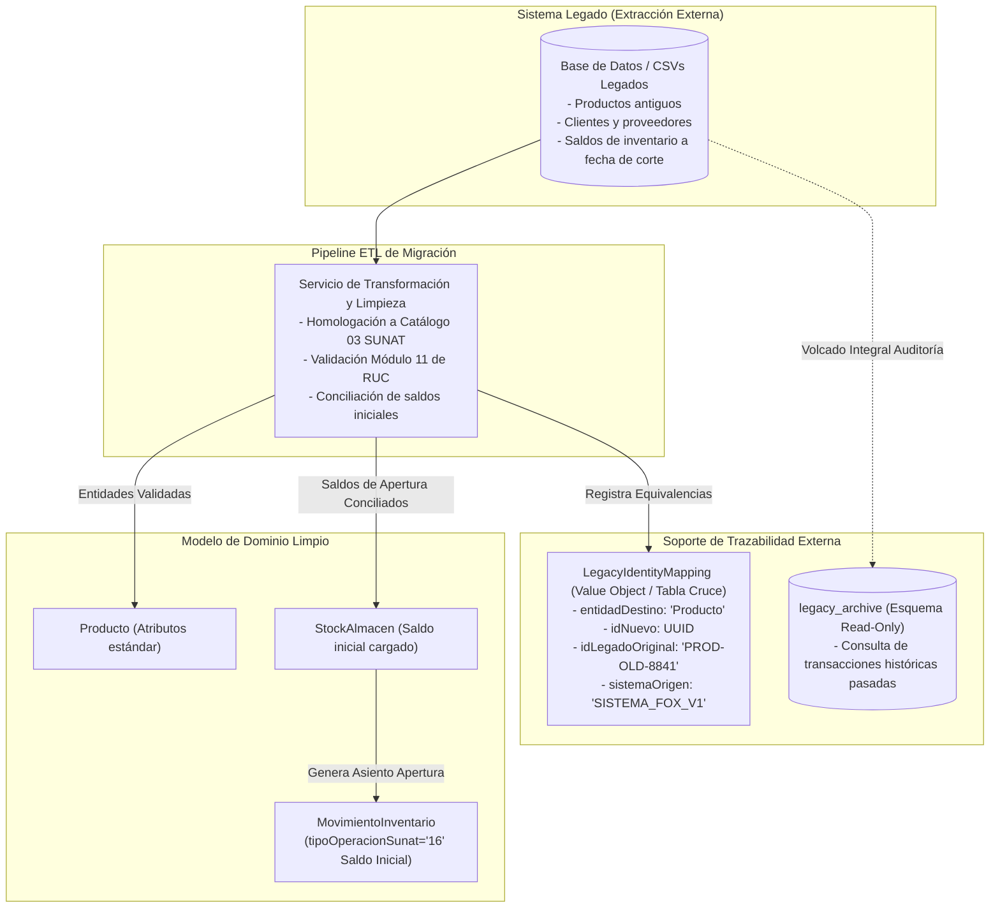

# Modelo de Dominio del Sistema Comercial, Inventarios y Facturación Electrónica

| Metadato | Detalle |
| :--- | :--- |
| **Proyecto / Asignatura** | Examen de Arquitectura de Software |
| **Entregable** | Modelo de Dominio Conceptual y Reglas de Integridad (Spec-First) |
| **Dominio** | Comercializadora Mayorista y Minorista de Abarrotes y Mercadería General |
| **Insumos de Entrada** | [01_Analisis_Requisitos/analisis_requisitos.md](file:///c:/Users/Franco%20Andre/OneDrive/dise%C3%B1o/01_Analisis_Requisitos/analisis_requisitos.md) y [01_Analisis_Requisitos/revision_requisitos.md](file:///c:/Users/Franco%20Andre/OneDrive/dise%C3%B1o/01_Analisis_Requisitos/revision_requisitos.md) |
| **Estado** | `APPROVED DOMAIN MODEL SPECIFICATION` |
| **Versión** | 1.0.0 |

---

## Índice de Contenidos

1. [Identificación y Justificación de Entidades del Dominio](#1-identificación-y-justificación-de-entidades-del-dominio)
2. [Definición Detallada de Entidades del Dominio](#2-definición-detallada-de-entidades-del-dominio)
   - 2.1. Módulo Catálogo: `Categoria`, `Producto`, `EscalaPrecio`
   - 2.2. Módulo Inventarios: `Almacen`, `StockAlmacen`, `Lote`, `MovimientoInventario`
   - 2.3. Módulo Abastecimiento: `Proveedor`, `RecepcionMercaderia`, `DetalleRecepcion`
   - 2.4. Módulo Terceros y Seguridad: `Cliente`, `Usuario`
   - 2.5. Módulo Ventas: `Venta`, `DetalleVenta`, `CuotaCredito`
   - 2.6. Módulo Tributario: `ComprobanteElectronico`, `DetalleComprobante`
3. [Definición de Relaciones UML y Cardinalidades](#3-definición-de-relaciones-uml-y-cardinalidades)
4. [Reglas de Integridad del Dominio e Invariantes](#4-reglas-de-integridad-del-dominio-e-invariantes)
   - 4.1. Cantidades, Precios y Consistencia Financiera
   - 4.2. Invariante Estricta de Kardex No Negativo
   - 4.3. Consistencia entre Venta, Despacho y Movimiento de Inventario
   - 4.4. Desacoplamiento entre Venta y Comprobante Electrónico
   - 4.5. Idempotencia y Prevención de Duplicados en Reintentos
5. [Estrategia de Soporte a Sistemas Legados y Migración](#5-estrategia-de-soporte-a-sistemas-legados-y-migración)
6. [Evaluación de Calidad del Modelo de Dominio](#6-evaluación-de-calidad-del-modelo-de-dominio)

---

## 1. Identificación y Justificación de Entidades del Dominio

Con base en los requerimientos funcionales (`RF`), no funcionales (`RNF`), reglas de negocio (`RN`) y las observaciones de la revisión técnica (`revision_requisitos.md`), se analiza la pertinencia de las entidades candidatas:

| Entidad Candidata | Clasificación | Justificación Arquitectónica y de Negocio | Requerimientos Asociados |
| :--- | :---: | :--- | :--- |
| **`Producto`** | **Necesaria** | Núcleo del catálogo comercial; identifica bienes físicos con atributos de venta, unidad de medida oficial SUNAT y control tributario. | `RF-CAT-001`, `RF-CAT-003`, `RF-VEN-003` |
| **`Categoria`** | **Necesaria** | Estructuración jerárquica para clasificación de abarrotes, mercadería general y reportes de rotación. | `RF-CAT-001` |
| **`EscalaPrecio`** | **Necesaria** | Modela el esquema dual explícito (precio minorista estándar vs. escalas mayoristas por volumen). | `RF-CAT-002`, `RF-VEN-001`, `RF-VEN-002` |
| **`Almacen`** | **Necesaria** | Exigida por la gestión multialmacén explícita (almacén central, tiendas, sucursales con código SUNAT). | `RF-ALM-001` |
| **`StockAlmacen`** | **Necesaria** | Resuelve el balance físico y disponible por producto en cada almacén; aísla el inventario de la definición abstracta de producto. | `RF-ALM-001`, `RF-ALM-004`, `RN-05` |
| **`Lote`** | **Condicional** | Requerida exclusivamente para productos perecibles con fecha de caducidad (`RF-CAT-004`). Opcional para mercadería general. | `RF-CAT-004`, `RN-PEND-02` |
| **`Proveedor`** | **Necesaria** | Identifica al emisor de compras mayoristas, condiciones comerciales y RUC validado. | `RF-DIR-002` |
| **`RecepcionMercaderia`** | **Necesaria** | Representa el evento físico y documental de ingreso de bienes al almacén (compras o devoluciones). | `RF-ALM-003` |
| **`DetalleRecepcion`** | **Necesaria** | Líneas de detalle recibidas con costo unitario de adquisición para recálculo del Kardex valorizado. | `RF-ALM-003`, `RF-ALM-002` |
| **`MovimientoInventario`** | **Necesaria** | Asiento inmutable del Kardex permanente (físico y valorizado) conforme al Catálogo N° 12 de SUNAT. | `RF-ALM-002`, `RF-TRZ-001`, `RN-05` |
| **`Cliente`** | **Necesaria** | Adquirente minorista o mayorista con documento validado según Catálogo 06 SUNAT (DNI/RUC) y perfil crediticio. | `RF-DIR-001`, `RF-DIR-003`, `RN-03` |
| **`Venta`** | **Necesaria** | Transacción comercial que consolida la operación tanto en mostrador (POS retail) como corporativa (mayorista). | `RF-VEN-001`, `RF-VEN-002` |
| **`DetalleVenta`** | **Necesaria** | Desglose de ítems vendidos, cantidades, precios aplicados, descuentos y afectación al IGV por ítem. | `RF-VEN-001`, `RF-VEN-003` |
| **`CuotaCredito`** | **Necesaria** | Requerimiento fiscal obligatorio de la RS 193-2020/SUNAT para ventas mayoristas al crédito. | `RF-VEN-002`, `RF-CPE-001`, `RN-04` |
| **`ComprobanteElectronico`** | **Necesaria** | Agregado fiscal desacoplado de la venta comercial. Maneja ciclo de vida UBL 2.1, firma digital, estado y CDR de SUNAT. | `RF-CPE-001` a `006`, `RF-SUN-001` a `004` |
| **`DetalleComprobante`** | **Necesaria** | Mapeo fiscal estricto de las líneas del comprobante para estructurar `cac:InvoiceLine` en el XML UBL 2.1. | `RF-CPE-001`, `RF-CPE-002`, `RNF-CMP-001` |
| **`Usuario`** | **Necesaria** | Responsable de la ejecución operativa para garantizar la pista inmutable de auditoría (RBAC). | `RF-TRZ-003`, `RNF-SEC-002` |

---

## 2. Definición Detallada de Entidades del Dominio

A continuación se formaliza cada entidad del modelo conceptual, manteniendo terminología uniforme en español, tipos de datos conceptuales, reglas e invariantes:

---

### 2.1. Módulo Catálogo

#### Entidad: `Categoria`
* **Responsabilidad**: Clasificar taxonómicamente los bienes de la empresa para facilitar la búsqueda, el control por familias y la parametrización de políticas comerciales.
* **Identificador Primario**: `id` (`Identificador` / UUID).
* **Atributos**:
  * `codigo`: `TextoCorto` (único, ej. `CAT-ABAR`).
  * `nombre`: `Texto` (ej. "Abarrotes y Granos").
  * `descripcion`: `Texto` (opcional).
  * `activa`: `Booleano` (default `true`).
* **Relaciones Conceptuales**:
  * Posee cero o más `Producto` (1 a 0..*).
* **Invariantes y Reglas**:
  * El `codigo` no puede duplicarse ni contener caracteres especiales.
  * No se permite desactivar una categoría si contiene productos con stock físico mayor a cero.
* **Requerimientos Asociados**: `RF-CAT-001`.

#### Entidad: `Producto`
* **Responsabilidad**: Representar el bien comercial vendible, almacenando su caracterización física, código de barras, código arancelario, unidad de medida oficial SUNAT y comportamiento perecible.
* **Identificador Primario**: `id` (`Identificador` / UUID).
* **Atributos**:
  * `sku`: `TextoCorto` (código de referencia único de inventario).
  * `codigoBarras`: `TextoCorto` (código EAN-13, EAN-8 o UPC; opcional).
  * `nombre`: `Texto` (denominación comercial clara).
  * `descripcion`: `TextoLargo` (detalle técnico o especificaciones).
  * `unidadMedida`: `CodigoSUNAT` (código según Catálogo 03 SUNAT: `NIU`, `KGM`, `BX`, `PK`).
  * `codigoSunat`: `CodigoSUNAT` (código según Catálogo 25 / UNSPSC de 8 dígitos; opcional).
  * `afectacionIgvDefecto`: `CodigoSUNAT` (Catálogo 07: `10` Gravado, `20` Exonerado, `30` Inafecto).
  * `esPerecible`: `Booleano` (indica si exige control de lotes y caducidad).
  * `activo`: `Booleano` (eliminación lógica).
* **Relaciones Conceptuales**:
  * Pertenece a una `Categoria` (obligatorio, * a 1).
  * Posee una o más `EscalaPrecio` (composición, 1 a 1..*).
  * Está presente en cero o más `StockAlmacen` (1 a 0..*).
  * Posee cero o más `Lote` (1 a 0..*).
* **Invariantes y Reglas**:
  * `sku` es inmutable una vez creado.
  * La unidad de medida debe pertenecer estrictamente al Catálogo N° 03 oficial de la SUNAT.
  * Prohibido el borrado físico si el producto tiene historial de movimientos en Kardex o ventas (`RF-CAT-001`).
* **Requerimientos Asociados**: `RF-CAT-001`, `RF-CAT-003`, `RF-CAT-005`.

#### Entidad: `EscalaPrecio`
* **Responsabilidad**: Modelar el esquema de precios diferenciados (precio minorista estándar y precios mayoristas por volumen o condición de cliente).
* **Identificador Primario**: `id` (`Identificador` / UUID).
* **Atributos**:
  * `tipoEscala`: `Enumeracion` (`MINORISTA_ESTANDAR`, `MAYORISTA_NIVEL_1`, `MAYORISTA_NIVEL_2`).
  * `cantidadMinima`: `CantidadDecimal` (umbral mínimo para aplicar el precio, $\ge 1.0$).
  * `precioUnitarioConIgv`: `MontoMonetario` (importe final con impuestos incluidos).
  * `moneda`: `CodigoMoneda` (`PEN`, `USD` según Catálogo 02 SUNAT).
  * `fechaInicio`: `Fecha` (inicio de vigencia).
  * `fechaFin`: `Fecha` (fin de vigencia; opcional).
* **Relaciones Conceptuales**:
  * Pertenece exclusivamente a un `Producto` (composición, * a 1).
* **Invariantes y Reglas**:
  * Todo producto debe contar con al menos una escala de tipo `MINORISTA_ESTANDAR` con `cantidadMinima = 1.0`.
  * `precioUnitarioConIgv` debe ser estrictamente positivo ($> 0$).
  * A mayor `cantidadMinima`, el precio unitario mayorista no puede ser superior al precio minorista.
* **Requerimientos Asociados**: `RF-CAT-002`, `RF-VEN-001`.

---

### 2.2. Módulo Inventarios

#### Entidad: `Almacen`
* **Responsabilidad**: Representar un espacio físico de acopio, distribución o venta al público, vinculado a un código de establecimiento oficial ante SUNAT.
* **Identificador Primario**: `id` (`Identificador` / UUID).
* **Atributos**:
  * `codigo`: `TextoCorto` (único, ej. `ALM-CENTRAL`, `TIENDA-01`).
  * `nombre`: `Texto`.
  * `codigoEstablecimientoSunat`: `CodigoSUNAT` (4 dígitos alfanuméricos según Catálogo 19, ej. `0000`).
  * `direccionFisica`: `TextoLargo`.
  * `esPuntoVentaRetail`: `Booleano` (indica si atiende público minorista en mostrador).
  * `activo`: `Booleano`.
* **Relaciones Conceptuales**:
  * Mantiene inventario mediante uno o más `StockAlmacen` (1 a 0..*).
  * Emite y recibe `MovimientoInventario` (1 a 0..*).
* **Invariantes y Reglas**:
  * El código de establecimiento de SUNAT debe corresponder al Registro Único de Contribuyentes (RUC) de la empresa.
* **Requerimientos Asociados**: `RF-ALM-001`.

#### Entidad: `StockAlmacen`
* **Responsabilidad**: Controlar el balance físico, reservas y valorización acumulada de un producto en un almacén específico.
* **Identificador Primario**: `id` (`Identificador` / UUID) o compuesto `(Almacen, Producto)`.
* **Atributos**:
  * `cantidadFisica`: `CantidadDecimal` (existencias reales en bodega, $\ge 0$).
  * `cantidadReservada`: `CantidadDecimal` (existencias comprometidas en pedidos mayoristas, $\ge 0$).
  * `cantidadDisponible`: `CantidadDecimal` (calculado: $cantidadFisica - cantidadReservada$).
  * `costoPromedioPonderadoUnitario`: `MontoMonetario` (costo contable medio en moneda nacional PEN).
  * `ultimaActualizacion`: `MarcaTemporal`.
* **Relaciones Conceptuales**:
  * Vincula exactamente a un `Almacen` (* a 1).
  * Vincula exactamente a un `Producto` (* a 1).
* **Invariantes y Reglas**:
  * Invariante de existencia física: $cantidadFisica \ge 0$. Queda terminantemente prohibido el saldo negativo (`RN-05`).
  * Invariante de reserva: $cantidadReservada \le cantidadFisica$, por ende $cantidadDisponible \ge 0$.
  * Toda mutación de `cantidadFisica` debe originarse exclusivamente mediante un `MovimientoInventario`.
* **Requerimientos Asociados**: `RF-ALM-001`, `RF-ALM-004`, `RN-05`.

#### Entidad: `Lote`
* **Responsabilidad**: Registrar la trazabilidad sanitaria, lote de producción y fecha de caducidad para productos clasificados como perecibles.
* **Identificador Primario**: `id` (`Identificador` / UUID).
* **Atributos**:
  * `codigoLote`: `TextoCorto` (impreso por el fabricante).
  * `fechaFabricacion`: `Fecha` (opcional).
  * `fechaVencimiento`: `Fecha` (obligatoria).
  * `cantidadInicial`: `CantidadDecimal` ($> 0$).
  * `cantidadRestante`: `CantidadDecimal` ($\ge 0$).
* **Relaciones Conceptuales**:
  * Pertenece a un `Producto` (* a 1).
  * Se almacena en un `Almacen` (* a 1).
* **Invariantes y Reglas**:
  * `fechaVencimiento` debe ser posterior a `fechaFabricacion`.
  * No se permite asignar lotes cuya `fechaVencimiento` sea anterior o igual a la fecha de la venta.
  * Invariante de saldo de lote: $0 \le cantidadRestante \le cantidadInicial$.
* **Requerimientos Asociados**: `RF-CAT-004`, `RN-PEND-02`.

#### Entidad: `MovimientoInventario`
* **Responsabilidad**: Constituir el asiento inmutable del Kardex permanente físico y valorizado, documentando formalmente cada entrada, salida, traslado o ajuste según la normativa fiscal.
* **Identificador Primario**: `id` (`Identificador` / UUID).
* **Atributos**:
  * `fechaHora`: `MarcaTemporal` (registro inmutable con microsegundos).
  * `tipoOperacionSunat`: `CodigoSUNAT` (Catálogo 12: `01` Venta, `02` Compra, `10` Traslado, `16` Saldo Inicial, `99` Otros/Ajuste).
  * `documentoReferencia`: `DocumentoReferencia` (Tipo comprobante Catálogo 01, Serie, Número).
  * `cantidadEntrada`: `CantidadDecimal` ($\ge 0$).
  * `costoUnitarioEntrada`: `MontoMonetario` ($\ge 0$).
  * `costoTotalEntrada`: `MontoMonetario` ($\ge 0$).
  * `cantidadSalida`: `CantidadDecimal` ($\ge 0$).
  * `costoUnitarioSalida`: `MontoMonetario` ($\ge 0$).
  * `costoTotalSalida`: `MontoMonetario` ($\ge 0$).
  * `saldoCantidad`: `CantidadDecimal` (resultado acumulado, $\ge 0$).
  * `saldoCostoUnitario`: `MontoMonetario` (nuevo costo promedio ponderado).
  * `saldoCostoTotal`: `MontoMonetario` (valor total del inventario remanente).
  * `motivoAjuste`: `Texto` (requerido si `tipoOperacionSunat == '99'`).
* **Relaciones Conceptuales**:
  * Vinculado a un `Almacen` (* a 1).
  * Vinculado a un `Producto` (* a 1).
  * Asociado opcionalmente a un `Lote` (* a 0..1).
  * Registrado por un `Usuario` (* a 1).
* **Invariantes y Reglas**:
  * **Inmutabilidad Absoluta**: Prohibida toda modificación (`UPDATE`) o eliminación (`DELETE`) de un registro de movimiento.
  * Consistencia del Costo Promedio Ponderado: En entradas, el costo unitario de saldo se recalcula con la fórmula oficial:
    $$C_{nuevo} = \frac{(Q_{anterior} \cdot C_{anterior}) + (Q_{entrada} \cdot C_{entrada})}{Q_{anterior} + Q_{entrada}}$$
  * En salidas, el costo unitario de salida es idéntico al costo promedio actual y no altera el costo unitario de saldo.
* **Requerimientos Asociados**: `RF-ALM-002`, `RF-ALM-006`, `RF-TRZ-001`, `RN-05`.

---

### 2.3. Módulo Abastecimiento

#### Entidad: `Proveedor`
* **Responsabilidad**: Gestionar la información comercial y fiscal de los abastecedores de abarrotes y mercadería general.
* **Identificador Primario**: `id` (`Identificador` / UUID).
* **Atributos**:
  * `ruc`: `TextoCorto` (11 dígitos, validado según Módulo 11 oficial de SUNAT).
  * `razonSocial`: `Texto` (denominación social legal).
  * `nombreComercial`: `Texto` (opcional).
  * `direccionFiscal`: `TextoLargo`.
  * `telefono`: `TextoCorto`.
  * `correoElectronico`: `TextoCorto`.
  * `activo`: `Booleano`.
* **Relaciones Conceptuales**:
  * Origina una o más `RecepcionMercaderia` (1 a 0..*).
* **Invariantes y Reglas**:
  * El RUC debe ser único y contar con estructura válida de 11 dígitos numéricos que comience con `10`, `15`, `17` o `20`.
* **Requerimientos Asociados**: `RF-DIR-002`.

#### Entidad: `RecepcionMercaderia`
* **Responsabilidad**: Formalizar la recepción física de mercancía comprada o transferida, registrando el documento de sustento (Guía de Remisión o Factura del proveedor).
* **Identificador Primario**: `id` (`Identificador` / UUID).
* **Atributos**:
  * `numeroRecepcion`: `TextoCorto` (correlativo interno, ej. `REC-2026-000123`).
  * `fechaRecepcion`: `MarcaTemporal`.
  * `tipoDocumentoSustento`: `CodigoSUNAT` (Catálogo 01: `01` Factura, `09` Guía Remisión).
  * `serieDocumentoSustento`: `TextoCorto`.
  * `numeroDocumentoSustento`: `TextoCorto`.
  * `estado`: `Enumeracion` (`BORRADOR`, `CONCILIADA_CON_KARDEX`, `ANULADA`).
* **Relaciones Conceptuales**:
  * Asociada a un `Proveedor` (* a 1).
  * Destinada a un `Almacen` (* a 1).
  * Compuesta por uno o más `DetalleRecepcion` (composición, 1 a 1..*).
  * Registrada por un `Usuario` (* a 1).
* **Invariantes y Reglas**:
  * Al pasar al estado `CONCILIADA_CON_KARDEX`, genera de forma atómica los correspondientes registros en `MovimientoInventario` y actualiza `StockAlmacen`.
  * Una recepción conciliada no puede ser modificada ni eliminada.
* **Requerimientos Asociados**: `RF-ALM-003`, `RF-TRZ-001`.

#### Entidad: `DetalleRecepcion`
* **Responsabilidad**: Especificar la cantidad física recibida por producto y el costo unitario de compra acordado antes de tributos.
* **Identificador Primario**: `id` (`Identificador` / UUID).
* **Atributos**:
  * `cantidad`: `CantidadDecimal` ($> 0$).
  * `costoUnitarioCompra`: `MontoMonetario` ($> 0$, sin IGV).
  * `costoTotalLinea`: `MontoMonetario` (calculado: $cantidad \times costoUnitarioCompra$).
* **Relaciones Conceptuales**:
  * Pertenece a una `RecepcionMercaderia` (composición, * a 1).
  * Referencia a un `Producto` (* a 1).
  * Puede vincularse a un `Lote` (* a 0..1) si el producto es perecible.
* **Invariantes y Reglas**:
  * `cantidad` y `costoUnitarioCompra` deben ser estrictamente positivos.
* **Requerimientos Asociados**: `RF-ALM-003`.

---

### 2.4. Módulo Terceros y Seguridad

#### Entidad: `Cliente`
* **Responsabilidad**: Identificar al adquirente de bienes en ventas mayoristas o minoristas, controlando sus datos fiscales ante SUNAT y su solvencia crediticia.
* **Identificador Primario**: `id` (`Identificador` / UUID).
* **Atributos**:
  * `tipoDocumentoIdentidad`: `CodigoSUNAT` (Catálogo 06: `1` DNI, `6` RUC, `4` Carné Extranjería, `7` Pasaporte, `0` No Domiciliado).
  * `numeroDocumento`: `TextoCorto` (validado según tipo).
  * `nombreORazonSocial`: `Texto`.
  * `direccionFiscal`: `TextoLargo`.
  * `correoElectronico`: `TextoCorto` (para envío de XML y representación gráfica).
  * `tipoCliente`: `Enumeracion` (`MINORISTA`, `MAYORISTA`).
  * `limiteCredito`: `MontoMonetario` ($\ge 0$).
  * `plazoCreditoDias`: `Entero` (días otorgados para el pago, ej. 15, 30, 45).
  * `estaBloqueadoPorMora`: `Booleano` (default `false`).
* **Relaciones Conceptuales**:
  * Realiza una o más `Venta` (1 a 0..*).
* **Invariantes y Reglas**:
  * Si `tipoDocumentoIdentidad == '6'` (RUC), debe tener longitud exacta de 11 dígitos y cumplir la validación algorítmica Módulo 11 de SUNAT.
  * Si `tipoCliente == 'MAYORISTA'`, es obligatorio consignar RUC de 11 dígitos o DNI con negocio.
  * Invariante crediticia: No se permite autorizar pedidos a crédito si el cliente mantiene el atributo `estaBloqueadoPorMora == true` o si la nueva venta excede el límite de crédito disponible (`RF-DIR-003`).
* **Requerimientos Asociados**: `RF-DIR-001`, `RF-DIR-003`, `RN-03`.

#### Entidad: `Usuario`
* **Responsabilidad**: Identificar al operador humano del sistema para control de acceso basado en roles (RBAC) y custodia de pistas inmutables de auditoría.
* **Identificador Primario**: `id` (`Identificador` / UUID).
* **Atributos**:
  * `nombreUsuario`: `TextoCorto` (login único).
  * `nombres`: `Texto`.
  * `apellidos`: `Texto`.
  * `rol`: `Enumeracion` (`ADMINISTRADOR`, `JEFE_ALMACEN`, `OPERADOR_ALMACEN`, `CAJERO_RETAIL`, `EJECUTIVO_MAYORISTA`, `CONTADOR_FACTURACION`).
  * `activo`: `Booleano`.
* **Relaciones Conceptuales**:
  * Registra `Venta`, `RecepcionMercaderia` y `MovimientoInventario`.
* **Invariantes y Reglas**:
  * Todo movimiento de inventario, cambio de precios o confirmación de venta debe registrar obligatoriamente el identificador del usuario que ejecutó la acción.
* **Requerimientos Asociados**: `RF-TRZ-003`, `RNF-SEC-002`.

---

### 2.5. Módulo Ventas

#### Entidad: `Venta` (Orden / Transacción Comercial)
* **Responsabilidad**: Coordinar la transacción económica de venta (minorista POS o pedido mayorista), liquidando los importes comerciales y sirviendo de origen para el despacho físico y la emisión del comprobante electrónico.
* **Identificador Primario**: `id` (`Identificador` / UUID).
* **Atributos**:
  * `canalVenta`: `Enumeracion` (`RETAIL_POS`, `MAYORISTA`).
  * `estado`: `Enumeracion` (`BORRADOR`, `CONFIRMADA`, `DESPACHADA`, `FACTURADA`, `ANULADA`).
  * `condicionPago`: `Enumeracion` (`CONTADO_EFECTIVO`, `CONTADO_TARJETA`, `CONTADO_BILLETERA_DIGITAL`, `CREDITO_DIAS`).
  * `moneda`: `CodigoMoneda` (`PEN`, `USD` según Catálogo 02 SUNAT).
  * `tipoCambio`: `MontoMonetario` (requerido si `moneda == 'USD'`).
  * `subtotalGravado`: `MontoMonetario` (base imponible del 18%).
  * `subtotalExonerado`: `MontoMonetario` (base con 0% IGV por Apéndice I).
  * `subtotalInafecto`: `MontoMonetario` (base inafecta).
  * `totalIgv`: `MontoMonetario` (18% sobre subtotal gravado).
  * `totalIcbper`: `MontoMonetario` (impuesto a las bolsas plásticas).
  * `totalDescuentos`: `MontoMonetario`.
  * `totalPagar`: `MontoMonetario` (monto final liquidado).
  * `fechaCreacion`: `MarcaTemporal`.
  * `fechaConfirmacion`: `MarcaTemporal` (opcional).
* **Relaciones Conceptuales**:
  * Efectuada por un `Cliente` (* a 1).
  * Despachada desde un `Almacen` (* a 1).
  * Atendida por un `Usuario` (* a 1).
  * Compuesta por uno o más `DetalleVenta` (composición, 1 a 1..*).
  * Posee cero o más `CuotaCredito` (composición, 1 a 0..*).
  * Vinculada a cero o más `ComprobanteElectronico` (1 a 0..*).
* **Invariantes y Reglas**:
  * Invariante de totalidad: `totalPagar = subtotalGravado + subtotalExonerado + subtotalInafecto + totalIgv + totalIcbper - totalDescuentos`.
  * Si `condicionPago == 'CREDITO_DIAS'`, la sumatoria de las cuotas en `CuotaCredito` debe ser exactamente igual al `totalPagar` menos cualquier pago inicial en efectivo.
  * Una venta en estado `CONFIRMADA` compromete stock (reserva en mayorista o deducción inmediata en retail).
* **Requerimientos Asociados**: `RF-VEN-001`, `RF-VEN-002`, `RF-VEN-003`.

#### Entidad: `DetalleVenta`
* **Responsabilidad**: Especificar la cantidad de producto comercializada, el precio pactado, descuentos específicos de línea y la afectación tributaria correspondiente.
* **Identificador Primario**: `id` (`Identificador` / UUID).
* **Atributos**:
  * `numeroItem`: `Entero` (secuencial dentro de la venta: 1, 2, 3...).
  * `cantidad`: `CantidadDecimal` ($> 0$).
  * `precioUnitarioConIgv`: `MontoMonetario` ($> 0$).
  * `valorUnitarioSinIgv`: `MontoMonetario` ($> 0$).
  * `codigoAfectacionIgv`: `CodigoSUNAT` (Catálogo 07: `10` Gravado, `20` Exonerado, `30` Inafecto).
  * `montoIgvLinea`: `MontoMonetario` ($\ge 0$).
  * `descuentoLinea`: `MontoMonetario` ($\ge 0$).
  * `totalLinea`: `MontoMonetario` (calculado: $cantidad \times valorUnitarioSinIgv + montoIgvLinea - descuentoLinea$).
* **Relaciones Conceptuales**:
  * Pertenece a una `Venta` (composición, * a 1).
  * Referencia a un `Producto` (* a 1).
  * Puede vincularse a un `Lote` (* a 0..1).
* **Invariantes y Reglas**:
  * Si `codigoAfectacionIgv == '10'` (Gravado), `montoIgvLinea` debe calcularse con redondeo exacto al medio más cercano:
    $$montoIgvLinea = \text{redondeo}((cantidad \times valorUnitarioSinIgv - descuentoLinea) \times 0.18, 2)$$
  * Si `codigoAfectacionIgv in ('20', '30')`, entonces estrictamente `montoIgvLinea == 0.00`.
* **Requerimientos Asociados**: `RF-VEN-001`, `RF-VEN-003`, `RN-06`.

#### Entidad: `CuotaCredito`
* **Responsabilidad**: Desglosar el calendario de pagos de las ventas mayoristas a crédito, cumpliendo la exigencia fiscal de la RS 193-2020/SUNAT.
* **Identificador Primario**: `id` (`Identificador` / UUID).
* **Atributos**:
  * `numeroCuota`: `Entero` (1, 2, 3...).
  * `montoCuota`: `MontoMonetario` ($> 0$).
  * `fechaVencimiento`: `Fecha` (fecha de pago límite).
* **Relaciones Conceptuales**:
  * Pertenece a una `Venta` (composición, * a 1).
* **Invariantes y Reglas**:
  * `fechaVencimiento` debe ser estrictamente posterior a la fecha de la venta.
  * $\sum montoCuota = \text{MontoNetoCredito}$.
* **Requerimientos Asociados**: `RF-VEN-002`, `RF-CPE-001`, `RN-04`.

---

### 2.6. Módulo Tributario

#### Entidad: `ComprobanteElectronico`
* **Responsabilidad**: Agregado que representa el Comprobante de Pago Electrónico (CPE) bajo el estándar OASIS UBL 2.1, gestionando su ciclo de vida tributario, firma digital XMLDSig, transmisión y constancia de recepción (CDR) de la SUNAT.
* **Identificador Primario**: `id` (`Identificador` / UUID).
* **Atributos**:
  * `tipoComprobante`: `CodigoSUNAT` (Catálogo 01: `01` Factura, `03` Boleta, `07` Nota de Crédito, `08` Nota de Débito).
  * `serie`: `TextoCorto` (alfanumérico de 4 caracteres: `F001` a `F999`, `B001` a `B999`, `FC01`, `BC01`).
  * `correlativo`: `Entero` (número secuencial 1 a 99999999).
  * `fechaEmision`: `Fecha` (`YYYY-MM-DD`).
  * `horaEmision`: `Hora` (`HH:MM:SS`).
  * `estado`: `Enumeracion` (`BORRADOR`, `XML_GENERADO`, `FIRMADO_DIGITALMENTE`, `ENVIADO_SUNAT`, `ACEPTADO_CDR`, `ACEPTADO_CON_OBSERVACIONES`, `RECHAZADO_SUNAT`, `ANULADO_POR_NOTA`).
  * `digestValue`: `TextoCorto` (Hash SHA-256 en Base64 resultante de la firma digital).
  * `signatureValue`: `TextoLargo` (valor criptográfico de la firma RSA).
  * `xmlFirmado`: `Binario` (archivo XML UBL 2.1 estándar).
  * `cdrZip`: `Binario` (archivo ZIP con la Constancia de Recepción oficial de SUNAT; opcional hasta recepción).
  * `codigoRespuestaSunat`: `TextoCorto` (código devuelto en el CDR: `0` = Aceptado, $>0$ = Rechazo/Error).
  * `glosaRespuestaSunat`: `Texto` (descripción oficial de SUNAT).
* **Relaciones Conceptuales**:
  * Originado a partir de una `Venta` (* a 1) [o ninguna en notas independientes].
  * Compuesto por uno o más `DetalleComprobante` (composición, 1 a 1..*).
  * Puede referenciar a otro `ComprobanteElectronico` (en caso de Nota de Crédito o Débito, * a 0..1).
* **Invariantes y Reglas**:
  * **Inmutabilidad Fiscal**: Si `estado in ('ACEPTADO_CDR', 'ACEPTADO_CON_OBSERVACIONES')`, la entidad queda bloqueada para modificaciones. Cualquier anulación o ajuste exige un nuevo comprobante de tipo `07` (Nota de Crédito) conforme a `RN-01`.
  * La tupla `(tipoComprobante, serie, correlativo)` es única a nivel del emisor.
  * Si `tipoComprobante == '01'` (Factura), el adquirente debe poseer obligatoriamente RUC de 11 dígitos válido (`RN-03`).
* **Requerimientos Asociados**: `RF-CPE-001` a `006`, `RF-SUN-001` a `004`, `RN-01`, `RN-02`.

#### Entidad: `DetalleComprobante`
* **Responsabilidad**: Modelar el renglón fiscal para la construcción del elemento XML `cac:InvoiceLine`, conteniendo las clasificaciones arancelarias y códigos de tributo requeridos por UBL 2.1.
* **Identificador Primario**: `id` (`Identificador` / UUID).
* **Atributos**:
  * `numeroLinea`: `Entero` (secuencial: 1, 2, 3...).
  * `codigoProducto`: `TextoCorto` (SKU del bien).
  * `codigoSunat`: `TextoCorto` (UNSPSC Catálogo 25).
  * `descripcion`: `Texto`.
  * `unidadMedida`: `CodigoSUNAT` (Catálogo 03).
  * `cantidad`: `CantidadDecimal`.
  * `precioComercialUnitario`: `MontoMonetario` (precio con IGV, `priceTypeCode='01'`).
  * `valorUnitario`: `MontoMonetario` (valor sin IGV).
  * `codigoAfectacionIgv`: `CodigoSUNAT` (Catálogo 07).
  * `montoIgv`: `MontoMonetario`.
  * `totalLinea`: `MontoMonetario`.
* **Relaciones Conceptuales**:
  * Pertenece a un `ComprobanteElectronico` (composición, * a 1).
* **Invariantes y Reglas**:
  * Toda línea debe asociarse a un esquema de tributo oficial de SUNAT (Catálogo N° 05).
* **Requerimientos Asociados**: `RF-CPE-001`, `RF-CPE-002`, `RNF-CMP-001`.

---

## 3. Definición de Relaciones UML y Cardinalidades

A continuación se analizan y justifican las relaciones entre entidades, distinguiendo tipos de relación, cardinalidades y obligatoriedad:

| Entidad Origen | Entidad Destino | Tipo de Relación | Multiplicidad | Justificación de Negocio | ¿Obligatoria? |
| :--- | :--- | :---: | :---: | :--- | :---: |
| **`Categoria`** | **`Producto`** | Asociación | `1` a `0..*` | Una categoría agrupa múltiples productos comerciales; un producto pertenece obligatoriamente a una sola categoría para reportes unificados. | Sí (en Producto) |
| **`Producto`** | **`EscalaPrecio`** | Composición | `1` a `1..*` | Un producto no puede existir comercialmente sin al menos un precio minorista. Las escalas de precio no tienen ciclo de vida independiente del producto. | Sí |
| **`Almacen`** | **`StockAlmacen`** | Composición | `1` a `0..*` | Cada almacén contiene registros de stock para los productos que custodia. El stock depende de la existencia del almacén. | Sí (en Stock) |
| **`Producto`** | **`StockAlmacen`** | Asociación | `1` a `0..*` | Un producto puede estar catalogado sin existencias en un almacén en particular. | Sí (en Stock) |
| **`Producto`** | **`Lote`** | Agregación | `1` a `0..*` | Solo los productos con `esPerecible == true` poseen lotes de caducidad. Si no es perecible, la multiplicidad es `0`. | No (Opcional según perecibilidad) |
| **`Proveedor`** | **`RecepcionMercaderia`**| Asociación | `1` a `0..*` | Un proveedor suministra múltiples ingresos de mercadería en el tiempo; una recepción proviene de un único proveedor identificado por su RUC. | Sí |
| **`RecepcionMercaderia`**| **`DetalleRecepcion`** | Composición | `1` a `1..*` | Una recepción física no tiene sentido sin al menos un ítem recibido; los detalles no existen fuera de la recepción. | Sí |
| **`DetalleRecepcion`** | **`Producto`** | Asociación | `*` a `1` | Cada línea de recepción especifica el bien del catálogo recibido y su costo de compra. | Sí |
| **`Producto`** | **`MovimientoInventario`**| Asociación | `1` a `0..*` | Todo movimiento de Kardex registra la alteración de saldo de un único producto. Un producto nuevo puede tener 0 movimientos. | Sí (en Movimiento) |
| **`Almacen`** | **`MovimientoInventario`**| Asociación | `1` a `0..*` | El movimiento de Kardex se asienta en el almacén físico donde ocurre la entrada o salida. | Sí |
| **`Cliente`** | **`Venta`** | Asociación | `1` a `0..*` | Un cliente puede registrar múltiples compras. Toda venta debe vincularse a un cliente (en retail, si es menor a S/ 700 puede ser cliente genérico "Público General"). | Sí |
| **`Venta`** | **`DetalleVenta`** | Composición | `1` a `1..*` | Una venta comercial no puede existir sin líneas de productos comercializados. Si se anula la venta, sus detalles se anulan con ella. | Sí |
| **`DetalleVenta`** | **`Producto`** | Asociación | `*` a `1` | Cada línea de venta referencia al producto vendido para calcular bases imponibles e impuestos. | Sí |
| **`Venta`** | **`CuotaCredito`** | Composición | `1` a `0..*` | Solo aplica cuando la venta se pacta bajo la modalidad al crédito (`RF-VEN-002`, RS 193-2020). En ventas al contado, la multiplicidad es `0`. | No (Condicional a crédito) |
| **`Venta`** | **`ComprobanteElectronico`**| Asociación | `1` a `0..*` | **Desacoplamiento Clave**: Una venta nace como transacción comercial. Posteriormente genera un comprobante tributario. Puede vincular más de uno si el comprobante original fue rechazado y reemitido, o si se emite una Nota de Crédito. | No (0 al nacer, 1..* tras facturar) |
| **`ComprobanteElectronico`**| **`DetalleComprobante`**| Composición | `1` a `1..*` | El comprobante fiscal exige un desglose obligatorio de líneas para estructurar el XML UBL 2.1. | Sí |
| **`ComprobanteElectronico`** (Nota)| **`ComprobanteElectronico`** (Modificado)| Asociación | `0..*` a `0..1` | Una Nota de Crédito o Débito (`07`/`08`) debe apuntar obligatoriamente al comprobante de pago de referencia que rectifica o anula. | No (Solo para notas) |

---

## 4. Reglas de Integridad del Dominio e Invariantes

---

### 4.1. Cantidades, Precios y Consistencia Financiera
1. **No Negatividad de Precios y Cantidades**:
   * Toda cantidad física en `StockAlmacen`, `DetalleRecepcion`, `DetalleVenta` y `MovimientoInventario` debe satisfacer: $\text{cantidad} > 0$.
   * Todo precio unitario o costo de compra debe satisfacer: $\text{monto} > 0$.
2. **Consistencia de Redondeo Decimal (UBL 2.1)**:
   * Los precios y valores unitarios admiten hasta 6 decimales para evitar distorsiones por redondeo en compras o ventas por bultos/fracciones.
   * Los subtotales, montos de IGV y totales a pagar se redondean formalmente a dos decimales con la regla de redondeo al medio más cercano (*Half-Up*).

---

### 4.2. Invariante Estricta de Kardex No Negativo
* En cumplimiento estricto de la regla confirmada `RN-05` y las subsanaciones del informe técnico de revisión (`revision_requisitos.md`), **queda prohibida cualquier transacción que provoque un saldo físico o disponible menor a cero** en `StockAlmacen` o `MovimientoInventario`:
  $$\forall (a, p): \quad cantidadFisica_{a, p} \ge 0$$
* Si una venta minorista o mayorista solicita una cantidad $Q_{solicitada} > cantidadDisponible_{a, p}$, el agregado de dominio debe disparar una violación de invariante (`StockInsuficienteDomainException`), impidiendo la confirmación de la venta y la salida de almacén.

---

### 4.3. Consistencia entre Venta, Despacho y Movimiento de Inventario
* La creación de una `Venta` en estado `BORRADOR` no altera las existencias físicas de los productos.
* Al pasar al estado `CONFIRMADA`:
  * En el **Canal Mayorista**: Se incrementa `StockAlmacen.cantidadReservada` para asegurar la separación física de los bienes sin generar aún asiento en Kardex de salida.
  * En el **Canal Minorista (POS)**: Al haber despacho inmediato en mostrador, la confirmación descuenta `cantidadFisica` de inmediato y genera de forma atómica el asiento en `MovimientoInventario` con `tipoOperacionSunat == '01'` (Venta).
* Al pasar al estado `DESPACHADA` (en mayorista): Se libera la reserva, se rebaja `cantidadFisica` y se asienta el `MovimientoInventario`.

---

### 4.4. Desacoplamiento entre Venta y Comprobante Electrónico
* **No Presunción de Sincronismo Fiscal**: No se asume que cada venta deba poseer un comprobante inmediatamente aceptado por SUNAT.
* Una venta se considera comercialmente consumada y cobrada con independencia de la latencia o disponibilidad de los servidores tributarios.
* El `ComprobanteElectronico` mantiene su propia máquina de estados (`BORRADOR` $\rightarrow$ `XML_GENERADO` $\rightarrow$ `FIRMADO_DIGITALMENTE` $\rightarrow$ `ENVIADO_SUNAT` $\rightarrow$ `ACEPTADO_CDR` / `RECHAZADO_SUNAT`), permitiendo que el comprobante se transmita asíncronamente vía el patrón *Transactional Outbox* dentro del plazo legal de 3 días (`RN-04`).

---

### 4.5. Idempotencia y Prevención de Duplicados en Reintentos
* **Unicidad de Comprobante Fiscal**: La combinación `(tipoComprobante, serie, correlativo)` es una clave de negocio única e inmutable.
* Ante un fallo de red durante el envío a SUNAT, el reintento de transmisión utiliza **estrictamente el mismo archivo XML previamente firmado y el mismo DigestValue SHA-256**, evitando re-generar comprobantes con series distintas para una misma operación de venta.

---

## 5. Estrategia de Soporte a Sistemas Legados y Migración

Para satisfacer los requerimientos `RF-MIG-001`, `RF-MIG-002` y `RF-MIG-003` sin sobrecargar las entidades del nuevo dominio con atributos obsoletos del sistema anterior, se adopta la siguiente estrategia:

### Principios del Soporte Legado:
1. **Objetos de Valor de Identidad Legada (`IdentificadorLegado`)**: Las entidades del dominio no contienen columnas huérfanas del sistema antiguo; la equivalencia se preserva mediante un componente desacoplado de mapeo cruzado (`idNuevo` $\leftrightarrow$ `idLegado`).
2. **Asientos de Saldo Inicial en Kardex**: La carga de existencias del sistema anterior genera un `MovimientoInventario` con código oficial SUNAT `16` ("Saldo Inicial"), estableciendo la línea base del Kardex con su costo unitario promedio de apertura debidamente auditado (`RF-MIG-002`).
3. **Esquema Segregado de Archivo Histórico (`legacy_archive`)**: Los movimientos de ventas y compras de ejercicios anteriores se almacenan en un repositorio de solo lectura sin mezclar su esquema con las entidades activas del dominio (`RF-MIG-003`).

---

## 6. Evaluación de Calidad del Modelo de Dominio

Se verifica la conformidad del diseño frente a los estándares de la ingeniería de software:

* **Alta Cohesión**: Cada entidad encapsula estrictamente la información y los métodos que le competen (ej. `Producto` no sabe de costos contables acumulados; eso pertenece a `StockAlmacen` y `MovimientoInventario`).
* **Bajo Acoplamiento**: La lógica comercial (`Venta`) no depende de la especificación técnica XML ni del protocolo SOAP de SUNAT (`ComprobanteElectronico`).
* **Trazabilidad Bidireccional Completa**: A partir de cualquier comprobante fiscal aceptado, se puede navegar hacia su venta, el cliente, los productos despachados y los asientos de Kardex asociados.
* **Apego al Marco Regulatorio Peruano**: Uso estricto de los Catálogos SUNAT (01, 02, 03, 05, 06, 07, 12, 16, 19, 25, 51) y la RS 193-2020.
