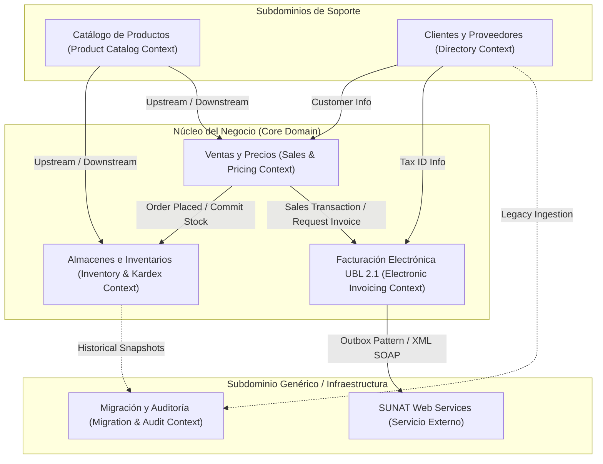
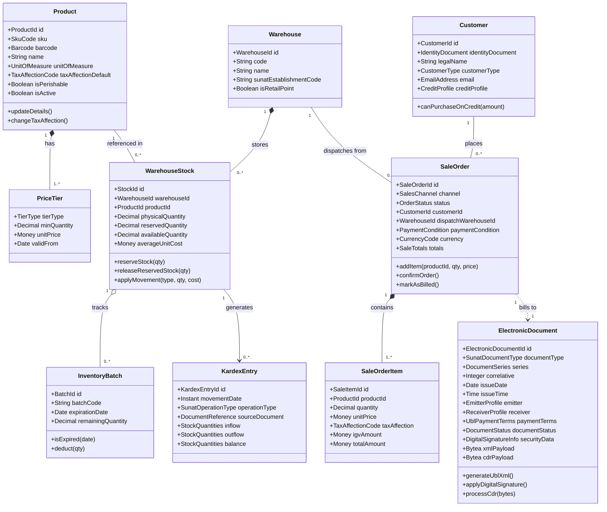
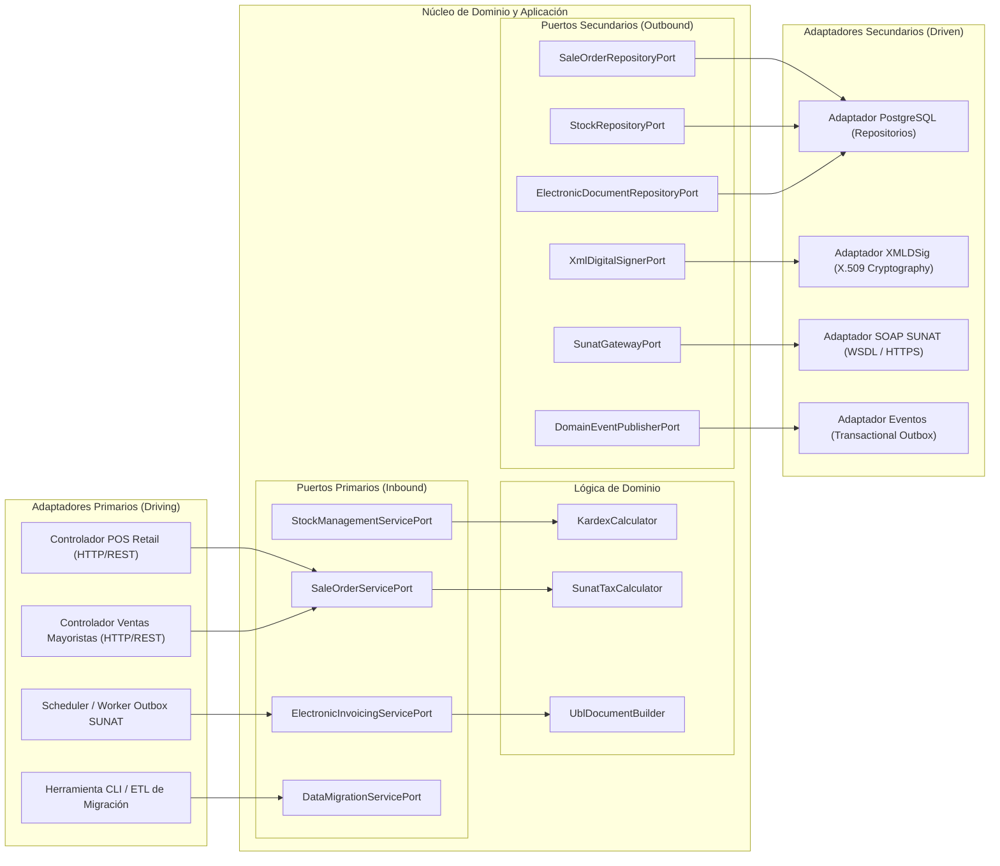

# Modelo de Dominio y Contratos de Datos (DTO / Schemas)

| Metadato | Detalle |
| :--- | :--- |
| **Proyecto / Asignatura** | Examen de Arquitectura de Software |
| **Entregable N° 1** | Modelo de Dominio y Contratos de Datos / DTO / Schemas |
| **Dominio** | Gestión Comercial, Control de Inventarios y Facturación Electrónica UBL 2.1 |
| **Metodología** | Domain-Driven Design (DDD) & Spec-Driven Development (Spec-First) |
| **Persistencia** | PostgreSQL (Relacional + JSONB) |
| **Estándar Fiscal** | SUNAT (Perú) - OASIS UBL 2.1 (RS 097-2012, RS 193-2020 y modificatorias) |
| **Estado** | `APPROVED FOR SPECIFICATION` (Diseño de Contratos y Dominio) |
| **Versión** | 1.0.0 |

---

## Índice de Contenidos

1. [Diseño Estratégico: Bounded Contexts y Context Map](#1-diseño-estratégico-bounded-contexts-y-context-map)
2. [Modelo de Dominio Táctico (Entidades, Agregados y Value Objects)](#2-modelo-de-dominio-táctico)
   - 2.1. Bounded Context: Catálogo y Productos
   - 2.2. Bounded Context: Almacenes e Inventarios (Kardex)
   - 2.3. Bounded Context: Clientes y Proveedores (Directorio)
   - 2.4. Bounded Context: Ventas y Operación Comercial
   - 2.5. Bounded Context: Facturación Electrónica UBL 2.1
   - 2.6. Bounded Context: Migración y Auditoría
3. [Diagrama Integral de Clases del Dominio (Mermaid)](#3-diagrama-integral-de-clases-del-dominio)
4. [Invariantes del Dominio y Reglas de Consistencia](#4-invariantes-del-dominio-y-reglas-de-consistencia)
5. [Definición de Puertos de la Arquitectura Hexagonal](#5-definición-de-puertos-de-la-arquitectura-hexagonal)
   - 5.1. Puertos Primarios (Driving / Inbound Ports)
   - 5.2. Puertos Secundarios (Driven / Outbound Ports)
6. [Contratos de Datos (DTOs y Schemas de Entrada/Salida)](#6-contratos-de-datos-dtos-y-schemas)
   - 6.1. DTOs de Ventas (Mayorista y Minorista)
   - 6.2. DTOs de Movimientos de Inventario y Kardex
   - 6.3. DTOs de Comprobantes de Pago Electrónicos (CPE)
   - 6.4. DTOs de Integración SUNAT (SOAP / CDR)
   - 6.5. DTOs del Pipeline de Migración de Datos Legados
7. [Mapeo Relacional Físico en PostgreSQL](#7-mapeo-relacional-físico-en-postgresql)
8. [Matriz de Mapeo de Atributos del Dominio a OASIS UBL 2.1 y Catálogos SUNAT](#8-matriz-de-mapeo-de-atributos-a-ubl-21)

---

## 1. Diseño Estratégico: Bounded Contexts y Context Map

Para estructurar un sistema comercial y tributario robusto, modular y altamente desacoplado, se aplica **Domain-Driven Design (DDD)** estratégico dividiendo la solución en **6 Contextos Delimitados (Bounded Contexts)**:



### Relaciones entre Contextos (Context Mapping)
1. **Catálogo $\rightarrow$ Almacenes / Ventas**: Catálogo actúa como *Upstream*, suministrando información inmutable de productos, códigos de barras, unidades de medida normalizadas y tipos de afectación tributaria predeterminados.
2. **Ventas $\rightarrow$ Almacenes**: Relación *Customer-Supplier*. La confirmación de un pedido o venta mayorista/minorista genera una reserva y posterior deducción de existencias en el contexto de inventarios.
3. **Ventas $\rightarrow$ Facturación Electrónica**: Ventas envía una orden comercial finalizada. El contexto de Facturación Electrónica transforma los conceptos comerciales en estructuras estrictamente fiscales conforme al estándar OASIS UBL 2.1.
4. **Facturación Electrónica $\rightarrow$ SUNAT**: Integración mediante un *Anti-Corruption Layer (ACL)* y el patrón *Transactional Outbox*, aislando al dominio de las complejidades del protocolo SOAP/WSDL y caídas de red.

---

## 2. Modelo de Dominio Táctico

Se definen Entidades, Agregados (Aggregate Roots), Objetos de Valor (Value Objects) y Eventos de Dominio para cada Bounded Context.

---

### 2.1. Bounded Context: Catálogo y Productos

#### Aggregate Root: `Product`
Representa el bien comercial comercializable (abarrotes o mercadería general).
* **Identificador**: `ProductId` (UUIDv7).
* **Atributos**:
  * `sku`: `SkuCode` (VO: alfanumérico único).
  * `barcode`: `Barcode` (VO: EAN-13, UPC o nulo).
  * `name`: String (descripción corta comercial).
  * `description`: String (descripción detallada).
  * `category`: `ProductCategory` (VO: Abarrotes, Bebidas, Limpieza, etc.).
  * `unitOfMeasure`: `UnitOfMeasure` (VO: código oficial Catálogo 03 SUNAT: `NIU`, `KGM`, `BX`, etc.).
  * `sunatProductCode`: `SunatProductCode` (VO: código Catálogo 25 / UNSPSC).
  * `taxAffectionDefault`: `TaxAffectionCode` (VO: Catálogo 07 SUNAT, ej. Gravado `10`, Exonerado `20`, Inafecto `30`).
  * `isPerishable`: Boolean.
  * `isActive`: Boolean.
* **Comportamiento**:
  * `updateDetails(name, description, category)`
  * `changeTaxAffection(newAffectionCode)`
  * `deactivate()`: Valida que no existan operaciones de venta en curso.

#### Value Object: `PriceTier`
Modela el esquema dual de precios (Mayorista y Minorista):
* `tierType`: Enum (`RETAIL_PRICE`, `WHOLESALE_TIER_1`, `WHOLESALE_TIER_2`).
* `minQuantity`: Decimal (umbral mínimo de unidades para aplicar el precio).
* `unitPrice`: `Money` (VO: importe con divisa, incluye IGV).
* `validFrom`: Date.
* `validTo`: Optional<Date>.

---

### 2.2. Bounded Context: Almacenes e Inventarios (Kardex)

#### Aggregate Root: `Warehouse`
Modela el espacio físico de almacenamiento y despacho.
* **Identificador**: `WarehouseId` (UUID).
* **Atributos**:
  * `code`: String (ej. `ALM-CENTRAL`, `TIENDA-01`, `CUARENTENA`).
  * `name`: String.
  * `address`: `PostalAddress` (VO).
  * `sunatEstablishmentCode`: String (código anexo SUNAT de 4 dígitos, ej. `0000` para sede principal).
  * `isRetailPoint`: Boolean.
  * `isActive`: Boolean.

#### Aggregate Root: `WarehouseStock`
Gestiona el balance y disponibilidad de un producto específico dentro de un almacén.
* **Identificador**: `StockId` (UUID) o clave compuesta `(WarehouseId, ProductId)`.
* **Atributos**:
  * `warehouseId`: `WarehouseId`.
  * `productId`: `ProductId`.
  * `physicalQuantity`: Decimal (cantidad física en estante/bodega).
  * `reservedQuantity`: Decimal (cantidad comprometida en pedidos mayoristas pendientes de despacho).
  * `availableQuantity`: Decimal (calculado: $physicalQuantity - reservedQuantity$).
  * `averageUnitCost`: `Money` (Costo Promedio Ponderado actual en moneda nacional PEN).
  * `totalCostBalance`: `Money` (Valor total del stock = $physicalQuantity \times averageUnitCost$).
* **Comportamiento**:
  * `reserveStock(quantity)`: Invariante: $availableQuantity \ge quantity$.
  * `releaseReservedStock(quantity)`
  * `applyMovement(movementType, quantity, unitCost)`: Aplica el recálculo formal de Costo Promedio Ponderado en entradas, o la disminución proporcional en salidas.

#### Entity / Value Object: `InventoryBatch` (Lote)
Control de trazabilidad para abarrotes perecibles.
* **Identificador**: `BatchId` (UUID).
* **Atributos**:
  * `batchCode`: String (código del lote impreso por el fabricante).
  * `manufacturingDate`: Optional<Date>.
  * `expirationDate`: Date.
  * `initialQuantity`: Decimal.
  * `remainingQuantity`: Decimal.
* **Comportamiento**:
  * `isExpired(currentDate)`: Retorna verdadero si ha vencido.
  * `deduct(quantity)`: Invariante: $remainingQuantity \ge quantity$ y no expirado.

#### Aggregate Root: `KardexEntry`
Registro inmutable de auditoría para cada variación física o valorizada del stock (cumplimiento SUNAT Resolución de Superintendencia N° 234-2006/SUNAT - Libro de Inventarios y Balances).
* **Identificador**: `KardexEntryId` (UUID).
* **Atributos**:
  * `movementDate`: Instant (marca temporal exacta).
  * `warehouseId`: `WarehouseId`.
  * `productId`: `ProductId`.
  * `batchId`: Optional<BatchId>.
  * `operationType`: `SunatOperationType` (VO: Catálogo 12 SUNAT, ej. `01` Venta, `02` Compra, `10` Transferencia entre almacenes, `99` Ajuste).
  * `sourceDocument`: `DocumentReference` (VO: Tipo de comprobante, Serie, Correlativo que sustenta el movimiento).
  * `inflow`: `StockQuantities` (cantidad física, costo unitario, costo total de entrada).
  * `outflow`: `StockQuantities` (cantidad física, costo unitario, costo total de salida).
  * `balance`: `StockQuantities` (cantidad final acumulada, costo promedio ponderado resultante, valor total).
  * `operatorUserId`: `UserId`.

---

### 2.3. Bounded Context: Clientes y Proveedores (Directorio)

#### Aggregate Root: `Customer`
Representa al adquirente tanto en el canal mayorista como en el minorista.
* **Identificador**: `CustomerId` (UUID).
* **Atributos**:
  * `identityDocument`: `IdentityDocument` (VO: `type`: Catálogo 06 SUNAT [`1`: DNI, `6`: RUC, `4`: CE, `7`: Pasaporte, `0`: No Domiciliado]; `number`: String validado con checksum).
  * `legalName`: String (Razón Social para RUC) o `fullName` (Nombres y Apellidos para personas naturales).
  * `tradeName`: Optional<String> (Nombre comercial).
  * `fiscalAddress`: `PostalAddress` (VO: Ubigeo, Dirección, Urbanización, Distrito, Provincia, Departamento).
  * `customerType`: Enum (`RETAIL`, `WHOLESALE`).
  * `email`: `EmailAddress` (para envío de XML/PDF).
  * `creditProfile`: `CreditProfile` (VO: `creditLimit`: Money; `creditTermDays`: Integer; `isCreditBlocked`: Boolean).
* **Comportamiento**:
  * `canPurchaseOnCredit(requestedAmount)`: Valida si $deudaActual + requestedAmount \le creditLimit$ y no está bloqueado.
  * `updateCreditStatus(isBlocked)`

#### Aggregate Root: `Supplier`
Representa al proveedor mayorista de abarrotes.
* **Identificador**: `SupplierId` (UUID).
* **Atributos**:
  * `ruc`: `IdentityDocument` (estrictamente Tipo 6, 11 dígitos).
  * `legalName`: String.
  * `contactName`: String.
  * `phone`: String.
  * `email`: `EmailAddress`.
  * `paymentTermDays`: Integer.

---

### 2.4. Bounded Context: Ventas y Operación Comercial

#### Aggregate Root: `SaleOrder` (Pedido / Venta)
Coordina la transacción comercial tanto en mostrador (POS minorista) como en ventas corporativas mayoristas.
* **Identificador**: `SaleOrderId` (UUID).
* **Atributos**:
  * `channel`: Enum (`RETAIL_POS`, `WHOLESALE_ORDER`).
  * `orderStatus`: Enum (`DRAFT`, `CONFIRMED`, `DISPATCHED`, `BILLED`, `CANCELLED`).
  * `customerId`: `CustomerId`.
  * `dispatchWarehouseId`: `WarehouseId`.
  * `paymentCondition`: `PaymentCondition` (VO: `CASH`, `CREDIT_15D`, `CREDIT_30D`, `DIGITAL_WALLET`, `CARD`).
  * `currency`: `CurrencyCode` (VO: `PEN` o `USD`, Catálogo 02 SUNAT).
  * `exchangeRate`: Optional<Decimal> (tipo de cambio oficial SUNAT para operaciones en USD).
  * `items`: List<`SaleOrderItem`> (Líneas de la venta).
  * `totals`: `SaleTotals` (VO: acumulador de Gravado, Exonerado, Inafecto, IGV, ICBPER, Descuentos globales, Total a Pagar).
  * `createdDate`: Instant.
  * `confirmedDate`: Optional<Instant>.
* **Comportamiento**:
  * `addItem(productId, quantity, requestedPriceTier)`: Calcula bases imponibles por ítem.
  * `removeItem(productId)`
  * `applyGlobalDiscount(discountAmount)`
  * `confirmOrder()`: Emite el evento `SaleOrderConfirmedDomainEvent` y valida que no esté vacía.
  * `markAsBilled(invoiceReference)`

#### Entity: `SaleOrderItem`
* **Identificador**: `SaleItemId` (UUID).
* **Atributos**:
  * `productId`: `ProductId`.
  * `quantity`: Decimal (con unidad de medida).
  * `unitPrice`: `Money` (incluye tributos).
  * `unitValue`: `Money` (precio antes de tributos).
  * `taxAffection`: `TaxAffectionCode` (Catálogo 07).
  * `igvAmount`: `Money`.
  * `discountAmount`: `Money`.
  * `totalAmount`: `Money`.

---

### 2.5. Bounded Context: Facturación Electrónica UBL 2.1

#### Aggregate Root: `ElectronicDocument` (CPE)
Representa el comprobante fiscal estructurado conforme a la normativa peruana.
* **Identificador**: `ElectronicDocumentId` (UUID).
* **Atributos**:
  * `documentType`: `SunatDocumentType` (VO: Catálogo 01 SUNAT: `01` Factura, `03` Boleta, `07` Nota de Crédito, `08` Nota de Débito).
  * `series`: `DocumentSeries` (VO: `F001` a `F999` para facturas; `B001` a `B999` para boletas; `FC01`, `BC01` para notas).
  * `correlative`: Integer (secuencial de 1 a 99999999, formato de 8 dígitos).
  * `issueDate`: Date.
  * `issueTime`: Time.
  * `emitter`: `EmitterProfile` (VO: RUC emisor, Razón Social, Dirección, Código de establecimiento SUNAT).
  * `receiver`: `ReceiverProfile` (VO: Tipo Doc, Número Doc, Razón Social, Correo).
  * `paymentTerms`: `UblPaymentTerms` (VO: `Contado` o `Credito`, cuotas con montos y fechas de vencimiento según RS 193-2020).
  * `lines`: List<`UblDocumentLine`>.
  * `taxSummary`: `UblTaxSummary` (VO: Subtotales Gravado 1000/VAT, Exonerado 9997/VAT, Inafecto 9998/FRE, ICBPER 7152/OTH, Total IGV).
  * `documentStatus`: Enum (`DRAFT`, `XML_GENERATED`, `SIGNED`, `SENT_TO_SUNAT`, `ACCEPTED_CDR`, `ACCEPTED_WITH_OBSERVATIONS`, `REJECTED_CDR`, `VOIDED`).
  * `securityData`: `DigitalSignatureInfo` (VO: `digestValue` [Hash SHA-256], `signatureValue`, `signingTime`).
  * `xmlPayload`: Text / Bytea (archivo XML UBL 2.1 firmado).
  * `cdrPayload`: Optional<Bytea> (archivo ZIP del CDR oficial retornado por SUNAT).
  * `cdrStatusCode`: Optional<String> (código retornado por SUNAT, `0` = Aceptado).
  * `cdrNotes`: List<String> (observaciones retornadas por SUNAT).
* **Comportamiento**:
  * `generateUblXml(templateEngine)`: Genera el XML sintácticamente conforme a OASIS UBL 2.1.
  * `applyDigitalSignature(signerService, certificate)`: Aplica el estándar XMLDSig y genera el DigestValue.
  * `processCdr(cdrZipBytes)`: Parsea el archivo `R-*.zip`, extrae el XML de respuesta de SUNAT y actualiza el estado.
  * `reject(errorCode, errorDescription)`

---

### 2.6. Bounded Context: Migración y Auditoría

#### Aggregate Root: `MigrationBatch`
Gestiona la ejecución y reconciliación de la ingesta de datos del sistema legado.
* **Identificador**: `BatchId` (UUID).
* **Atributos**:
  * `targetEntity`: Enum (`PRODUCT_CATALOG`, `CUSTOMERS`, `SUPPLIERS`, `INITIAL_STOCK_BALANCES`).
  * `sourceFileName`: String.
  * `totalRecords`: Integer.
  * `processedRecords`: Integer.
  * `failedRecords`: Integer.
  * `status`: Enum (`PENDING`, `IN_PROGRESS`, `RECONCILED`, `FAILED`).
  * `executedBy`: `UserId`.
  * `executionLog`: JSONB (detalle de errores fila por fila).

#### Aggregate Root: `AuditRecord`
Pista de auditoría inmutable en PostgreSQL.
* **Identificador**: `AuditId` (UUIDv7 secuencial).
* **Atributos**:
  * `timestamp`: Instant.
  * `userId`: `UserId`.
  * `entityName`: String (ej. `SaleOrder`, `WarehouseStock`, `ElectronicDocument`).
  * `entityId`: String.
  * `action`: Enum (`CREATE`, `UPDATE`, `VOID`, `SECURITY_EVENT`).
  * `previousState`: JSONB.
  * `newState`: JSONB.
  * `clientIp`: String.

---

## 3. Diagrama Integral de Clases del Dominio

El siguiente diagrama formaliza las entidades del dominio, sus asociaciones, multiplicidades y Value Objects clave:



---

## 4. Invariantes del Dominio y Reglas de Consistencia

1. **Invariante de Inventario No Negativo**:
   * Para cualquier almacén $w$ y producto $p$, una salida física regular no puede resultar en $physicalQuantity_{w,p} < 0$.
   * Toda reserva debe cumplir estrictamente: $reservedQuantity_{w,p} \le physicalQuantity_{w,p}$.
2. **Invariante del Costo Promedio Ponderado (Kardex)**:
   * Al registrar una entrada (Inflow) con cantidad $Q_{in}$ y costo unitario $C_{in}$, sobre un saldo previo de cantidad $Q_{prev}$ y costo unitario $C_{prev}$:
     $$C_{promedio\_nuevo} = \frac{(Q_{prev} \times C_{prev}) + (Q_{in} \times C_{in})}{Q_{prev} + Q_{in}}$$
   * Al registrar una salida (Outflow), el costo unitario de salida es idéntico a $C_{promedio}$ actual, y no altera el costo unitario del saldo remanente.
3. **Invariante de Integridad Fiscal UBL 2.1**:
   * En todo comprobante electrónico, la sumatoria de las líneas de detalle debe cuadrar con los totales del comprobante:
     $$\text{LineExtensionAmount}_{total} = \sum \text{LineExtensionAmount}_{i}$$
     $$\text{TaxAmount}_{total} = \sum \text{TaxAmount}_{i}$$
     $$\text{PayableAmount} = \text{LineExtensionAmount}_{total} + \text{TaxAmount}_{total} - \text{TotalDiscount}$$
4. **Invariante de Inmutabilidad de Comprobantes con CDR**:
   * Todo `ElectronicDocument` en estado `ACCEPTED_CDR` queda bloqueado para modificaciones. Ningún método de mutación puede alterar sus líneas, montos, series o receptor. Cualquier corrección requiere emitir una entidad `ElectronicDocument` de tipo `07` (Nota de Crédito).
5. **Invariante de Documento Adquirente**:
   * Si `ElectronicDocument.documentType == '01'` (Factura), entonces obligatoriamente `receiver.identityDocument.type == '6'` (RUC) y longitud de 11 caracteres con dígito verificador módulo 11 válido.
   * Si `ElectronicDocument.documentType == '03'` (Boleta) y `PayableAmount >= 700.00 PEN`, es mandatorio registrar `receiver.identityDocument.type` diferente de vacío y con número válido.

---

## 5. Definición de Puertos de la Arquitectura Hexagonal

Conforme a los principios de **Arquitectura Hexagonal (Ports & Adapters)**, el núcleo de dominio se aísla completamente mediante interfaces tipadas:



### 5.1. Puertos Primarios (Driving / Inbound Ports)

Interfaces que expresan los casos de uso disponibles para los controladores de la aplicación:

```typescript
// Puerto de Gestión de Ventas
interface SaleOrderServicePort {
  createDraftOrder(cmd: CreateSaleOrderCommand): Promise<SaleOrderDto>;
  addItemToOrder(cmd: AddItemCommand): Promise<SaleOrderDto>;
  confirmSaleOrder(orderId: string, operatorUserId: string): Promise<ConfirmedSaleResultDto>;
  cancelSaleOrder(orderId: string, reason: string): Promise<void>;
  getOrderById(orderId: string): Promise<SaleOrderDto>;
}

// Puerto de Control de Inventarios y Kardex
interface StockManagementServicePort {
  registerInflow(cmd: RegisterStockInflowCommand): Promise<KardexEntryDto>;
  registerOutflow(cmd: RegisterStockOutflowCommand): Promise<KardexEntryDto>;
  transferBetweenWarehouses(cmd: TransferStockCommand): Promise<TransferResultDto>;
  adjustStock(cmd: AdjustStockCommand): Promise<KardexEntryDto>;
  getKardexByProduct(warehouseId: string, productId: string, fromDate: Date, toDate: Date): Promise<KardexReportDto>;
}

// Puerto de Facturación Electrónica UBL 2.1
interface ElectronicInvoicingServicePort {
  issueDocumentFromSale(saleOrderId: string, documentType: string, series: string): Promise<ElectronicDocumentDto>;
  processOutboxPendingDocuments(batchSize: number): Promise<SyncResultDto>;
  syncDocumentCdr(documentId: string): Promise<CdrResultDto>;
  issueCreditNote(cmd: IssueCreditNoteCommand): Promise<ElectronicDocumentDto>;
}

// Puerto de Migración de Datos Legados
interface DataMigrationServicePort {
  ingestProductCatalog(payload: LegacyProductIngestDto): Promise<MigrationBatchSummaryDto>;
  ingestCustomerDirectory(payload: LegacyCustomerIngestDto): Promise<MigrationBatchSummaryDto>;
  ingestInitialStockBalances(payload: LegacyStockBalanceIngestDto): Promise<MigrationBatchSummaryDto>;
  getMigrationStatus(batchId: string): Promise<MigrationBatchSummaryDto>;
}
```

### 5.2. Puertos Secundarios (Driven / Outbound Ports)

Interfaces que el dominio define para interactuar con la infraestructura:

```typescript
// Repositorios de Persistencia
interface SaleOrderRepositoryPort {
  save(order: SaleOrder): Promise<void>;
  findById(id: SaleOrderId): Promise<SaleOrder | null>;
}

interface StockRepositoryPort {
  getStock(warehouseId: WarehouseId, productId: ProductId): Promise<WarehouseStock | null>;
  saveStock(stock: WarehouseStock): Promise<void>;
  saveKardexEntry(entry: KardexEntry): Promise<void>;
}

interface ElectronicDocumentRepositoryPort {
  save(document: ElectronicDocument): Promise<void>;
  findById(id: ElectronicDocumentId): Promise<ElectronicDocument | null>;
  findBySeriesAndNumber(docType: string, series: string, correlative: number): Promise<ElectronicDocument | null>;
  findPendingTransmission(limit: number): Promise<ElectronicDocument[]>;
}

// Servicios Criptográficos y de Integración Externa
interface XmlDigitalSignerPort {
  signXmlDocument(rawXmlBytes: Uint8Array, privateKeyId: string): Promise<{ signedXmlBytes: Uint8Array; digestValue: string; signatureValue: string }>;
}

interface SunatGatewayPort {
  sendBill(fileName: string, zippedXmlBytes: Uint8Array): Promise<{ cdrZippedBytes: Uint8Array }>;
  sendSummary(fileName: string, zippedXmlBytes: Uint8Array): Promise<{ ticketNumber: string }>;
  getStatus(ticketNumber: string): Promise<{ cdrZippedBytes: Uint8Array; statusCode: string }>;
}
```

---

## 6. Contratos de Datos (DTOs y Schemas)

Se formalizan los esquemas de intercambio de datos tipados en formato agnóstico / TypeScript con restricciones semánticas y mapeo a JSON Schema.

---

### 6.1. DTOs de Ventas (Mayorista y Minorista)

#### Contrato: `CreateSaleOrderCommandDto`
```json
{
  "$schema": "https://json-schema.org/draft/2020-12/schema",
  "title": "CreateSaleOrderCommandDto",
  "type": "object",
  "required": ["channel", "customerId", "dispatchWarehouseId", "currency", "paymentCondition", "items"],
  "properties": {
    "channel": {
      "type": "string",
      "enum": ["RETAIL_POS", "WHOLESALE_ORDER"]
    },
    "customerId": {
      "type": "string",
      "format": "uuid"
    },
    "dispatchWarehouseId": {
      "type": "string",
      "format": "uuid"
    },
    "currency": {
      "type": "string",
      "enum": ["PEN", "USD"],
      "default": "PEN"
    },
    "paymentCondition": {
      "type": "string",
      "enum": ["CASH", "CREDIT_15D", "CREDIT_30D", "CREDIT_45D", "DEBIT_CARD", "CREDIT_CARD", "DIGITAL_WALLET"]
    },
    "items": {
      "type": "array",
      "minItems": 1,
      "items": {
        "type": "object",
        "required": ["productId", "quantity", "unitPrice"],
        "properties": {
          "productId": { "type": "string", "format": "uuid" },
          "quantity": { "type": "number", "exclusiveMinimum": 0 },
          "unitPrice": { "type": "number", "exclusiveMinimum": 0 },
          "batchId": { "type": "string", "format": "uuid" }
        }
      }
    }
  }
}
```

---

### 6.2. DTOs de Movimientos de Inventario y Kardex

#### Contrato: `RegisterStockMovementDto`
```typescript
interface RegisterStockMovementDto {
  warehouseId: string; // UUID
  productId: string;   // UUID
  batchId?: string;    // UUID para perecibles
  movementType: 'INFLOW_PURCHASE' | 'INFLOW_RETURN' | 'OUTFLOW_SALE' | 'OUTFLOW_DISCARD' | 'ADJUSTMENT_POSITIVE' | 'ADJUSTMENT_NEGATIVE';
  sunatOperationCode: string; // Catálogo 12: '01' Venta, '02' Compra, etc.
  quantity: number;    // Cantidad física > 0
  unitCost: number;    // Costo unitario antes de IGV
  documentReference: {
    documentTypeCode: string; // Catálogo 01: '01', '03', '09' Guía, etc.
    series: string;           // Ej: 'F001'
    number: number;           // Correlativo numérico
    issuerRuc?: string;       // RUC del proveedor en compras
  };
  notes?: string;
}
```

---

### 6.3. DTOs de Comprobantes de Pago Electrónicos (CPE UBL 2.1)

#### Contrato: `IssueElectronicDocumentRequestDto`
Este DTO representa la entrada al puerto de facturación electrónica para transformar una venta o nota de crédito en el documento UBL 2.1 estándar:

```typescript
interface IssueElectronicDocumentRequestDto {
  documentTypeCode: '01' | '03' | '07' | '08'; // Catálogo 01 SUNAT
  series: string;                              // Ej: 'F001', 'B001', 'FC01'
  saleOrderId: string;                         // UUID de la venta origen
  issueDate: string;                           // Formato 'YYYY-MM-DD'
  issueTime: string;                           // Formato 'HH:MM:SS'
  emitter: {
    ruc: string;                               // 11 dígitos emisor
    legalName: string;
    tradeName?: string;
    establishmentCode: string;                 // Catálogo 4 dígitos (ej: '0000')
    address: {
      ubigeo: string;                          // 6 dígitos (INEI)
      department: string;
      province: string;
      district: string;
      addressLine: string;
    };
  };
  receiver: {
    identityDocumentType: '1' | '6' | '4' | '7' | '0' | '-'; // Catálogo 06 SUNAT
    identityDocumentNumber: string;
    legalName: string;
    email?: string;
    addressLine?: string;
  };
  paymentTerms: {
    type: 'Contado' | 'Credito';
    totalAmount?: number;                      // Obligatorio si es Crédito
    installments?: Array<{                     // Cuotas de pago (RS 193-2020)
      installmentNumber: number;
      amount: number;
      dueDate: string;                         // Formato 'YYYY-MM-DD'
    }>;
  };
  referenceDocument?: {                        // Obligatorio para Notas de Crédito / Débito
    documentTypeCode: string;                  // Catálogo 01
    seriesAndNumber: string;                   // Ej: 'F001-00000123'
    discrepancyResponseCode: string;           // Catálogo 09 (NC) o 10 (ND)
    reasonDescription: string;
  };
  items: Array<{
    lineNumber: number;
    productCode: string;
    sunatProductCode?: string;                 // Catálogo 25 (UNSPSC)
    description: string;
    unitCode: string;                          // Catálogo 03 (ej: 'NIU', 'KGM')
    quantity: number;
    unitPrice: number;                         // Precio comercial con tributos
    unitValue: number;                         // Valor unitario sin tributos
    taxAffectionCode: string;                  // Catálogo 07 (ej: '10', '20', '30')
    igvAmount: number;
    icbperAmount?: number;
    totalLineAmount: number;                   // unitValue * quantity - discount
  }>;
  taxSummary: {
    taxableOperationsAmount: number;           // Base imponible Gravada (Código 1001)
    exoneratedOperationsAmount: number;        // Base Exonerada (Código 1003)
    unaffectedOperationsAmount: number;        // Base Inafecta (Código 1002)
    totalIgvAmount: number;                    // 18% del Gravado
    totalIcbperAmount: number;                 // Bolsa plástica
    totalDiscounts: number;
    totalPayableAmount: number;                // Monto Total a pagar
  };
}
```

---

### 6.4. DTOs de Integración SUNAT (SOAP / CDR)

#### Contrato: `SunatCdrResponseDto`
Representa el resultado deserializado del archivo `R-*.zip` devuelto por SUNAT:

```typescript
interface SunatCdrResponseDto {
  documentReference: {
    documentTypeCode: string;
    series: string;
    correlative: number;
  };
  sunatResponseCode: string;                   // '0' = Aceptado, >0 = Rechazo con código oficial
  sunatResponseDescription: string;            // Glosa oficial emitida por el CDR
  cdrReceiptDate: string;                      // Fecha/Hora de procesamiento en SUNAT
  cdrHashValue: string;                        // Resumen digital calculado por SUNAT
  observations: Array<{
    code: string;                              // Código de advertencia (ej. 'Obs 4032')
    message: string;
  }>;
  isAccepted: boolean;
}
```

---

### 6.5. DTOs del Pipeline de Migración de Datos Legados

#### Contrato: `LegacyStockBalanceIngestDto`
Estructura para la ingesta y reconciliación de saldos de apertura de inventario:

```typescript
interface LegacyStockBalanceIngestDto {
  cutoffDate: string;                          // Fecha de corte 'YYYY-MM-DD'
  warehouseCode: string;                       // Código de almacén destino
  entries: Array<{
    sourceProductSku: string;
    unitCode: string;                          // Catálogo 03
    quantity: number;
    unitCostWithoutTax: number;
    batchCode?: string;
    expirationDate?: string;
  }>;
  reconciliationSummary: {
    totalSkus: number;
    totalStockValuePEN: number;
    approvedBySignature: string;
  };
}
```

---

## 7. Mapeo Relacional Físico en PostgreSQL

A continuación se definen las sentencias DDL estructuradas con llaves primarias, foráneas, restricciones de integridad de dominio (`CHECK`), índices de alto rendimiento y campos `JSONB`:

```sql
-- Habilitar extensión para identificadores universales únicos
CREATE EXTENSION IF NOT EXISTS "uuid-ossp";

-- 1. Tabla de Catálogo de Productos
CREATE TABLE catalog_products (
    product_id UUID PRIMARY KEY DEFAULT uuid_generate_v4(),
    sku VARCHAR(50) NOT NULL UNIQUE,
    barcode VARCHAR(30) UNIQUE,
    name VARCHAR(255) NOT NULL,
    description TEXT,
    category VARCHAR(100) NOT NULL,
    unit_of_measure VARCHAR(10) NOT NULL, -- Catálogo 03 SUNAT (NIU, KGM)
    sunat_product_code VARCHAR(20),       -- Catálogo 25 (UNSPSC)
    tax_affection_default VARCHAR(5) NOT NULL DEFAULT '10', -- Catálogo 07
    is_perishable BOOLEAN NOT NULL DEFAULT FALSE,
    is_active BOOLEAN NOT NULL DEFAULT TRUE,
    created_at TIMESTAMPTZ NOT NULL DEFAULT NOW(),
    updated_at TIMESTAMPTZ NOT NULL DEFAULT NOW()
);

-- 2. Tabla de Escalas de Precios (Dual: Mayorista / Minorista)
CREATE TABLE catalog_price_tiers (
    price_tier_id UUID PRIMARY KEY DEFAULT uuid_generate_v4(),
    product_id UUID NOT NULL REFERENCES catalog_products(product_id) ON DELETE RESTRICT,
    tier_type VARCHAR(30) NOT NULL, -- 'RETAIL_PRICE', 'WHOLESALE_TIER_1', 'WHOLESALE_TIER_2'
    min_quantity NUMERIC(12, 3) NOT NULL DEFAULT 1.000,
    unit_price NUMERIC(14, 4) NOT NULL, -- Precio incluye IGV
    currency VARCHAR(3) NOT NULL DEFAULT 'PEN',
    valid_from DATE NOT NULL,
    valid_to DATE,
    CONSTRAINT chk_price_positive CHECK (unit_price > 0),
    CONSTRAINT chk_qty_positive CHECK (min_quantity > 0)
);

-- 3. Tabla de Almacenes Físicos
CREATE TABLE inventory_warehouses (
    warehouse_id UUID PRIMARY KEY DEFAULT uuid_generate_v4(),
    code VARCHAR(20) NOT NULL UNIQUE,
    name VARCHAR(150) NOT NULL,
    sunat_establishment_code VARCHAR(4) NOT NULL DEFAULT '0000',
    is_retail_point BOOLEAN NOT NULL DEFAULT FALSE,
    is_active BOOLEAN NOT NULL DEFAULT TRUE
);

-- 4. Tabla de Stock Consolidado por Almacén
CREATE TABLE inventory_warehouse_stock (
    stock_id UUID PRIMARY KEY DEFAULT uuid_generate_v4(),
    warehouse_id UUID NOT NULL REFERENCES inventory_warehouses(warehouse_id),
    product_id UUID NOT NULL REFERENCES catalog_products(product_id),
    physical_quantity NUMERIC(14, 3) NOT NULL DEFAULT 0.000,
    reserved_quantity NUMERIC(14, 3) NOT NULL DEFAULT 0.000,
    average_unit_cost NUMERIC(16, 6) NOT NULL DEFAULT 0.000000,
    currency VARCHAR(3) NOT NULL DEFAULT 'PEN',
    last_updated TIMESTAMPTZ NOT NULL DEFAULT NOW(),
    CONSTRAINT uq_warehouse_product UNIQUE (warehouse_id, product_id),
    CONSTRAINT chk_stock_non_negative CHECK (physical_quantity >= 0),
    CONSTRAINT chk_reserved_lte_physical CHECK (reserved_quantity <= physical_quantity)
);

-- 5. Tabla de Lotes y Fechas de Vencimiento
CREATE TABLE inventory_batches (
    batch_id UUID PRIMARY KEY DEFAULT uuid_generate_v4(),
    product_id UUID NOT NULL REFERENCES catalog_products(product_id),
    warehouse_id UUID NOT NULL REFERENCES inventory_warehouses(warehouse_id),
    batch_code VARCHAR(50) NOT NULL,
    manufacturing_date DATE,
    expiration_date DATE NOT NULL,
    initial_quantity NUMERIC(14, 3) NOT NULL,
    remaining_quantity NUMERIC(14, 3) NOT NULL,
    CONSTRAINT chk_batch_remaining CHECK (remaining_quantity >= 0 AND remaining_quantity <= initial_quantity)
);

-- 6. Tabla de Kardex Permanente Inmutable
CREATE TABLE inventory_kardex_entries (
    kardex_id UUID PRIMARY KEY DEFAULT uuid_generate_v4(),
    movement_timestamp TIMESTAMPTZ NOT NULL DEFAULT NOW(),
    warehouse_id UUID NOT NULL REFERENCES inventory_warehouses(warehouse_id),
    product_id UUID NOT NULL REFERENCES catalog_products(product_id),
    batch_id UUID REFERENCES inventory_batches(batch_id),
    sunat_operation_type VARCHAR(2) NOT NULL, -- Catálogo 12 SUNAT
    doc_reference_type VARCHAR(2) NOT NULL,   -- Catálogo 01 SUNAT
    doc_reference_series VARCHAR(10) NOT NULL,
    doc_reference_number VARCHAR(20) NOT NULL,
    inflow_quantity NUMERIC(14, 3) NOT NULL DEFAULT 0.000,
    inflow_unit_cost NUMERIC(16, 6) NOT NULL DEFAULT 0.000000,
    inflow_total_cost NUMERIC(16, 2) NOT NULL DEFAULT 0.00,
    outflow_quantity NUMERIC(14, 3) NOT NULL DEFAULT 0.000,
    outflow_unit_cost NUMERIC(16, 6) NOT NULL DEFAULT 0.000000,
    outflow_total_cost NUMERIC(16, 2) NOT NULL DEFAULT 0.00,
    balance_quantity NUMERIC(14, 3) NOT NULL,
    balance_unit_cost NUMERIC(16, 6) NOT NULL,
    balance_total_cost NUMERIC(16, 2) NOT NULL,
    operator_user_id VARCHAR(50) NOT NULL
);

-- 7. Tabla de Clientes
CREATE TABLE directory_customers (
    customer_id UUID PRIMARY KEY DEFAULT uuid_generate_v4(),
    identity_document_type VARCHAR(2) NOT NULL, -- Catálogo 06 ('1': DNI, '6': RUC)
    identity_document_number VARCHAR(20) NOT NULL,
    legal_name VARCHAR(255) NOT NULL,
    customer_type VARCHAR(20) NOT NULL,         -- 'RETAIL', 'WHOLESALE'
    email VARCHAR(150),
    credit_limit NUMERIC(14, 2) NOT NULL DEFAULT 0.00,
    credit_term_days INT NOT NULL DEFAULT 0,
    is_credit_blocked BOOLEAN NOT NULL DEFAULT FALSE,
    CONSTRAINT uq_customer_doc UNIQUE (identity_document_type, identity_document_number)
);

-- 8. Tabla de Órdenes de Venta Comercial
CREATE TABLE sales_orders (
    order_id UUID PRIMARY KEY DEFAULT uuid_generate_v4(),
    order_channel VARCHAR(20) NOT NULL, -- 'RETAIL_POS', 'WHOLESALE_ORDER'
    order_status VARCHAR(20) NOT NULL,  -- 'DRAFT', 'CONFIRMED', 'DISPATCHED', 'BILLED', 'CANCELLED'
    customer_id UUID NOT NULL REFERENCES directory_customers(customer_id),
    warehouse_id UUID NOT NULL REFERENCES inventory_warehouses(warehouse_id),
    payment_condition VARCHAR(30) NOT NULL,
    currency VARCHAR(3) NOT NULL DEFAULT 'PEN',
    exchange_rate NUMERIC(8, 4),
    subtotal_taxable NUMERIC(14, 2) NOT NULL DEFAULT 0.00,
    subtotal_exonerated NUMERIC(14, 2) NOT NULL DEFAULT 0.00,
    subtotal_unaffected NUMERIC(14, 2) NOT NULL DEFAULT 0.00,
    total_igv NUMERIC(14, 2) NOT NULL DEFAULT 0.00,
    total_icbper NUMERIC(14, 2) NOT NULL DEFAULT 0.00,
    total_payable NUMERIC(14, 2) NOT NULL DEFAULT 0.00,
    created_at TIMESTAMPTZ NOT NULL DEFAULT NOW()
);

-- 9. Tabla de Comprobantes de Pago Electrónicos (CPE UBL 2.1)
CREATE TABLE billing_electronic_documents (
    document_id UUID PRIMARY KEY DEFAULT uuid_generate_v4(),
    sale_order_id UUID REFERENCES sales_orders(order_id),
    document_type_code VARCHAR(2) NOT NULL, -- Catálogo 01 ('01' Factura, '03' Boleta, '07' NC, '08' ND)
    series VARCHAR(4) NOT NULL,             -- Ej. 'F001', 'B001'
    correlative INT NOT NULL,               -- Secuencial 1..99999999
    issue_date DATE NOT NULL,
    issue_time TIME NOT NULL,
    receiver_document_type VARCHAR(2) NOT NULL,
    receiver_document_number VARCHAR(20) NOT NULL,
    receiver_legal_name VARCHAR(255) NOT NULL,
    payment_terms_type VARCHAR(20) NOT NULL, -- 'Contado', 'Credito'
    payment_terms_details JSONB,            -- Cuotas de crédito con fechas y montos
    document_status VARCHAR(30) NOT NULL,   -- 'DRAFT', 'XML_SIGNED', 'SENT_TO_SUNAT', 'ACCEPTED_CDR', 'REJECTED_CDR'
    digest_value VARCHAR(64),               -- Hash SHA-256 de la firma
    xml_signed_content TEXT,                -- Documento UBL 2.1 firmado
    cdr_response_zip BYTEA,                 -- Archivo binario de respuesta oficial de SUNAT
    cdr_response_code VARCHAR(10),          -- '0' = Aceptado
    cdr_response_description TEXT,
    created_at TIMESTAMPTZ NOT NULL DEFAULT NOW(),
    CONSTRAINT uq_cpe_identity UNIQUE (document_type_code, series, correlative)
);

-- 10. Tabla para Patrón Transactional Outbox (Envíos Asíncronos a SUNAT)
CREATE TABLE billing_outbox_events (
    outbox_id UUID PRIMARY KEY DEFAULT uuid_generate_v4(),
    aggregate_type VARCHAR(50) NOT NULL,
    aggregate_id UUID NOT NULL,
    event_type VARCHAR(50) NOT NULL,        -- 'ELECTRONIC_DOCUMENT_READY_FOR_DISPATCH'
    payload JSONB NOT NULL,
    retry_count INT NOT NULL DEFAULT 0,
    max_retries INT NOT NULL DEFAULT 5,
    next_retry_at TIMESTAMPTZ NOT NULL DEFAULT NOW(),
    status VARCHAR(20) NOT NULL DEFAULT 'PENDING', -- 'PENDING', 'PROCESSING', 'DELIVERED', 'FAILED'
    created_at TIMESTAMPTZ NOT NULL DEFAULT NOW()
);

-- Índices de Alto Rendimiento
CREATE INDEX idx_kardex_product_warehouse ON inventory_kardex_entries(warehouse_id, product_id, movement_timestamp);
CREATE INDEX idx_cpe_status_issue_date ON billing_electronic_documents(document_status, issue_date);
CREATE INDEX idx_outbox_pending ON billing_outbox_events(status, next_retry_at) WHERE status = 'PENDING';
```

---

## 8. Matriz de Mapeo de Atributos del Dominio a OASIS UBL 2.1 y Catálogos SUNAT

La siguiente tabla establece la equivalencia formal y exacta entre los atributos del modelo de dominio, las rutas XPath del esquema UBL 2.1 y los catálogos oficiales de la SUNAT:

| Entidad / Atributo del Dominio | Elemento XML / XPath OASIS UBL 2.1 | Catálogo SUNAT | Tipo de Dato / Regla Normativa |
| :--- | :--- | :--- | :--- |
| `ElectronicDocument.documentType` | `/Invoice/cbc:InvoiceTypeCode` | **Catálogo N° 01** | Código `01` (Factura) o `03` (Boleta). Atributo `listID="0101"`. |
| `ElectronicDocument.series` + `correlative` | `/Invoice/cbc:ID` | Regla formato | Patrón: `^[F|B][A-Z0-9]{3}-[0-9]{1,8}$` (ej. `F001-00000001`). |
| `ElectronicDocument.issueDate` | `/Invoice/cbc:IssueDate` | Estándar ISO | Formato `YYYY-MM-DD`. |
| `ElectronicDocument.issueTime` | `/Invoice/cbc:IssueTime` | Estándar ISO | Formato `HH:MM:SS`. |
| `ElectronicDocument.currency` | `/Invoice/cbc:DocumentCurrencyCode` | **Catálogo N° 02** | Código `PEN` (Soles) o `USD` (Dólares). |
| `Emitter.ruc` | `/Invoice/cac:AccountingSupplierParty/cac:Party/cac:PartyIdentification/cbc:ID` | **Catálogo N° 06** | Tipo `6` (RUC de 11 dígitos con dígito verificador). |
| `Emitter.establishmentCode` | `/Invoice/cac:AccountingSupplierParty/cac:Party/cac:PostalAddress/cbc:AddressTypeCode` | **Catálogo N° 19** | Código de 4 dígitos asignado por SUNAT (ej. `0000`). |
| `Receiver.identityDocument.type` | `/Invoice/cac:AccountingCustomerParty/cac:Party/cac:PartyIdentification/cbc:ID/@schemeID` | **Catálogo N° 06** | `6`=RUC, `1`=DNI, `4`=Carné Extranjería, `7`=Pasaporte, `-`=Sin Doc. |
| `Receiver.identityDocument.number`| `/Invoice/cac:AccountingCustomerParty/cac:Party/cac:PartyIdentification/cbc:ID` | Catálogo N° 06 | Número correspondiente al documento de identidad. |
| `PaymentTerms.type` | `/Invoice/cac:PaymentTerms[cbc:ID='FormaPago']/cbc:PaymentMeansID` | **RS 193-2020** | `Contado` o `Credito`. |
| `PaymentTerms.installments` | `/Invoice/cac:PaymentTerms[cbc:ID='CuotaNNN']/cbc:Amount` y `cbc:PaymentDueDate` | **RS 193-2020** | Desglose obligatorio de cuotas pendientes con fecha de vencimiento si es crédito. |
| `Product.unitOfMeasure` | `/Invoice/cac:InvoiceLine/cbc:InvoicedQuantity/@unitCode` | **Catálogo N° 03** | `NIU` (Unidades), `KGM` (Kilos), `BX` (Cajas), `PK` (Paquetes). |
| `SaleOrderItem.unitPrice` | `/Invoice/cac:InvoiceLine/cac:PricingReference/cac:AlternativeConditionPrice/cbc:PriceAmount` | **Catálogo N° 16** | Precio comercial unitario que incluye tributos (`priceTypeCode="01"`). |
| `SaleOrderItem.unitValue` | `/Invoice/cac:InvoiceLine/cac:Price/cbc:PriceAmount` | Estándar UBL | Valor unitario neto sin tributos. |
| `SaleOrderItem.taxAffection` | `/Invoice/cac:InvoiceLine/cac:TaxTotal/cac:TaxSubtotal/cac:TaxCategory/cbc:TaxExemptionReasonCode` | **Catálogo N° 07** | `10` Gravado, `20` Exonerado, `30` Inafecto. |
| `SaleTotals.taxableAmount` | `/Invoice/cac:TaxTotal/cac:TaxSubtotal[cac:TaxCategory/cac:TaxScheme/cbc:ID='1000']/cbc:TaxableAmount` | **Catálogo N° 05** | Base imponible gravada (Código tributo `1000`, `IGV`, `VAT`). |
| `SaleTotals.igvAmount` | `/Invoice/cac:TaxTotal/cac:TaxSubtotal[cac:TaxCategory/cac:TaxScheme/cbc:ID='1000']/cbc:TaxAmount` | Catálogo N° 05 | Importe total del 18% de IGV liquidado. |
| `DigitalSignature.digestValue` | `/Invoice/ext:UBLExtensions/.../ds:Reference/ds:DigestValue` | Estándar XMLDSig | Hash SHA-256 generado al firmar digitalmente el comprobante. |
| `KardexEntry.operationType` | *(Interno Kardex)* | **Catálogo N° 12** | `01` Venta, `02` Compra, `10` Transferencia, `99` Ajustes. |
