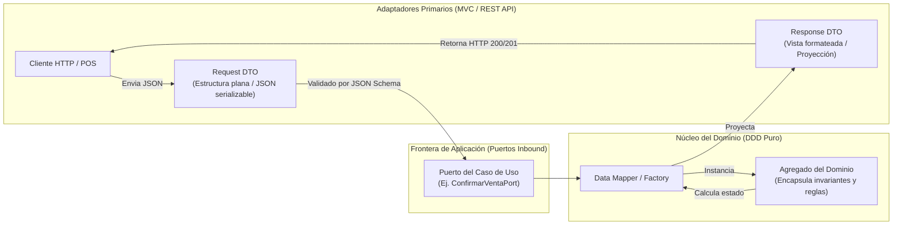

# Especificación Formal de DTOs, Schemas y Contratos de Persistencia

| Metadato | Detalle |
| :--- | :--- |
| **Proyecto / Asignatura** | Examen de Arquitectura de Software |
| **Entregable N° 3** | DTOs (Data Transfer Objects), JSON Schemas y Esquemas Físicos de Persistencia |
| **Dominio** | Comercializadora Mayorista y Minorista de Abarrotes, Inventarios y Facturación UBL 2.1 |
| **Enfoque** | Spec-First / Contract-Driven Development |
| **Tecnologías Base** | JSON Schema (Draft 2020-12), TypeScript Type Signatures, PostgreSQL 15+ |
| **Estado** | `APPROVED DTO & SCHEMA SPECIFICATION` |
| **Versión** | 1.0.0 |

---

## Índice de Contenidos

1. [Fundamentación Arquitectónica: Desacoplamiento mediante DTOs](#1-fundamentación-arquitectónica-desacoplamiento-mediante-dtos)
   - 1.1. Principio de Aislamiento del Dominio
   - 1.2. Validación en Dos Fases: Sintáctica (Schema) vs. Semántica (Invariantes)
2. [Catálogo Formal de DTOs de Entrada (Command / Request DTOs)](#2-catálogo-formal-de-dtos-de-entrada)
   - 2.1. Módulo Catálogo y Precios
   - 2.2. Módulo Inventarios y Movimientos
   - 2.3. Módulo Clientes y Directorio
   - 2.4. Módulo Ventas (Retail POS y Mayorista)
   - 2.5. Módulo Facturación Electrónica UBL 2.1
   - 2.6. Módulo Migración de Datos Legados
3. [Catálogo Formal de DTOs de Salida (Response / View DTOs)](#3-catálogo-formal-de-dtos-de-salida)
4. [Especificación Formal de JSON Schemas (Draft 2020-12)](#4-especificación-formal-de-json-schemas)
   - 4.1. Schema: Venta Rápida en Punto de Venta Retail (`CrearVentaRetailPos.schema.json`)
   - 4.2. Schema: Emisión de Comprobante con Cuotas de Crédito RS 193-2020 (`EmitirComprobanteFiscal.schema.json`)
   - 4.3. Schema: Recepción y Entrada de Mercadería al Kardex (`RegistrarEntradaStock.schema.json`)
5. [Contratos de Persistencia Relacional en PostgreSQL](#5-contratos-de-persistencia-relacional-en-postgresql)
   - 5.1. DDL de Tablas con Restricciones de Integridad de Dominio
   - 5.2. Índices de Rendimiento y Patrón Transactional Outbox
6. [Matriz de Transformación y Mapeo Bidireccional](#6-matriz-de-transformación-y-mapeo-bidireccional)

---

## 1. Fundamentación Arquitectónica: Desacoplamiento mediante DTOs

### 1.1. Principio de Aislamiento del Dominio

En concordancia con los principios de la **Arquitectura Hexagonal (Puertos y Adaptadores)** y **Domain-Driven Design (DDD)**, las Entidades y Agregados del Dominio (`Producto`, `StockAlmacen`, `Venta`, `ComprobanteElectronico`) **nunca deben exponerse directamente hacia el exterior**:



#### Justificación Técnica:
1. **Encapsulamiento e Invariantes**: Si un cliente externo pudiera enviar directamente el estado de una entidad, podría vulnerar reglas de negocio (ej. forzar un saldo de Kardex negativo o alterar un comprobante con CDR aceptado).
2. **Evolución Independiente**: El modelo de datos externo (JSON sobre HTTP) puede versionarse (`v1`, `v2`) sin que un cambio en la estructura de la API obligue a modificar el núcleo del negocio.
3. **Seguridad y Prevención de *Over-Posting***: Evita que parámetros sensibles (ej. `estaBloqueadoPorMora`, `costoPromedioPonderadoUnitario`, `digestValue`) sean manipulados en la carga útil de la petición.

---

### 1.2. Validación en Dos Fases

Para garantizar máxima eficiencia operativa y resiliencia:

* **Fase 1: Validación Estructural y Sintáctica (En Adaptador Primario)**:
  * Se ejecuta con **JSON Schema Draft 2020-12** antes de ingresar al núcleo de aplicación.
  * Valida: tipos de datos (UUID, strings, numbers), formatos (fechas `YYYY-MM-DD`, correos, RUC de 11 dígitos con regex), campos obligatorios y rangos numéricos ($> 0$).
  * Si falla: Retorna inmediatamente `400 Bad Request` bajo el estándar RFC 7807 sin consumir recursos de base de datos ni lógica de dominio.
* **Fase 2: Validación Semántica y de Invariantes (En el Núcleo del Dominio)**:
  * Se ejecuta en los Servicios de Aplicación y Entidades DDD.
  * Valida: existencia de stock suficiente ($Q_{disponible} \ge Q_{solicitada}$), línea de crédito del cliente disponible, comprobación del dígito verificador Módulo 11 de SUNAT, coherencia de afectación al IGV (Gravado 18% vs Exonerado) y reglas de negocio tributarias.

---

## 2. Catálogo Formal de DTOs de Entrada (Command / Request DTOs)

Definición agnóstica fuertemente tipada de los contratos de entrada:

---

### 2.1. Módulo Catálogo y Precios

#### DTO: `CrearProductoComandoDto`
```typescript
interface CrearProductoComandoDto {
  sku: string;                         // 3 a 50 caracteres alfanuméricos únicos
  codigoBarras?: string;               // EAN-13, EAN-8 o UPC (opcional)
  nombre: string;                      // Máximo 255 caracteres
  descripcion?: string;                // Descripción comercial detallada
  categoriaId: string;                 // UUID de la categoría existente
  unidadMedida: string;                // Código oficial SUNAT Catálogo 03: 'NIU', 'KGM', 'BX', 'PK'
  codigoSunat?: string;                // Código UNSPSC Catálogo 25 (8 dígitos numéricos)
  afectacionIgvDefecto: '10' | '20' | '30'; // Catálogo 07: 10=Gravado, 20=Exonerado, 30=Inafecto
  esPerecible: boolean;                // true si exige lote y fecha de vencimiento
  escalasPrecioIniciales: Array<{
    tipoEscala: 'MINORISTA_ESTANDAR' | 'MAYORISTA_NIVEL_1' | 'MAYORISTA_NIVEL_2';
    cantidadMinima: number;            // >= 1.0
    precioUnitarioConIgv: number;      // Importe monetario > 0
    moneda: 'PEN' | 'USD';             // Catálogo 02 SUNAT
    fechaInicio: string;               // Formato 'YYYY-MM-DD'
  }>;
}
```

#### DTO: `ActualizarEscalaPrecioComandoDto`
```typescript
interface ActualizarEscalaPrecioComandoDto {
  productoId: string;                  // UUID del producto
  tipoEscala: 'MINORISTA_ESTANDAR' | 'MAYORISTA_NIVEL_1' | 'MAYORISTA_NIVEL_2';
  cantidadMinima: number;              // Umbral mínimo de unidades
  nuevoPrecioUnitarioConIgv: number;   // Monto > 0
  moneda: 'PEN' | 'USD';
  fechaInicioVigencia: string;         // 'YYYY-MM-DD'
  fechaFinVigencia?: string;           // 'YYYY-MM-DD' opcional
  motivoModificacion: string;          // Justificación para el log de auditoría
}
```

---

### 2.2. Módulo Inventarios y Movimientos

#### DTO: `RegistrarEntradaMercaderiaComandoDto`
```typescript
interface RegistrarEntradaMercaderiaComandoDto {
  almacenId: string;                   // UUID del almacén de destino
  proveedorId: string;                 // UUID del proveedor emisor
  documentoSustento: {
    tipoComprobante: '01' | '09';      // Catálogo 01: 01=Factura, 09=Guía de Remisión
    serie: string;                     // Ej. 'F001'
    numero: string;                    // Correlativo del proveedor
    fechaEmisionComprobante: string;   // 'YYYY-MM-DD'
  };
  items: Array<{
    productoId: string;                // UUID del producto recibido
    cantidadRecibida: number;          // Cantidad física > 0
    costoUnitarioSinIgv: number;       // Costo de adquisición unitario neto > 0
    lote?: {
      codigoLote: string;              // Requerido si el producto es perecible
      fechaFabricacion?: string;       // 'YYYY-MM-DD'
      fechaVencimiento: string;        // 'YYYY-MM-DD' obligatoria si es perecible
    };
  }>;
  observaciones?: string;
}
```

#### DTO: `TransferirStockInteralmacenComandoDto`
```typescript
interface TransferirStockInteralmacenComandoDto {
  almacenOrigenId: string;             // UUID del almacén emisor
  almacenDestinoId: string;            // UUID del almacén receptor
  items: Array<{
    productoId: string;                // UUID del producto
    cantidadATransferir: number;       // Cantidad > 0 a descontar
    loteId?: string;                   // UUID del lote si aplica
  }>;
  motivoTraslado: string;              // 'TRASLADO_ENTRE_ESTABLECIMIENTOS'
  generarGuiaRemision: boolean;        // true si genera GRE según RS 123-2022
}
```

#### DTO: `RegistrarAjusteInventarioComandoDto`
```typescript
interface RegistrarAjusteInventarioComandoDto {
  almacenId: string;                   // UUID del almacén
  productoId: string;                  // UUID del producto
  loteId?: string;                     // UUID del lote opcional
  tipoAjuste: 'SOBRANTE_POSITIVO' | 'FALTANTE_MERMA_NEGATIVO';
  cantidadAjuste: number;              // Cantidad física positiva (> 0)
  costoUnitarioValorizacion: number;   // Costo unitario para el asiento contable
  motivoDetallado: string;             // Justificación legal / operativa
  aprobadoPorUsuarioId: string;        // UUID del Jefe de Almacén autorizador
}
```

---

### 2.3. Módulo Clientes y Directorio

#### DTO: `RegistrarClienteComandoDto`
```typescript
interface RegistrarClienteComandoDto {
  tipoDocumentoIdentidad: '1' | '6' | '4' | '7' | '0'; // Catálogo 06 SUNAT
  numeroDocumento: string;             // DNI (8 dígitos), RUC (11 dígitos con módulo 11)
  nombreORazonSocial: string;          // Denominación legal
  nombreComercial?: string;
  direccionFiscal: {
    ubigeo: string;                    // 6 dígitos INEI (ej. '150101')
    departamento: string;
    provincia: string;
    distrito: string;
    direccionDetallada: string;
  };
  correoElectronico?: string;          // Para entrega electrónica de CPE
  telefono?: string;
  tipoCliente: 'MINORISTA' | 'MAYORISTA';
  perfilCredito?: {
    limiteCreditoMonetario: number;    // Límite en Soles PEN
    plazoDiasCredito: number;          // Días de crédito comercial (15, 30, 45)
  };
}
```

---

### 2.4. Módulo Ventas (Retail POS y Mayorista)

#### DTO: `CrearVentaRetailPosComandoDto`
```typescript
interface CrearVentaRetailPosComandoDto {
  almacenId: string;                   // UUID del almacén / mostrador retail
  cajaNumero: number;                  // Identificador de terminal POS
  cliente?: {
    tipoDocumento: '1' | '6' | '4' | '7' | '0' | '-';
    numeroDocumento: string;           // Obligatorio si total >= S/ 700.00
    nombreRazonSocial: string;
  };
  tipoComprobanteDeseado: '03' | '01'; // 03=Boleta, 01=Factura
  medioPago: {
    tipo: 'EFECTIVO' | 'TARJETA_DEBITO' | 'TARJETA_CREDITO' | 'BILLETERA_DIGITAL';
    montoRecibido: number;             // Para cálculo de vuelto en efectivo
    codigoReferenciaTransaccion?: string; // Voucher POS bancario
  };
  items: Array<{
    productoId: string;                // UUID del producto
    cantidad: number;                  // Cantidad física > 0
    precioUnitarioConIgv: number;      // Precio cobrado por unidad
    descuentoLinea?: number;           // Importe de descuento monetario
  }>;
}
```

#### DTO: `CrearPedidoMayoristaComandoDto`
```typescript
interface CrearPedidoMayoristaComandoDto {
  clienteId: string;                   // UUID del cliente mayorista
  almacenDespachoId: string;           // UUID del almacén central de despacho
  modalidadPago: 'CONTADO' | 'CREDITO_COMERCIAL';
  plazoCreditoDias?: number;           // Requerido si es a crédito (15, 30, 45 días)
  moneda: 'PEN' | 'USD';
  items: Array<{
    productoId: string;                // UUID del producto
    cantidadSolicitada: number;        // Volumen de compra mayorista
    precioUnitarioPactado: number;     // Precio mayorista aplicado
  }>;
  fechaEntregaComprometida?: string;   // 'YYYY-MM-DD'
  solicitaReservaInmediata: boolean;   // true: incrementa cantidadReservada
}
```

---

### 2.5. Módulo Facturación Electrónica UBL 2.1

#### DTO: `EmitirComprobantePagoComandoDto`
```typescript
interface EmitirComprobantePagoComandoDto {
  ventaId: string;                     // UUID de la transacción comercial origen
  tipoComprobante: '01' | '03' | '07' | '08'; // Catálogo 01 SUNAT
  serie: string;                       // 'F001', 'B001', 'FC01', 'BC01'
  fechaEmision: string;                // 'YYYY-MM-DD'
  formaPago: {
    tipo: 'Contado' | 'Credito';       // RS 193-2020/SUNAT
    montoPendienteCredito?: number;    // Obligatorio si es Crédito
    cuotas?: Array<{                   // Desglose de cuotas pendientes
      numeroCuota: number;             // 1, 2, 3...
      montoCuota: number;              // Importe de la cuota
      fechaVencimiento: string;        // 'YYYY-MM-DD' posterior a fechaEmision
    }>;
  };
  documentoReferenciaModificado?: {    // Obligatorio para Notas de Crédito / Débito
    tipoDocumento: string;             // '01' o '03'
    serieYNumero: string;              // Ej. 'F001-00008540'
    codigoMotivoModificacion: string;  // Catálogo 09 (NC) o Catálogo 10 (ND)
    glosaSustento: string;             // Motivo descriptivo de anulación o corrección
  };
}
```

---

### 2.6. Módulo Migración de Datos Legados

#### DTO: `IngestarSaldosLegadosComandoDto`
```typescript
interface IngestarSaldosLegadosComandoDto {
  fechaCorte: string;                  // 'YYYY-MM-DD' de cierre del sistema anterior
  almacenDestinoCodigo: string;        // Ej. 'ALM-CENTRAL'
  firmaAprobacionAdmin: string;        // Token o firma digital de autorización
  registros: Array<{
    skuOrigen: string;                 // Código identificador en el sistema legado
    skuNuevo?: string;                 // Mapeo al nuevo SKU normalizado
    cantidadFisica: number;            // Saldo de apertura > 0
    costoUnitarioNetoSinIgv: number;   // Costo promedio ponderado a la fecha de corte
    loteOrigen?: string;
    fechaVencimiento?: string;         // 'YYYY-MM-DD'
  }>;
}
```

---

## 3. Catálogo Formal de DTOs de Salida (Response / View DTOs)

Definición de las proyecciones de salida que los puertos y controladores exponen hacia los clientes:

```typescript
// Resumen de Producto para Catálogo y Búsqueda
interface ProductoResumenDto {
  productoId: string;
  sku: string;
  codigoBarras?: string;
  nombre: string;
  unidadMedida: string;
  categoriaNombre: string;
  precioMinoristaActual: number;
  precioMayoristaMinimo: number;
  esPerecible: boolean;
  activo: boolean;
}

// Resumen de Saldo y Disponibilidad de Stock
interface StockDisponibilidadDto {
  almacenId: string;
  almacenNombre: string;
  productoId: string;
  sku: string;
  cantidadFisica: number;
  cantidadReservada: number;
  cantidadDisponible: number;          // cantidadFisica - cantidadReservada
  costoPromedioUnitarioPEN: number;
  lotesDisponibles?: Array<{
    loteId: string;
    codigoLote: string;
    fechaVencimiento: string;
    cantidadDisponibleLote: number;
  }>;
}

// Respuesta de Confirmación de Venta POS Retail
interface VentaRetailResultadoDto {
  ventaId: string;
  numeroTicketVenta: string;
  fechaHoraTransaccion: string;
  comprobanteEmitido: {
    documentoId: string;
    tipoComprobante: string;
    serieYNumero: string;              // Ej. 'B001-00012450'
    estadoFiscal: 'XML_FIRMADO_OUTBOX_PENDIENTE' | 'ACEPTADO_CDR';
    digestValue: string;               // Hash SHA-256
  };
  liquidaciones: {
    subtotalGravado: number;
    subtotalExonerado: number;
    totalIgv: number;
    totalIcbper: number;
    totalPagar: number;
  };
  montoVueltoEfectivo: number;
  urlDescargaTicketPdf: string;
}

// Resultado del Procesamiento de CDR de SUNAT
interface SunatCdrRespuestaDto {
  documentoId: string;
  serieYNumero: string;
  estadoFiscal: 'ACEPTADO' | 'ACEPTADO_CON_OBSERVACIONES' | 'RECHAZADO';
  codigoRespuestaSunat: string;        // '0' = Aceptado, códigos de error 100 a 3999
  glosaRespuestaSunat: string;
  fechaHoraRecepcionSunat: string;
  hashCdrSunat: string;
  advertenciasObservaciones: Array<{
    codigo: string;
    descripcion: string;
  }>;
}

// Estado del Trabajo de Migración ETL
interface TrabajoMigracionEstadoDto {
  jobId: string;
  estado: 'PENDIENTE' | 'PROCESANDO' | 'CONCILIADO' | 'FALLIDO';
  tipoEntidad: string;
  totalRegistrosEnviados: number;
  registrosProcesadosExitosamente: number;
  registrosFallidos: number;
  resumenValorizadoTotalPEN: number;
  erroresDetallados?: Array<{
    lineaNumero: number;
    skuOrigen: string;
    codigoError: string;
    motivo: string;
  }>;
}
```

---

## 4. Especificación Formal de JSON Schemas (Draft 2020-12)

A continuación se formalizan los esquemas canónicos JSON Schema empleados para la validación automática en los límites de la arquitectura (adaptadores primarios):

---

### 4.1. Schema: Venta Rápida en Punto de Venta Retail (`CrearVentaRetailPos.schema.json`)

```json
{
  "$schema": "https://json-schema.org/draft/2020-12/schema",
  "$id": "https://api.empresa-abarrotes.pe/schemas/v1/CrearVentaRetailPos.schema.json",
  "title": "CrearVentaRetailPosComandoDto",
  "description": "Contrato de entrada para transacciones rápidas de venta en mostrador minorista.",
  "type": "object",
  "required": [
    "almacenId",
    "cajaNumero",
    "tipoComprobanteDeseado",
    "medioPago",
    "items"
  ],
  "properties": {
    "almacenId": {
      "type": "string",
      "format": "uuid",
      "description": "Identificador del almacén físico de despacho."
    },
    "cajaNumero": {
      "type": "integer",
      "minimum": 1,
      "maximum": 99,
      "description": "Número físico de la caja terminal POS."
    },
    "tipoComprobanteDeseado": {
      "type": "string",
      "enum": ["03", "01"],
      "description": "03 para Boleta de Venta, 01 para Factura Electrónica."
    },
    "cliente": {
      "type": "object",
      "required": ["tipoDocumento", "numeroDocumento", "nombreRazonSocial"],
      "properties": {
        "tipoDocumento": {
          "type": "string",
          "enum": ["1", "6", "4", "7", "0", "-"]
        },
        "numeroDocumento": {
          "type": "string",
          "pattern": "^[A-Za-z0-9]{1,15}$"
        },
        "nombreRazonSocial": {
          "type": "string",
          "minLength": 2,
          "maxLength": 255
        }
      }
    },
    "medioPago": {
      "type": "object",
      "required": ["tipo", "montoRecibido"],
      "properties": {
        "tipo": {
          "type": "string",
          "enum": ["EFECTIVO", "TARJETA_DEBITO", "TARJETA_CREDITO", "BILLETERA_DIGITAL"]
        },
        "montoRecibido": {
          "type": "number",
          "exclusiveMinimum": 0
        },
        "codigoReferenciaTransaccion": {
          "type": "string",
          "maxLength": 50
        }
      }
    },
    "items": {
      "type": "array",
      "minItems": 1,
      "items": {
        "type": "object",
        "required": ["productoId", "cantidad", "precioUnitarioConIgv"],
        "properties": {
          "productoId": {
            "type": "string",
            "format": "uuid"
          },
          "cantidad": {
            "type": "number",
            "exclusiveMinimum": 0
          },
          "precioUnitarioConIgv": {
            "type": "number",
            "exclusiveMinimum": 0
          },
          "descuentoLinea": {
            "type": "number",
            "minimum": 0,
            "default": 0.0
          }
        }
      }
    }
  },
  "additionalProperties": false
}
```

---

### 4.2. Schema: Emisión de Comprobante con Cuotas de Crédito RS 193-2020 (`EmitirComprobanteFiscal.schema.json`)

```json
{
  "$schema": "https://json-schema.org/draft/2020-12/schema",
  "$id": "https://api.empresa-abarrotes.pe/schemas/v1/EmitirComprobanteFiscal.schema.json",
  "title": "EmitirComprobantePagoComandoDto",
  "description": "Contrato formal para estructuración de comprobantes fiscales UBL 2.1 con soporte de cuotas según RS 193-2020/SUNAT.",
  "type": "object",
  "required": [
    "ventaId",
    "tipoComprobante",
    "serie",
    "fechaEmision",
    "formaPago"
  ],
  "properties": {
    "ventaId": {
      "type": "string",
      "format": "uuid"
    },
    "tipoComprobante": {
      "type": "string",
      "enum": ["01", "03", "07", "08"]
    },
    "serie": {
      "type": "string",
      "pattern": "^[F|B][A-Z0-9]{3}$"
    },
    "fechaEmision": {
      "type": "string",
      "format": "date"
    },
    "formaPago": {
      "type": "object",
      "required": ["tipo"],
      "properties": {
        "tipo": {
          "type": "string",
          "enum": ["Contado", "Credito"]
        },
        "montoPendienteCredito": {
          "type": "number",
          "exclusiveMinimum": 0
        },
        "cuotas": {
          "type": "array",
          "minItems": 1,
          "items": {
            "type": "object",
            "required": ["numeroCuota", "montoCuota", "fechaVencimiento"],
            "properties": {
              "numeroCuota": {
                "type": "integer",
                "minimum": 1
              },
              "montoCuota": {
                "type": "number",
                "exclusiveMinimum": 0
              },
              "fechaVencimiento": {
                "type": "string",
                "format": "date"
              }
            }
          }
        }
      },
      "allOf": [
        {
          "if": {
            "properties": { "tipo": { "const": "Credito" } }
          },
          "then": {
            "required": ["montoPendienteCredito", "cuotas"]
          }
        }
      ]
    },
    "documentoReferenciaModificado": {
      "type": "object",
      "required": [
        "tipoDocumento",
        "serieYNumero",
        "codigoMotivoModificacion",
        "glosaSustento"
      ],
      "properties": {
        "tipoDocumento": { "type": "string", "enum": ["01", "03"] },
        "serieYNumero": { "type": "string", "pattern": "^[F|B][A-Z0-9]{3}-[0-9]{1,8}$" },
        "codigoMotivoModificacion": { "type": "string", "minLength": 2, "maxLength": 2 },
        "glosaSustento": { "type": "string", "minLength": 5, "maxLength": 255 }
      }
    }
  },
  "allOf": [
    {
      "if": {
        "properties": { "tipoComprobante": { "enum": ["07", "08"] } }
      },
      "then": {
        "required": ["documentoReferenciaModificado"]
      }
    }
  ],
  "additionalProperties": false
}
```

---

### 4.3. Schema: Recepción y Entrada de Mercadería al Kardex (`RegistrarEntradaStock.schema.json`)

```json
{
  "$schema": "https://json-schema.org/draft/2020-12/schema",
  "$id": "https://api.empresa-abarrotes.pe/schemas/v1/RegistrarEntradaStock.schema.json",
  "title": "RegistrarEntradaMercaderiaComandoDto",
  "description": "Contrato de entrada para abastecimiento de inventarios sustentado en comprobante de compra.",
  "type": "object",
  "required": [
    "almacenId",
    "proveedorId",
    "documentoSustento",
    "items"
  ],
  "properties": {
    "almacenId": { "type": "string", "format": "uuid" },
    "proveedorId": { "type": "string", "format": "uuid" },
    "documentoSustento": {
      "type": "object",
      "required": ["tipoComprobante", "serie", "numero", "fechaEmisionComprobante"],
      "properties": {
        "tipoComprobante": { "type": "string", "enum": ["01", "09"] },
        "serie": { "type": "string", "minLength": 1, "maxLength": 10 },
        "numero": { "type": "string", "minLength": 1, "maxLength": 20 },
        "fechaEmisionComprobante": { "type": "string", "format": "date" }
      }
    },
    "items": {
      "type": "array",
      "minItems": 1,
      "items": {
        "type": "object",
        "required": ["productoId", "cantidadRecibida", "costoUnitarioSinIgv"],
        "properties": {
          "productoId": { "type": "string", "format": "uuid" },
          "cantidadRecibida": { "type": "number", "exclusiveMinimum": 0 },
          "costoUnitarioSinIgv": { "type": "number", "exclusiveMinimum": 0 },
          "lote": {
            "type": "object",
            "required": ["codigoLote", "fechaVencimiento"],
            "properties": {
              "codigoLote": { "type": "string", "minLength": 1, "maxLength": 50 },
              "fechaFabricacion": { "type": "string", "format": "date" },
              "fechaVencimiento": { "type": "string", "format": "date" }
            }
          }
        }
      }
    },
    "observaciones": { "type": "string", "maxLength": 500 }
  },
  "additionalProperties": false
}
```

---

## 5. Contratos de Persistencia Relacional en PostgreSQL

Se establecen las sentencias formales de definición de datos (DDL) para PostgreSQL 15+, incorporando tipos de datos de alta precisión para operaciones contables, llaves primarias basadas en UUID, restricciones de dominio mediante `CHECK` e índices estratégicos:

```sql
-- Habilitar extensión para identificadores universales únicos v4
CREATE EXTENSION IF NOT EXISTS "uuid-ossp";

-- 1. Tabla de Catálogo de Productos
CREATE TABLE catalog_products (
    product_id UUID PRIMARY KEY DEFAULT uuid_generate_v4(),
    sku VARCHAR(50) NOT NULL UNIQUE,
    barcode VARCHAR(30) UNIQUE,
    name VARCHAR(255) NOT NULL,
    description TEXT,
    category_id UUID NOT NULL,
    unit_of_measure VARCHAR(10) NOT NULL, -- Catálogo 03 SUNAT (NIU, KGM, BX, PK)
    sunat_product_code VARCHAR(20),       -- Catálogo 25 (UNSPSC de 8 dígitos)
    tax_affection_default VARCHAR(5) NOT NULL DEFAULT '10', -- Catálogo 07
    is_perishable BOOLEAN NOT NULL DEFAULT FALSE,
    is_active BOOLEAN NOT NULL DEFAULT TRUE,
    created_at TIMESTAMPTZ NOT NULL DEFAULT NOW(),
    updated_at TIMESTAMPTZ NOT NULL DEFAULT NOW()
);

-- 2. Tabla de Escalas de Precio Duales (Minorista / Mayorista)
CREATE TABLE catalog_price_tiers (
    price_tier_id UUID PRIMARY KEY DEFAULT uuid_generate_v4(),
    product_id UUID NOT NULL REFERENCES catalog_products(product_id) ON DELETE RESTRICT,
    tier_type VARCHAR(30) NOT NULL,       -- 'RETAIL_PRICE', 'WHOLESALE_TIER_1', 'WHOLESALE_TIER_2'
    min_quantity NUMERIC(12, 3) NOT NULL DEFAULT 1.000,
    unit_price_inc_tax NUMERIC(14, 4) NOT NULL,
    currency VARCHAR(3) NOT NULL DEFAULT 'PEN',
    valid_from DATE NOT NULL,
    valid_to DATE,
    created_at TIMESTAMPTZ NOT NULL DEFAULT NOW(),
    CONSTRAINT chk_price_positive CHECK (unit_price_inc_tax > 0),
    CONSTRAINT chk_min_qty_positive CHECK (min_quantity > 0)
);

-- 3. Tabla de Almacenes Físicos
CREATE TABLE inventory_warehouses (
    warehouse_id UUID PRIMARY KEY DEFAULT uuid_generate_v4(),
    code VARCHAR(20) NOT NULL UNIQUE,
    name VARCHAR(150) NOT NULL,
    sunat_establishment_code VARCHAR(4) NOT NULL DEFAULT '0000',
    physical_address TEXT NOT NULL,
    is_retail_point BOOLEAN NOT NULL DEFAULT FALSE,
    is_active BOOLEAN NOT NULL DEFAULT TRUE
);

-- 4. Tabla de Stock por Almacén (Invariante Kardex No Negativo RN-05)
CREATE TABLE inventory_warehouse_stock (
    stock_id UUID PRIMARY KEY DEFAULT uuid_generate_v4(),
    warehouse_id UUID NOT NULL REFERENCES inventory_warehouses(warehouse_id),
    product_id UUID NOT NULL REFERENCES catalog_products(product_id),
    physical_quantity NUMERIC(14, 3) NOT NULL DEFAULT 0.000,
    reserved_quantity NUMERIC(14, 3) NOT NULL DEFAULT 0.000,
    average_unit_cost NUMERIC(16, 6) NOT NULL DEFAULT 0.000000,
    currency VARCHAR(3) NOT NULL DEFAULT 'PEN',
    last_updated TIMESTAMPTZ NOT NULL DEFAULT NOW(),
    CONSTRAINT uq_warehouse_product UNIQUE (warehouse_id, product_id),
    CONSTRAINT chk_stock_non_negative CHECK (physical_quantity >= 0),
    CONSTRAINT chk_reserved_lte_physical CHECK (reserved_quantity <= physical_quantity)
);

-- 5. Tabla de Lotes y Fechas de Vencimiento
CREATE TABLE inventory_batches (
    batch_id UUID PRIMARY KEY DEFAULT uuid_generate_v4(),
    product_id UUID NOT NULL REFERENCES catalog_products(product_id),
    warehouse_id UUID NOT NULL REFERENCES inventory_warehouses(warehouse_id),
    batch_code VARCHAR(50) NOT NULL,
    manufacturing_date DATE,
    expiration_date DATE NOT NULL,
    initial_quantity NUMERIC(14, 3) NOT NULL,
    remaining_quantity NUMERIC(14, 3) NOT NULL,
    CONSTRAINT chk_batch_remaining CHECK (remaining_quantity >= 0 AND remaining_quantity <= initial_quantity),
    CONSTRAINT chk_batch_dates CHECK (manufacturing_date IS NULL OR expiration_date > manufacturing_date)
);

-- 6. Tabla de Kardex Permanente Inmutable (RS 234-2006/SUNAT)
CREATE TABLE inventory_kardex_entries (
    kardex_id UUID PRIMARY KEY DEFAULT uuid_generate_v4(),
    movement_timestamp TIMESTAMPTZ NOT NULL DEFAULT NOW(),
    warehouse_id UUID NOT NULL REFERENCES inventory_warehouses(warehouse_id),
    product_id UUID NOT NULL REFERENCES catalog_products(product_id),
    batch_id UUID REFERENCES inventory_batches(batch_id),
    sunat_operation_type VARCHAR(2) NOT NULL, -- Catálogo 12: '01' Venta, '02' Compra, '10' Traslado, '16' Saldo Inicial, '99' Ajuste
    doc_reference_type VARCHAR(2) NOT NULL,   -- Catálogo 01: '01', '03', '09'
    doc_reference_series VARCHAR(10) NOT NULL,
    doc_reference_number VARCHAR(20) NOT NULL,
    inflow_quantity NUMERIC(14, 3) NOT NULL DEFAULT 0.000,
    inflow_unit_cost NUMERIC(16, 6) NOT NULL DEFAULT 0.000000,
    inflow_total_cost NUMERIC(16, 2) NOT NULL DEFAULT 0.00,
    outflow_quantity NUMERIC(14, 3) NOT NULL DEFAULT 0.000,
    outflow_unit_cost NUMERIC(16, 6) NOT NULL DEFAULT 0.000000,
    outflow_total_cost NUMERIC(16, 2) NOT NULL DEFAULT 0.00,
    balance_quantity NUMERIC(14, 3) NOT NULL,
    balance_unit_cost NUMERIC(16, 6) NOT NULL,
    balance_total_cost NUMERIC(16, 2) NOT NULL,
    operator_user_id VARCHAR(50) NOT NULL,
    adjustment_reason TEXT,
    CONSTRAINT chk_kardex_balance_non_negative CHECK (balance_quantity >= 0)
);

-- 7. Tabla de Clientes y Perfiles Crediticios
CREATE TABLE directory_customers (
    customer_id UUID PRIMARY KEY DEFAULT uuid_generate_v4(),
    identity_document_type VARCHAR(2) NOT NULL, -- Catálogo 06: '1' DNI, '6' RUC
    identity_document_number VARCHAR(20) NOT NULL,
    legal_name VARCHAR(255) NOT NULL,
    trade_name VARCHAR(255),
    fiscal_address JSONB NOT NULL,              -- Ubigeo, departamento, provincia, distrito, dirección
    customer_type VARCHAR(20) NOT NULL,         -- 'RETAIL', 'WHOLESALE'
    email VARCHAR(150),
    credit_limit NUMERIC(14, 2) NOT NULL DEFAULT 0.00,
    credit_term_days INT NOT NULL DEFAULT 0,
    is_credit_blocked BOOLEAN NOT NULL DEFAULT FALSE,
    CONSTRAINT uq_customer_identity UNIQUE (identity_document_type, identity_document_number)
);

-- 8. Tabla de Órdenes de Venta Comercial
CREATE TABLE sales_orders (
    order_id UUID PRIMARY KEY DEFAULT uuid_generate_v4(),
    order_channel VARCHAR(20) NOT NULL,         -- 'RETAIL_POS', 'WHOLESALE_ORDER'
    order_status VARCHAR(20) NOT NULL,          -- 'DRAFT', 'CONFIRMED', 'DISPATCHED', 'BILLED', 'CANCELLED'
    customer_id UUID NOT NULL REFERENCES directory_customers(customer_id),
    warehouse_id UUID NOT NULL REFERENCES inventory_warehouses(warehouse_id),
    payment_condition VARCHAR(30) NOT NULL,
    currency VARCHAR(3) NOT NULL DEFAULT 'PEN',
    exchange_rate NUMERIC(8, 4),
    subtotal_taxable NUMERIC(14, 2) NOT NULL DEFAULT 0.00,
    subtotal_exonerated NUMERIC(14, 2) NOT NULL DEFAULT 0.00,
    subtotal_unaffected NUMERIC(14, 2) NOT NULL DEFAULT 0.00,
    total_igv NUMERIC(14, 2) NOT NULL DEFAULT 0.00,
    total_icbper NUMERIC(14, 2) NOT NULL DEFAULT 0.00,
    total_discounts NUMERIC(14, 2) NOT NULL DEFAULT 0.00,
    total_payable NUMERIC(14, 2) NOT NULL DEFAULT 0.00,
    created_at TIMESTAMPTZ NOT NULL DEFAULT NOW(),
    confirmed_at TIMESTAMPTZ
);

-- 9. Tabla de Comprobantes de Pago Electrónicos (OASIS UBL 2.1)
CREATE TABLE billing_electronic_documents (
    document_id UUID PRIMARY KEY DEFAULT uuid_generate_v4(),
    sale_order_id UUID REFERENCES sales_orders(order_id),
    document_type_code VARCHAR(2) NOT NULL,     -- Catálogo 01: '01' Factura, '03' Boleta, '07' NC, '08' ND
    series VARCHAR(4) NOT NULL,                 -- Ej. 'F001', 'B001'
    correlative INT NOT NULL,                   -- Secuencial 1 a 99999999
    issue_date DATE NOT NULL,
    issue_time TIME NOT NULL,
    receiver_document_type VARCHAR(2) NOT NULL,
    receiver_document_number VARCHAR(20) NOT NULL,
    receiver_legal_name VARCHAR(255) NOT NULL,
    payment_terms_type VARCHAR(20) NOT NULL,     -- 'Contado', 'Credito'
    payment_terms_details JSONB,                -- Desglose de cuotas y vencimientos (RS 193-2020)
    document_status VARCHAR(30) NOT NULL,       -- 'DRAFT', 'XML_SIGNED', 'SENT_TO_SUNAT', 'ACCEPTED_CDR', 'REJECTED_CDR'
    digest_value VARCHAR(64),                   -- Hash SHA-256
    signature_value TEXT,
    xml_signed_content TEXT,
    cdr_response_zip BYTEA,                     -- Binario del CDR oficial
    cdr_response_code VARCHAR(10),              -- '0' = Aceptado
    cdr_response_description TEXT,
    created_at TIMESTAMPTZ NOT NULL DEFAULT NOW(),
    CONSTRAINT uq_cpe_identity UNIQUE (document_type_code, series, correlative)
);

-- 10. Tabla de Eventos Outbox (Patrón Transactional Outbox para SUNAT)
CREATE TABLE billing_outbox_events (
    outbox_id UUID PRIMARY KEY DEFAULT uuid_generate_v4(),
    aggregate_type VARCHAR(50) NOT NULL,
    aggregate_id UUID NOT NULL,
    event_type VARCHAR(50) NOT NULL,            -- 'ELECTRONIC_DOCUMENT_READY_FOR_DISPATCH'
    payload JSONB NOT NULL,
    retry_count INT NOT NULL DEFAULT 0,
    max_retries INT NOT NULL DEFAULT 5,
    next_retry_at TIMESTAMPTZ NOT NULL DEFAULT NOW(),
    status VARCHAR(20) NOT NULL DEFAULT 'PENDING', -- 'PENDING', 'PROCESSING', 'DELIVERED', 'FAILED'
    created_at TIMESTAMPTZ NOT NULL DEFAULT NOW()
);

-- Índices de Alto Rendimiento para Consultas Críticas
CREATE INDEX idx_kardex_warehouse_product ON inventory_kardex_entries(warehouse_id, product_id, movement_timestamp);
CREATE INDEX idx_cpe_search ON billing_electronic_documents(document_type_code, series, correlative);
CREATE INDEX idx_outbox_worker_queue ON billing_outbox_events(status, next_retry_at) WHERE status = 'PENDING';
```

---

## 6. Matriz de Transformación y Mapeo Bidireccional

Alineación formal del flujo de datos entre las capas de la arquitectura:

| Concepto de Negocio | Request DTO | Entidad de Dominio | Columna PostgreSQL | Elemento XML OASIS UBL 2.1 |
| :--- | :--- | :--- | :--- | :--- |
| **Tipo de Comprobante** | `tipoComprobante` | `ComprobanteElectronico.tipoComprobante` | `billing_electronic_documents.document_type_code` | `/Invoice/cbc:InvoiceTypeCode` (Catálogo 01) |
| **Serie y Correlativo** | `serie` | `ComprobanteElectronico.serie`, `correlative` | `series`, `correlative` | `/Invoice/cbc:ID` (ej. `F001-00008540`) |
| **Fecha de Emisión** | `fechaEmision` | `ComprobanteElectronico.fechaEmision` | `issue_date` | `/Invoice/cbc:IssueDate` |
| **RUC / DNI Adquirente**| `cliente.numeroDocumento` | `Cliente.numeroDocumento` | `directory_customers.identity_document_number` | `.../cac:AccountingCustomerParty/cac:Party/.../cbc:ID` |
| **Forma de Pago Crédito**| `formaPago.cuotas` | `CuotaCredito` | `payment_terms_details` (JSONB) | `/Invoice/cac:PaymentTerms[starts-with(cbc:ID,'Cuota')]` |
| **Unidad de Medida** | `items[].unidadMedida` | `Producto.unidadMedida` | `catalog_products.unit_of_measure` | `/Invoice/cac:InvoiceLine/cbc:InvoicedQuantity/@unitCode` |
| **Precio con Impuesto** | `items[].precioUnitarioConIgv`| `EscalaPrecio.precioUnitarioConIgv` | `catalog_price_tiers.unit_price_inc_tax` | `/Invoice/cac:InvoiceLine/cac:PricingReference/.../cbc:PriceAmount` |
| **Valor Neto de Línea** | `items[].valorUnitario` | `DetalleVenta.valorUnitarioSinIgv` | `sales_order_items.unit_value` | `/Invoice/cac:InvoiceLine/cac:Price/cbc:PriceAmount` |
| **Tributo IGV (18%)** | *(Calculado)* | `Venta.totalIgv` | `sales_orders.total_igv` | `/Invoice/cac:TaxTotal/cac:TaxSubtotal[cbc:ID='1000']/cbc:TaxAmount` |
| **Resumen Digital (Hash)**| *(Generado)* | `ComprobanteElectronico.digestValue` | `billing_electronic_documents.digest_value` | `//ds:Reference/ds:DigestValue` (SHA-256 Base64) |
| **Código Operación Kardex**| `tipoOperacionSunat` | `MovimientoInventario.tipoOperacionSunat`| `inventory_kardex_entries.sunat_operation_type` | *(Normativa Contable SUNAT RS 234-2006)* |
