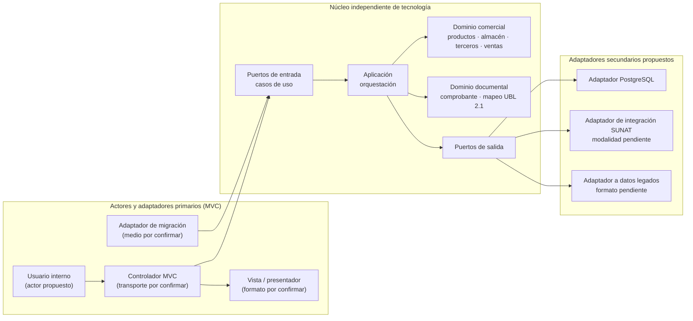
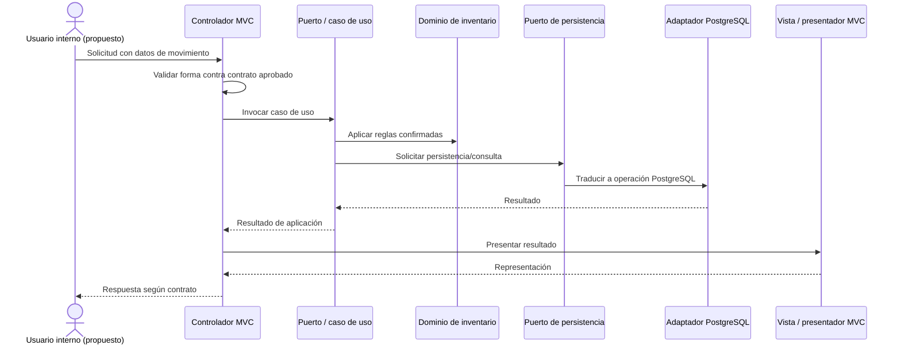
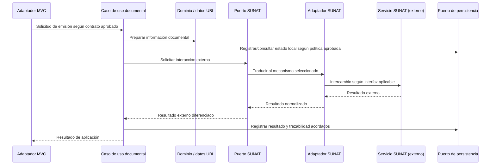

# Arquitectura MVC con perspectiva hexagonal

| Metadato | Valor |
|---|---|
| Proyecto | Examen de Arquitectura de Software |
| Entregable | Arquitectura MVC con visión hexagonal |
| Estado | `DRAFT` — propuesta conceptual; no aprobada para implementación |
| Fuente de alcance | [Análisis de requisitos](../01_Analisis_Requisitos/analisis_requisitos.md) |
| Especificación relacionada | [SPEC-002](../specs/features/002-sistema-comercial-facturacion.md) |
| Persistencia indicada | PostgreSQL |

## 1. Propósito y límites

Esta arquitectura reconcilia el diseño con el alcance del análisis vigente. Expresa únicamente las restricciones arquitectónicas confirmadas y muestra una organización modular candidata; no fija infraestructura, protocolos de integración ni políticas operativas.

El análisis requiere una solución modular basada en MVC y principios hexagonales, PostgreSQL, contratos antes del código y considerar UBL Invoice 2.1 para comprobantes. Se mantienen pendientes la modalidad de SUNAT, los tipos de comprobantes, autenticación/autorización, consistencia transaccional de ventas e inventario, operación de migración, despliegue, rendimiento y disponibilidad.

La versión anterior de este documento presentaba como decisiones aprobadas SOAP, XMLDSig, OSE, Outbox, POS/crédito, reservas, costo promedio, cálculos tributarios específicos, esquemas, nombres de implementación y topología. Ninguna de esas decisiones se confirma en el análisis vigente; por ello no forma parte del diseño aprobado ni de los diagramas de esta versión. Pueden evaluarse en ADR cuando exista información suficiente.

## 2. Restricciones expresas y decisiones de diseño

| Elemento | Clasificación | Tratamiento arquitectónico |
|---|---|---|
| MVC | Expreso (`RNF-ARQ-001`) | Patrón de la frontera de interacción; el framework y las vistas concretas están pendientes. |
| Principios de arquitectura hexagonal | Expreso (`RNF-ARQ-001`) | Separar puertos/adaptadores del núcleo; la división específica en módulos es propuesta. |
| PostgreSQL | Expreso (`RNF-TEC-001`) | Adaptador de persistencia propuesto; versión, topología y estrategia de transacción pendientes. |
| Definir contratos antes de implementar | Expreso (`RNF-SDD-001`) | DTOs y API permanecen en `DRAFT`; no se modelan aquí como implementación. |
| UBL Invoice 2.1 | Expreso (`RNF-DOC-001`) | Consideración para el modelo documental; no demuestra cumplimiento del perfil SUNAT. |
| Servicios SUNAT | Expreso (`RF-SUN-001`) | Puerto de salida conceptual; SEE, protocolo, proveedor y respuestas están pendientes. |
| Adaptador de migración | Necesidad expresa (`RF-MIG-001`) | Puerto/flujo conceptual sujeto a definir fuente y proceso legado. |
| Módulos de dominio y puertos mostrados abajo | Propuesta | Nombres y límites conceptuales para revisión; no constituyen estructura de código aprobada. |
| Autorización, idempotencia, Outbox, colas, firma y reintentos | Pendiente/propuesta según decisión | No se prescribe tecnología ni comportamiento hasta aprobación y validación de requisitos. |

## 3. Articulación de MVC y arquitectura hexagonal

MVC organiza la interacción: el **Controlador** recibe una solicitud y la convierte a un contrato de entrada; el **Modelo** representa el estado y comportamiento del negocio a través de aplicación y dominio; la **Vista/Presentador** transforma el resultado en una representación apropiada para el consumidor. Las entidades de dominio no son las vistas ni las filas de PostgreSQL.

La visión hexagonal organiza dependencias: los consumidores externos entran mediante adaptadores primarios y puertos de entrada; el núcleo de aplicación/dominio no depende de MVC ni de proveedores tecnológicos; los puertos de salida describen capacidades externas y sus adaptadores las conectan con PostgreSQL, SUNAT o la fuente legada. Los protocolos concretos siguen abiertos.

## 4. Vista lógica propuesta

### 4.1 Responsabilidad conceptual

| Área | Responsabilidad propuesta | Requisitos relacionados |
|---|---|---|
| Adaptador MVC | Recibir solicitudes, validar formato externo y presentar respuestas mediante contratos aprobados. | `RNF-ARQ-001`, `RNF-SDD-001` |
| Aplicación | Coordinar casos de uso sin concentrar reglas de negocio en controladores. | `RF-PRO-001`, `RF-INV-001/002`, `RF-COM-001`, `RF-VEN-001`, `RF-CPE-001`, `RF-MIG-001` |
| Dominio comercial | Expresar conceptos de productos, almacenes, movimientos, terceros y ventas, aplicando sólo reglas que se confirmen. | `RF-PRO-001`, `RF-INV-001/002`, `RF-COM-001`, `RF-VEN-001` |
| Dominio documental | Representar información del comprobante y relacionarla con UBL sin acoplar el dominio al transporte SUNAT. | `RF-CPE-001`, `RF-SUN-001`, `RNF-DOC-001` |
| Puerto/adaptador PostgreSQL | Persistir información usando PostgreSQL; el esquema no se define en este entregable. | `RNF-TEC-001`, `RF-TRZ-001` |
| Puerto/adaptador SUNAT | Aislar la integración externa y su resultado, una vez acordado el sistema de emisión aplicable. | `RF-SUN-001`, `RF-CPE-001`, `RF-TRZ-001` |
| Adaptador de migración | Importar desde la fuente legado según un mapeo y una estrategia aún por definir. | `RF-MIG-001`, `RF-VAL-001`, `RF-TRZ-001` |

Los términos de esta tabla son límites lógicos, no una lista aprobada de clases, servicios, endpoints o paquetes. No se presupone que una venta y sus movimientos se guarden en una misma transacción; esa consistencia requiere una decisión de negocio y diseño.

## 5. Contratos y dependencias

La frontera MVC debe recibir y emitir DTOs definidos en los documentos de contratos, no entidades de persistencia. El núcleo depende de abstracciones estables, mientras que los adaptadores traducen entre esas abstracciones y tecnologías externas.

Los contratos actuales de DTO/API siguen en `DRAFT`. La API preliminar propone HTTP/REST, pero esta arquitectura no eleva esa elección a requisito aprobado. Los puertos de salida para SUNAT y legado tampoco fijan operación remota, protocolo, formatos de importación o semántica de reintento.

## 6. Interacciones conceptuales

Los diagramas siguientes muestran límites y responsabilidades, no transacciones, cardinalidades, estados, protocolos ni políticas ya aprobadas.

### 6.1 Registrar y consultar un movimiento

La clasificación de ingresos/salidas, los efectos sobre saldos, los ajustes y la forma de preservar el historial deben concretarse con `RF-INV-002` antes de aprobar el flujo.

### 6.2 Solicitar emisión y comunicarse con SUNAT

No se prescribe envío síncrono o asíncrono, firma, empaquetado, CDR, estados concretos, plazos ni reintentos. La matriz [normativa vigente](../06_Matriz_Trazabilidad_Normativa/marco_normativo_ubl_sunat.md) distingue reglas verificadas, límites de evidencia y pendientes; validar contra XSD no equivale a aceptación de SUNAT.

## 7. Decisiones arquitectónicas pendientes

| Decisión | Opciones que podrían estudiarse | Evidencia/decisión necesaria |
|---|---|---|
| Límite transaccional entre venta e inventario | Una operación atómica, etapas con compensación u otra política | Reglas de venta/stock, concurrencia y reversos aprobadas |
| Modalidad de emisión | SEE aplicable, proveedor autorizado u otra opción pertinente | Alcance empresarial y verificación normativa vigente |
| Comunicación con SUNAT | Síncrona, asíncrona o combinada | Contrato del servicio seleccionado, tolerancia a fallos y experiencia operativa |
| Reintentos e idempotencia | Clave de idempotencia y política de repetición/consulta | Semántica de cada operación y prevención de duplicados |
| Autenticación/autorización | Roles, permisos, identidad y sesiones | Actores, riesgos y política de seguridad aprobada |
| Migración | Lote controlado, importación asistida u otro proceso | Inventario de fuentes, calidad, volumen y criterios de conciliación |
| Trazabilidad | Eventos, historial de cambios o auditoría específica | Datos a preservar, acceso y retención |
| Despliegue/operación | Topología, copias, monitoreo y recuperación | Requisitos de disponibilidad, seguridad, volumen y presupuesto |

Las alternativas no son compromisos ni requisitos. Las decisiones que condicionen módulos o interfaces deben registrarse y aprobarse antes de implementación; las obligaciones legales deben mantenerse separadas de las decisiones internas.

## 8. Brechas y condición de aprobación

- Confirmar actores humanos y permisos; no se establece una matriz de roles en el análisis.
- Precisar ciclos de ventas, inventario, anulaciones/correcciones y consistencia entre ellos.
- Definir alcance documental, SEE y perfil nacional aplicable; verificar normativa y anexos oficiales vigentes.
- Completar DTOs/API necesarios para UBL y respuestas externas, manteniendo separados estados locales y resultados SUNAT.
- Acordar fuente, mapeos, validación, conciliación y trazabilidad de migración.
- Definir requisitos de calidad medibles (seguridad, disponibilidad, rendimiento y operación) si el examen los requiere.

Este documento permanece en `DRAFT`. La arquitectura no se considera aprobada ni autoriza implementación hasta revisión expresa de sus decisiones pendientes.

## 9. Documentos relacionados

- [Análisis de requisitos](../01_Analisis_Requisitos/analisis_requisitos.md)
- [SPEC-002](../specs/features/002-sistema-comercial-facturacion.md)
- [Contratos API](../05_Contratos_API/especificacion_contratos_api.md)
- [Matriz normativa UBL/SUNAT](../06_Matriz_Trazabilidad_Normativa/marco_normativo_ubl_sunat.md)
- [Informe de brechas normativas](../06_Matriz_Trazabilidad_Normativa/informe_brechas_normativas.md)
