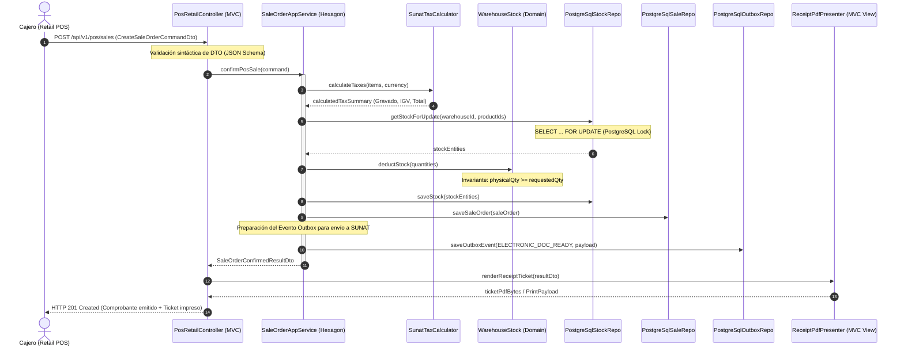
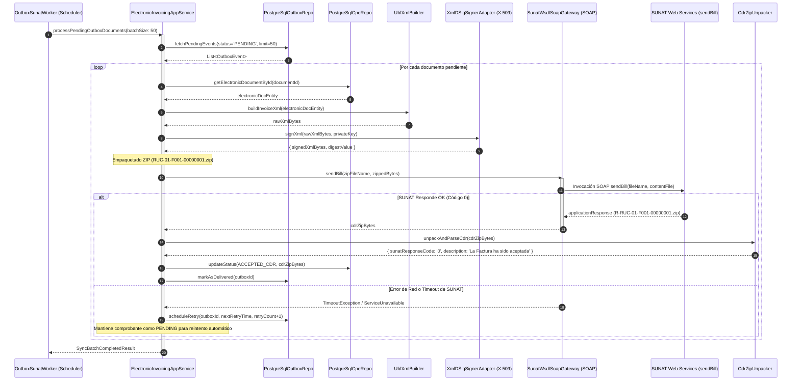
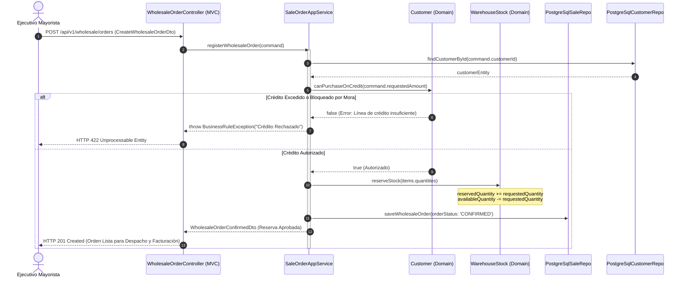
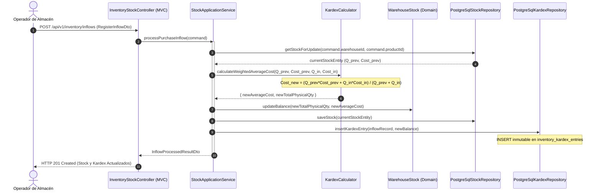
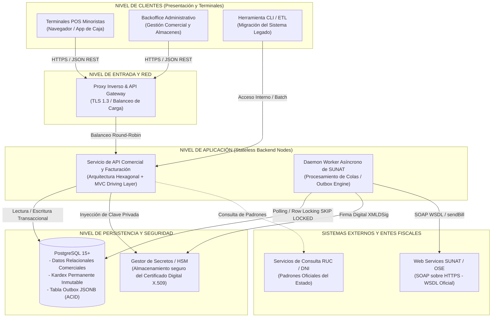

# Diagramas de Arquitectura MVC y Perspectiva Hexagonal

| Metadato | Detalle |
| :--- | :--- |
| **Proyecto / Asignatura** | Examen de Arquitectura de Software |
| **Entregable N° 4** | Diagramas de Arquitectura MVC con Perspectiva Hexagonal |
| **Dominio** | Gestión Comercial, Control de Inventarios y Facturación Electrónica UBL 2.1 |
| **Patrón Arquitectónico** | Arquitectura Hexagonal (Ports & Adapters) articulada con Modelo-Vista-Controlador (MVC) |
| **Persistencia** | PostgreSQL con Patrón Transactional Outbox |
| **Integración Externa** | Web Services SUNAT (SOAP / XMLDSig) |
| **Estado** | `APPROVED SPECIFICATION` (Diseño de Arquitectura y Vistas Dinámicas) |
| **Versión** | 1.0.0 |

---

## Índice de Contenidos

1. [Articulación Conceptual: Fusión del Patrón MVC y la Arquitectura Hexagonal](#1-articulación-conceptual-fusión-del-patrón-mvc-y-la-arquitectura-hexagonal)
2. [Vista Macro-Arquitectónica: El Hexágono de Capas y Dependencias](#2-vista-macro-arquitectónica-el-hexágono-de-capas-y-dependencias)
3. [Estructura Modular de Paquetes del Sistema](#3-estructura-modular-de-paquetes-del-sistema)
4. [Diagramas de Secuencia Dinámica (Flujos Clave End-to-End)](#4-diagramas-de-secuencia-dinámica)
   - 4.1. Flujo A: Venta Minorista en Punto de Venta (POS) y Emisión de Boleta
   - 4.2. Flujo B: Despacho Asíncrono a SUNAT y Procesamiento de CDR (Transactional Outbox)
   - 4.3. Flujo C: Venta Mayorista a Crédito con Reserva Multialmacén
   - 4.4. Flujo D: Registro de Entrada de Stock y Recálculo del Kardex Valorizado
5. [Diagrama de Contenedores y Despliegue Físico (Modelo C4)](#5-diagrama-de-contenedores-y-despliegue-físico)
6. [Matriz de Decisión y Principio de Inversión de Dependencias (DIP)](#6-matriz-de-decisión-y-principio-de-inversión-de-dependencias)

---

## 1. Articulación Conceptual: Fusión del Patrón MVC y la Arquitectura Hexagonal

Uno de los principales desafíos en el diseño de sistemas empresariales radica en reconciliar el patrón clásico **Modelo-Vista-Controlador (MVC)** con los principios de la **Arquitectura Hexagonal (Puertos y Adaptadores / Clean Architecture)**. 

En arquitecturas tradicionales acopladas, el "Modelo" del MVC suele confundirse con las entidades de la base de datos (ActiveRecord u ORM directo), lo cual genera fuga de lógica de negocio hacia controladores o vistas y hace imposible probar la lógica tributaria o de inventario sin levantar una base de datos o un servidor HTTP.

### Enfoque de Diseño Adoptado:
* **El patrón MVC se ubica exclusivamente en la frontera exterior como Adaptador Primario (Driving Adapter)**:
  * **Controlador (Controller)**: Recibe los estímulos externos (solicitudes HTTP/REST o acciones del operador en el POS), valida la sintaxis del payload (DTO de entrada) y traduce la petición en comandos de aplicación para invocar un **Puerto Primario (Inbound Port)**.
  * **Vista / Presentador (View / Presenter)**: Toma los DTOs de respuesta o eventos emitidos por el dominio y los formatea según el medio receptor (respuestas JSON REST, plantillas HTML para interfaces de gestión o PDFs para impresión de comprobantes en caja).
  * **Modelo (Model)**: **No es una tabla de base de datos**. El "Modelo" desde la perspectiva del MVC corresponde a la totalidad del **Núcleo Hexagonal** (Servicios de Aplicación, Agregados del Dominio, Reglas Tributarias de SUNAT y Motores de Kardex).
* **Los Puertos y Adaptadores garantizan la Inversión de Dependencias**:
  * El Núcleo de Dominio no conoce la existencia del framework web (Express, Nest, Spring o ASP.NET), ni la tecnología de base de datos (PostgreSQL), ni el protocolo de transporte hacia SUNAT (SOAP).
  * Toda comunicación hacia infraestructura externa (PostgreSQL, Firma Digital X.509, Web Service SUNAT) se realiza a través de **Puertos Secundarios (Outbound Ports)** implementados por **Adaptadores Secundarios (Driven Adapters)**.

---

## 2. Vista Macro-Arquitectónica: El Hexágono de Capas y Dependencias

El siguiente diagrama ilustra la separación estricta en capas concéntricas, donde la dirección de las dependencias apunta **invariablemente hacia el centro** (Núcleo de Dominio):

```mermaid
flowchart TD
    subgraph DrivingAdaptersLayer["CAPA DE ADAPTADORES PRIMARIOS (Driving Adapters - MVC Exterior)"]
        POS_CTRL["PosRetailController\n(REST Controller)"]
        ORDER_CTRL["WholesaleOrderController\n(REST Controller)"]
        STOCK_CTRL["InventoryStockController\n(REST Controller)"]
        CPE_CTRL["ElectronicBillingController\n(REST Controller)"]
        MIG_CLI["MigrationCliAdapter\n(Consola / ETL)"]
        OUTBOX_JOB["OutboxWorkerScheduler\n(Cron Job / Daemon)"]
        VIEW_JSON["JsonViewPresenter\n(Formateador DTO API)"]
        VIEW_PDF["TicketPdfPresenter\n(Renderizador Ticket/A4)"]
    end

    subgraph PortsInLayer["PUERTOS PRIMARIOS (Inbound Ports / Use Case Interfaces)"]
        P_IN_SALE["SaleOrderServicePort"]
        P_IN_STOCK["StockManagementServicePort"]
        P_IN_CPE["ElectronicInvoicingServicePort"]
        P_IN_MIG["DataMigrationServicePort"]
    end

    subgraph HexagonalCore["NÚCLEO DEL DOMINIO (Domain & Application Core)"]
        subgraph AppServices["Servicios de Aplicación"]
            APP_SALE["SaleOrderApplicationService"]
            APP_STOCK["StockApplicationService"]
            APP_CPE["ElectronicInvoicingApplicationService"]
            APP_MIG["DataMigrationApplicationService"]
        end

        subgraph DomainModels["Modelo de Dominio Puro (Sin dependencias externas)"]
            AGG_PROD["Product (Aggregate Root)"]
            AGG_STOCK["WarehouseStock (Aggregate Root)"]
            AGG_SALE["SaleOrder (Aggregate Root)"]
            AGG_CPE["ElectronicDocument (Aggregate Root)"]
            AGG_CUST["Customer (Aggregate Root)"]
            
            VO_KARDEX["KardexCalculator\n(Costo Promedio Ponderado)"]
            VO_TAX["SunatTaxCalculator\n(IGV 18%, Exon, Inaf, ICBPER)"]
            VO_UBL["UblXmlBuilder\n(OASIS UBL 2.1 Engine)"]
        end
    end

    subgraph PortsOutLayer["PUERTOS SECUNDARIOS (Outbound Ports / Infrastructure Interfaces)"]
        P_OUT_SALE_REPO["SaleOrderRepositoryPort"]
        P_OUT_STOCK_REPO["StockRepositoryPort"]
        P_OUT_CPE_REPO["ElectronicDocumentRepositoryPort"]
        P_OUT_OUTBOX_REPO["OutboxRepositoryPort"]
        P_OUT_SIGN["XmlDigitalSignerPort"]
        P_OUT_SUNAT["SunatGatewayPort"]
    end

    subgraph DrivenAdaptersLayer["CAPA DE ADAPTADORES SECUNDARIOS (Driven Adapters - Infraestructura)"]
        ADAPT_PG_SALE["PostgreSqlSaleRepository"]
        ADAPT_PG_STOCK["PostgreSqlStockRepository"]
        ADAPT_PG_CPE["PostgreSqlCpeRepository"]
        ADAPT_PG_OUTBOX["PostgreSqlOutboxRepository"]
        ADAPT_SIGN_X509["BouncyCastleXmlDSigAdapter\n(Certificado X.509)"]
        ADAPT_SOAP_SUNAT["SunatWsdlSoapAdapter\n(sendBill / getStatus)"]
    end

    %% Flujo de Dependencias Primarias
    POS_CTRL --> P_IN_SALE
    ORDER_CTRL --> P_IN_SALE
    STOCK_CTRL --> P_IN_STOCK
    CPE_CTRL --> P_IN_CPE
    MIG_CLI --> P_IN_MIG
    OUTBOX_JOB --> P_IN_CPE

    P_IN_SALE -.-> APP_SALE
    P_IN_STOCK -.-> APP_STOCK
    P_IN_CPE -.-> APP_CPE
    P_IN_MIG -.-> APP_MIG

    APP_SALE --> AGG_SALE
    APP_SALE --> VO_TAX
    APP_STOCK --> AGG_STOCK
    APP_STOCK --> VO_KARDEX
    APP_CPE --> AGG_CPE
    APP_CPE --> VO_UBL

    %% Flujo de Dependencias Secundarias
    APP_SALE --> P_OUT_SALE_REPO
    APP_SALE --> P_OUT_STOCK_REPO
    APP_STOCK --> P_OUT_STOCK_REPO
    APP_CPE --> P_OUT_CPE_REPO
    APP_CPE --> P_OUT_OUTBOX_REPO
    APP_CPE --> P_OUT_SIGN
    APP_CPE --> P_OUT_SUNAT

    P_OUT_SALE_REPO -.-> ADAPT_PG_SALE
    P_OUT_STOCK_REPO -.-> ADAPT_PG_STOCK
    P_OUT_CPE_REPO -.-> ADAPT_PG_CPE
    P_OUT_OUTBOX_REPO -.-> ADAPT_PG_OUTBOX
    P_OUT_SIGN -.-> ADAPT_SIGN_X509
    P_OUT_SUNAT -.-> ADAPT_SOAP_SUNAT

    POS_CTRL -.-> VIEW_JSON
    POS_CTRL -.-> VIEW_PDF
```



---

## 3. Estructura Modular de Paquetes del Sistema

Para materializar este diseño arquitectónico en la implementación, se establece la siguiente distribución formal de directorios y paquetes, orientada a mantener la pureza del dominio y la intercambiabilidad de adaptadores:

```text
src/
├── domain/                               # Núcleo puro (Agnóstico a frameworks y bases de datos)
│   ├── model/
│   │   ├── catalog/                      # Product, Sku, Barcode, PriceTier, UnitOfMeasure
│   │   ├── inventory/                    # Warehouse, WarehouseStock, InventoryBatch, KardexEntry
│   │   ├── directory/                    # Customer, Supplier, IdentityDocument, CreditProfile
│   │   ├── sales/                        # SaleOrder, SaleOrderItem, SalesChannel, PaymentCondition
│   │   └── billing/                      # ElectronicDocument, UblDocumentLine, CdrResult, TaxSummary
│   ├── services/                         # Servicios de Dominio (Cálculos complejos y sin estado)
│   │   ├── KardexCalculator.ts           # Algoritmo de Costo Promedio Ponderado
│   │   ├── SunatTaxCalculator.ts         # Cálculo oficial de IGV, bases imponibles e ICBPER
│   │   └── UblXmlBuilder.ts              # Serializador estructurado OASIS UBL 2.1
│   └── events/                           # Eventos de dominio (SaleConfirmed, StockDeducted, CpeIssued)
│
├── application/                          # Orquestación de Casos de Uso
│   ├── ports/
│   │   ├── in/                           # Interfaces de Casos de Uso (Puertos Primarios)
│   │   │   ├── SaleOrderServicePort.ts
│   │   │   ├── StockManagementServicePort.ts
│   │   │   ├── ElectronicInvoicingServicePort.ts
│   │   │   └── DataMigrationServicePort.ts
│   │   └── out/                          # Interfaces de Infraestructura (Puertos Secundarios)
│   │       ├── SaleOrderRepositoryPort.ts
│   │       ├── StockRepositoryPort.ts
│   │       ├── ElectronicDocumentRepositoryPort.ts
│   │       ├── OutboxRepositoryPort.ts
│   │       ├── XmlDigitalSignerPort.ts
│   │       └── SunatGatewayPort.ts
│   └── services/                         # Implementación de Casos de Uso
│       ├── SaleOrderApplicationService.ts
│       ├── StockApplicationService.ts
│       ├── ElectronicInvoicingApplicationService.ts
│       └── DataMigrationApplicationService.ts
│
└── infrastructure/                       # Adaptadores Tecnológicos (Detalles de implementación)
    ├── adapters/
    │   ├── in/                           # Adaptadores Primarios (MVC Driving Layer)
    │   │   ├── web/                      # Controladores REST API / HTTP
    │   │   │   ├── PosRetailController.ts
    │   │   │   ├── WholesaleOrderController.ts
    │   │   │   ├── InventoryStockController.ts
    │   │   │   └── ElectronicBillingController.ts
    │   │   ├── presenters/               # Vistas y Formateadores (MVC Views)
    │   │   │   ├── JsonApiResponsePresenter.ts
    │   │   │   └── ReceiptPdfGeneratorPresenter.ts
    │   │   ├── cli/                      # Adaptador Consola para ETL de Migración
    │   │   │   └── LegacyDataMigrationCli.ts
    │   │   └── schedulers/               # Daemons de ejecución periódica
    │   │       └── OutboxSunatWorker.ts  # Despachador asíncrono a SUNAT
    │   │
    │   └── out/                          # Adaptadores Secundarios (Driven Layer)
    │       ├── persistence/              # Repositorios PostgreSQL
    │       │   ├── schema/               # DDLs y migraciones SQL
    │       │   ├── PostgreSqlSaleRepository.ts
    │       │   ├── PostgreSqlStockRepository.ts
    │       │   ├── PostgreSqlCpeRepository.ts
    │       │   └── PostgreSqlOutboxRepository.ts
    │       ├── cryptography/             # Firma Digital XMLDSig X.509
    │       │   └── XmlDSigSignerAdapter.ts
    │       └── sunat/                    # Cliente Web Service SOAP WSDL
    │           ├── SunatWsdlSoapGateway.ts
    │           └── CdrZipUnpacker.ts
```

---

## 4. Diagramas de Secuencia Dinámica

Los siguientes diagramas detallan la interacción entre los controladores MVC, los casos de uso hexagonales, las entidades de dominio y los adaptadores de persistencia y servicios externos.

---

### 4.1. Flujo A: Venta Minorista en Punto de Venta (POS) y Emisión de Boleta

Representa una transacción de alta velocidad en mostrador. La venta y la emisión fiscal local se confirman de forma síncrona en milisegundos, desacoplando el envío a SUNAT mediante el patrón Outbox para no bloquear la atención al cliente:



---

### 4.2. Flujo B: Despacho Asíncrono a SUNAT y Procesamiento de CDR (Transactional Outbox)

Proceso en segundo plano ejecutado por el worker de contingencia y sincronización fiscal. Garantiza el cumplimiento de los plazos de la SUNAT con reintentos exponenciales e idempotencia:



---

### 4.3. Flujo C: Venta Mayorista a Crédito con Reserva Multialmacén

Muestra el flujo comercial corporativo: verificación de solvencia crediticia del cliente mayorista, reserva temporal de mercancía en el almacén central y facturación formal con detalle de cuotas de crédito conforme a la RS 193-2020/SUNAT:



---

### 4.4. Flujo D: Registro de Entrada de Stock y Recálculo del Kardex Valorizado

Ilustra la recepción física de mercadería de proveedores mayoristas con recálculo dinámico de la fórmula del Costo Promedio Ponderado y persistencia en el Kardex permanente de PostgreSQL:



---

## 5. Diagrama de Contenedores y Despliegue Físico (Modelo C4)

El siguiente diagrama formaliza la infraestructura física, los límites de contenedores y los protocolos de red utilizados para garantizar alta concurrencia, tolerancia a fallos y cumplimiento tributario:



---

## 6. Matriz de Decisión y Principio de Inversión de Dependencias (DIP)

Para verificar formalmente la conformidad con la regla de oro de la Arquitectura Hexagonal y Spec-First, se documentan las decisiones técnicas adoptadas:

| Componente | Capa Arquitectónica | Responsabilidad | ¿Depende de Infraestructura? | Mecanismo de Desacoplamiento |
| :--- | :--- | :--- | :--- | :--- |
| **`PosRetailController`** | Adaptador Primario (MVC) | Recibir HTTP, validar JSON y renderizar respuesta. | Sí (HTTP Framework). | Depende únicamente del puerto `SaleOrderServicePort`. |
| **`SaleOrderApplicationService`** | Casos de Uso (Aplicación) | Orquestar transacciones, transaccionalidad ACID y reglas de venta. | **No**. | Implementa puerto primario e invoca puertos secundarios tipados. |
| **`KardexCalculator`** | Dominio Puro | Ejecutar fórmula matemática de Costo Promedio Ponderado. | **No**. | Funciones puras sin estado ni dependencias externas. |
| **`SunatTaxCalculator`** | Dominio Puro | Liquidar IGV, bases imponibles y redondeos fiscales peruanos. | **No**. | Reglas matemáticas sustentadas en tablas del dominio. |
| **`PostgreSqlStockRepository`**| Adaptador Secundario | Ejecutar sentencias SQL, manejar bloqueos de filas y transacciones. | Sí (Driver PostgreSQL). | Implementa `StockRepositoryPort`; el dominio desconoce la sintaxis SQL. |
| **`SunatWsdlSoapGateway`** | Adaptador Secundario | Construir envelopes SOAP, gestionar transporte HTTPS y reintentos. | Sí (Librería SOAP). | Implementa `SunatGatewayPort`; el dominio desconoce que la comunicación es SOAP. |
| **`XmlDSigSignerAdapter`** | Adaptador Secundario | Aplicar firma digital X.509 al documento UBL 2.1. | Sí (Librería criptográfica).| Implementa `XmlDigitalSignerPort`. |

### Justificación del Desacoplamiento de SUNAT
Los servicios tributarios de la SUNAT presentan históricamente ventanas de intermitencia, mantenimiento dominical y latencias variables. Al estructurar la integración mediante el patrón **Transactional Outbox**:
1. La venta comercial y la emisión local del comprobante se completan en menos de 1 segundo en la base de datos PostgreSQL con certeza ACID.
2. El cliente y el almacén reciben su comprobante y ticket de despacho de inmediato.
3. El proceso de fondo (`OutboxSunatWorker`) gestiona la firma y el envío a la SUNAT de forma asíncrona, absorbiendo cualquier fallo o reintento sin congelar la caja registradora ni la línea de despacho de abarrotes.
