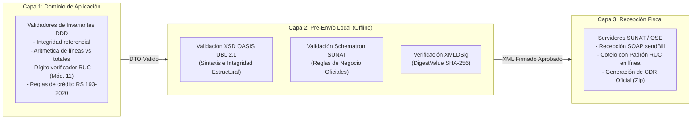

# Matriz de Trazabilidad Regulatoria: Requisitos, UBL 2.1 y Reglas SUNAT

| Metadato | Detalle |
| :--- | :--- |
| **Proyecto / Asignatura** | Examen de Arquitectura de Software |
| **Entregable N° 4** | Matriz de Trazabilidad Regulatoria (Requisitos $\leftrightarrow$ UBL 2.1 $\leftrightarrow$ SUNAT) |
| **Dominio** | Facturación Electrónica y Control Comercial/Inventarios de Abarrotes |
| **Marco Tributario** | SUNAT (Perú) - Sistema de Emisión Electrónica (SEE) |
| **Estándar Internacional** | OASIS Universal Business Language (UBL) versión 2.1 |
| **Normativa Legal Clave** | RS 097-2012/SUNAT, RS 117-2017/SUNAT, RS 193-2020/SUNAT, RS 000003-2023/SUNAT |
| **Estado** | `APPROVED SPECIFICATION` (Referencia Regulatoria Oficial del Sistema) |
| **Versión** | 1.0.0 |

---

## Índice de Contenidos

1. [Marco Normativo y Catálogos Oficiales de la SUNAT](#1-marco-normativo-y-catálogos-oficiales-de-la-sunat)
2. [Estrategia de Validación en Tres Capas (Defensa en Profundidad)](#2-estrategia-de-validación-en-tres-capas)
3. [Matriz Maestra de Trazabilidad Regulatoria](#3-matriz-maestra-de-trazabilidad-regulatoria)
   - 3.1. Datos de Cabecera y Metadatos del Comprobante
   - 3.2. Datos del Emisor y Establecimiento Comercial
   - 3.3. Datos del Adquirente y Validación de Identidad
   - 3.4. Condiciones de Pago y Crédito Comercial (RS 193-2020)
   - 3.5. Líneas de Detalle, Unidades de Medida y Catálogos
   - 3.6. Desglose de Tributos e Impuesto General a las Ventas (IGV)
   - 3.7. Totales Monetarios y Valor de Venta
   - 3.8. Firma Digital, Hash SHA-256 y Seguridad Criptográfica
4. [Catálogo de Códigos de Rechazo SUNAT y Estrategias de Mitigación](#4-catálogo-de-códigos-de-rechazo-sunat)
5. [Trazabilidad de Documentos de Referencia: Notas de Crédito y Débito](#5-trazabilidad-de-documentos-de-referencia)
6. [Protocolo de Verificación e Inspección de Auditoría Fiscal](#6-protocolo-de-verificación-e-inspección-de-auditoría-fiscal)

---

## 1. Marco Normativo y Catálogos Oficiales de la SUNAT

El presente diseño arquitectónico se fundamenta y cumple estrictamente con el cuerpo normativo tributario peruano vigente:

* **Resolución de Superintendencia N° 097-2012/SUNAT** y modificatorias: Crea el Sistema de Emisión Electrónica desarrollado desde los sistemas del contribuyente (SEE-Del Contribuyente).
* **Resolución de Superintendencia N° 117-2017/SUNAT**: Establece la adopción obligatoria del estándar **OASIS UBL versión 2.1** para los Comprobantes de Pago Electrónicos (CPE).
* **Resolución de Superintendencia N° 193-2020/SUNAT**: Regula la información obligatoria que debe consignarse respecto a la forma de pago (Contado o Crédito) y el desglose de cuotas pendientes con fechas de vencimiento en Facturas Electrónicas y Recibos por Honorarios.
* **Resolución de Superintendencia N° 000003-2023/SUNAT** (y modificatoria de la RS 150-2021): Fija el plazo legal máximo de envío a la SUNAT o al OSE de hasta **3 días calendario**, computados desde el día siguiente a la fecha de emisión del comprobante.
* **Texto Único Ordenado de la Ley del Impuesto General a las Ventas (IGV)** - D.S. N° 055-99-EF: Establece la tasa del 18%, las operaciones gravadas, inafectas y exoneradas (Apéndice I de abarrotes de primera necesidad).
* **Ley N° 30884 y D.S. N° 244-2019-EF**: Regula el Impuesto al Consumo de las Bolsas de Plástico (ICBPER).

### Catálogos Oficiales SUNAT Empleados en la Arquitectura

| N° Catálogo | Denominación Oficial de la SUNAT |
| :--- | :--- |
| **Catálogo N° 01** | Código de Tipo de Documento (Comprobantes de Pago). |
| **Catálogo N° 02** | Código de Tipo de Moneda. |
| **Catálogo N° 03** | Código de Tipo de Unidad de Medida Comercial. |
| **Catálogo N° 05** | Códigos de Tipos de Tributos. |
| **Catálogo N° 06** | Códigos de Tipos de Documentos de Identidad. |
| **Catálogo N° 07** | Códigos de Tipos de Afectación al IGV. |
| **Catálogo N° 09** | Códigos de Tipos de Nota de Crédito Electrónica. |
| **Catálogo N° 10** | Códigos de Tipos de Nota de Débito Electrónica. |
| **Catálogo N° 12** | Códigos de Tipos de Operación para el Registro del Kardex. |
| **Catálogo N° 16** | Códigos de Tipo de Precio de Venta Unitario. |
| **Catálogo N° 19** | Códigos de Estado de Establecimientos Anexos del Domicilio Fiscal. |
| **Catálogo N° 25** | Códigos de Productos y Servicios (Segmento / Familia basado en UNSPSC). |
| **Catálogo N° 51** | Códigos de Tipo de Operación de Venta. |
| **Catálogo N° 53** | Códigos de Cargos o Descuentos que no afectan la Base Imponible del IGV. |

---

## 2. Estrategia de Validación en Tres Capas (Defensa en Profundidad)

Para garantizar un 0% de rechazos en los servidores de la SUNAT, el sistema implementa una arquitectura de validación escalonada:

1. **Capa 1: Validaciones de Negocio en el Dominio**: Valida antes de persistir la transacción en PostgreSQL (consistencia de stock, coherencia de bases imponibles, fechas de vencimiento de cuotas).
2. **Capa 2: Validación Estructural y Schematron Local**: Antes de enviar el ZIP a SUNAT, el adaptador secundario valida el XML contra los esquemas oficiales `.xsd` de OASIS y las reglas Schematron `.sch` de SUNAT. Si falla localmente, el documento no se transmite y se registra el error de construcción.
3. **Capa 3: Validación Remota en los Servidores de SUNAT / OSE**: Procesa la respuesta oficial del Web Service y persiste el CDR binario como prueba legal inmutable.

---

## 3. Matriz Maestra de Trazabilidad Regulatoria

La siguiente matriz vincula de forma exhaustiva cada requerimiento funcional del sistema con su base legal, catálogo de SUNAT, ruta XPath en el estándar UBL 2.1, regla de validación Schematron y código de rechazo oficial:

---

### 3.1. Datos de Cabecera y Metadatos del Comprobante

| Requerimiento | Base Legal SUNAT | Catálogo | Elemento XML / XPath OASIS UBL 2.1 | Regla Schematron SUNAT | Código Rechazo SUNAT | Mecanismo de Mitigación en el Sistema |
| :--- | :--- | :--- | :--- | :--- | :--- | :--- |
| **`RF-CPE-001`** (Factura) / **`RF-CPE-002`** (Boleta) | RS 097-2012 / RS 117-2017 | **Cat. 01** | `/Invoice/cbc:InvoiceTypeCode` | `cbc:InvoiceTypeCode in ('01', '03')` | **Rechazo 1063**: Código de documento tributario inválido. | Validación por Enum en `SunatDocumentType` del dominio. |
| **`RF-CPE-001`** (Versión UBL) | RS 117-2017 | N/A | `/Invoice/cbc:UBLVersionID` | `cbc:UBLVersionID = '2.1'` | **Rechazo 2115**: La versión del UBL no es la correcta. | Constante estricta `'2.1'` en el serializador `UblXmlBuilder`. |
| **`RF-CPE-001`** (Personalización) | RS 097-2012 | N/A | `/Invoice/cbc:CustomizationID` | `cbc:CustomizationID = '2.0'` | **Rechazo 2116**: El CustomizationID no es válido. | Constante estricta `'2.0'` requerida por SUNAT para UBL 2.1. |
| **`RN-02`** (Serie y Correlativo) | RS 097-2012 | Regla Formato | `/Invoice/cbc:ID` | `matches(cbc:ID, '^[F|B][A-Z0-9]{3}-[0-9]{1,8}$')` | **Rechazo 1056**: La serie o el correlativo no cumple con el formato. | Expresión regular en el Value Object `DocumentSeries` y correlativo autoincremental de 8 dígitos. |
| **`RN-04`** (Plazo legal de envío) | RS 193-2020 / RS 000003-2023 | N/A | `/Invoice/cbc:IssueDate` | `current-date() - cbc:IssueDate <= 3 días` | **Rechazo 2118**: La fecha de emisión supera el plazo máximo legal permitido. | Control del Outbox Worker que prioriza comprobantes próximos a cumplir 72 horas y alerta al contador (`ACT-06`). |
| **`RF-VEN-003`** (Moneda) | RS 097-2012 | **Cat. 02** | `/Invoice/cbc:DocumentCurrencyCode` | `cbc:DocumentCurrencyCode in ('PEN', 'USD')` | **Rechazo 2072**: El código de moneda no corresponde a las tablas oficiales. | Validación de divisa ISO 4217 en el Value Object `CurrencyCode`. |

---

### 3.2. Datos del Emisor y Establecimiento Comercial

| Requerimiento | Base Legal SUNAT | Catálogo | Elemento XML / XPath OASIS UBL 2.1 | Regla Schematron SUNAT | Código Rechazo SUNAT | Mecanismo de Mitigación en el Sistema |
| :--- | :--- | :--- | :--- | :--- | :--- | :--- |
| **`RF-CPE-001`** (RUC Emisor) | RS 097-2012 | **Cat. 06** | `/Invoice/cac:AccountingSupplierParty/cac:Party/cac:PartyIdentification/cbc:ID` | `cbc:ID/@schemeID = '6' and string-length(.) = 11` | **Rechazo 1034**: El RUC del emisor no existe o no está activo en el padrón. | Constante de configuración empresarial validada contra padrón oficial de SUNAT. |
| **`RF-CPE-001`** (Razón Social Emisor) | RS 097-2012 | N/A | `/Invoice/cac:AccountingSupplierParty/cac:Party/cac:PartyLegalEntity/cbc:RegistrationName` | `string-length(normalize-space(.)) > 0` | **Rechazo 2229**: Falta consignar la razón social del emisor. | Campo obligatorio no nulo en la entidad `EmitterProfile`. |
| **`RF-ALM-001`** (Establecimiento Anexo) | RS 097-2012 | **Cat. 19** | `/Invoice/cac:AccountingSupplierParty/cac:Party/cac:PostalAddress/cbc:AddressTypeCode` | `matches(., '^[0-9]{4}$')` | **Rechazo 2883**: Código de establecimiento anexo del emisor no es válido. | Código de 4 dígitos configurado en la tabla `inventory_warehouses` (ej. `0000` para almacén principal). |

---

### 3.3. Datos del Adquirente y Validación de Identidad

| Requerimiento | Base Legal SUNAT | Catálogo | Elemento XML / XPath OASIS UBL 2.1 | Regla Schematron SUNAT | Código Rechazo SUNAT | Mecanismo de Mitigación en el Sistema |
| :--- | :--- | :--- | :--- | :--- | :--- | :--- |
| **`RN-03`** (Receptor en Facturas) | RS 097-2012 | **Cat. 06** | `/Invoice/cac:AccountingCustomerParty/cac:Party/cac:PartyIdentification/cbc:ID/@schemeID` | `if (cbc:InvoiceTypeCode = '01') then (@schemeID = '6')` | **Rechazo 2022**: Para emitir una Factura el adquirente debe poseer obligatoriamente RUC. | El caso de uso `IssueElectronicInvoiceUseCase` lanza excepción si se solicita factura para un cliente sin RUC. |
| **`RN-03`** (Boletas $\ge$ S/ 700) | RS 097-2012 | **Cat. 06** | `/Invoice/cac:AccountingCustomerParty/cac:Party/cac:PartyIdentification/cbc:ID` | `if (cbc:InvoiceTypeCode = '03' and PayableAmount >= 700) then (string-length(.) > 0)` | **Rechazo 2014**: En Boletas de Venta iguales o mayores a 700 Soles se debe identificar al adquirente. | Validación obligatoria en el Controlador del POS minorista: bloquea el cobro si el total es $\ge 700$ y no se ingresó DNI/CE. |
| **`RF-DIR-001`** (Algoritmo RUC) | Art. 174 Código Tributario | **Cat. 06** | `/Invoice/cac:AccountingCustomerParty/cac:Party/cac:PartyIdentification/cbc:ID` | Validación algorítmica Módulo 11 (factores 5,4,3,2,7,6,5,4,3,2). | **Rechazo 2021**: El número de RUC no supera la validación aritmética oficial. | Algoritmo formal de verificación Módulo 11 implementado en el Value Object `IdentityDocument`. |

---

### 3.4. Condiciones de Pago y Crédito Comercial (RS 193-2020)

| Requerimiento | Base Legal SUNAT | Catálogo | Elemento XML / XPath OASIS UBL 2.1 | Regla Schematron SUNAT | Código Rechazo SUNAT | Mecanismo de Mitigación en el Sistema |
| :--- | :--- | :--- | :--- | :--- | :--- | :--- |
| **`RF-CPE-001`** (Forma de Pago) | RS 193-2020 | N/A | `/Invoice/cac:PaymentTerms[cbc:ID='FormaPago']/cbc:PaymentMeansID` | `cbc:PaymentMeansID in ('Contado', 'Credito')` | **Rechazo 2750**: Falta consignar la forma de pago (Contado o Crédito). | Tag obligatorio generado en `UblXmlBuilder` derivado de `SaleOrder.paymentCondition`. |
| **`RF-VEN-002`** (Monto Neto Crédito) | RS 193-2020 | N/A | `/Invoice/cac:PaymentTerms[cbc:ID='FormaPago']/cbc:Amount` | `if (PaymentMeansID = 'Credito') then (cbc:Amount > 0)` | **Rechazo 2751**: En operaciones a crédito, el monto neto pendiente de pago es obligatorio. | Cálculo automático del saldo pendiente tras restar cuotas iniciales o anticipos. |
| **`RF-VEN-002`** (Desglose de Cuotas) | RS 193-2020 | N/A | `/Invoice/cac:PaymentTerms[starts-with(cbc:ID, 'Cuota')]/cbc:Amount` y `cbc:PaymentDueDate` | `sum(Cuotas/Amount) = PaymentTerms[FormaPago]/Amount` | **Rechazo 2752**: La sumatoria de las cuotas a crédito no coincide con el monto neto pendiente de pago. | Validación aritmética exacta: $\sum \text{Cuotas} = \text{MontoNetoCredito}$ previo a la generación del XML. |
| **`RF-VEN-002`** (Vencimiento Cuotas) | RS 193-2020 | N/A | `/Invoice/cac:PaymentTerms[starts-with(cbc:ID, 'Cuota')]/cbc:PaymentDueDate` | `cbc:PaymentDueDate > /Invoice/cbc:IssueDate` | **Rechazo 2753**: La fecha de vencimiento de la cuota no puede ser anterior ni igual a la fecha de emisión. | Invariante en el agregado `PaymentTerms`: `dueDate` debe ser posterior a `issueDate`. |

---

### 3.5. Líneas de Detalle, Unidades de Medida y Catálogos

| Requerimiento | Base Legal SUNAT | Catálogo | Elemento XML / XPath OASIS UBL 2.1 | Regla Schematron SUNAT | Código Rechazo SUNAT | Mecanismo de Mitigación en el Sistema |
| :--- | :--- | :--- | :--- | :--- | :--- | :--- |
| **`RF-CAT-003`** (Unidad de Medida) | RS 097-2012 | **Cat. 03** | `/Invoice/cac:InvoiceLine/cbc:InvoicedQuantity/@unitCode` | `unitCode in ('NIU', 'KGM', 'BX', 'PK', ...)` | **Rechazo 2054**: Unidad de medida comercial no existe en el Catálogo N° 03. | Forzado mediante clave foránea y enum restringido en `catalog_products.unit_of_measure`. |
| **`RF-CAT-005`** (Código UNSPSC) | RS 097-2012 | **Cat. 25** | `/Invoice/cac:InvoiceLine/cac:Item/cac:CommodityClassification/cbc:ItemClassificationCode` | `string-length(.) = 8 and @listID = 'UNSPSC'` | **Rechazo 2707**: El código de producto SUNAT no cumple con la estructura requerida. | Validación de 8 dígitos numéricos si el producto tiene asignado código SUNAT. |
| **`RF-CAT-002`** (Precio Unitario) | RS 097-2012 | **Cat. 16** | `/Invoice/cac:InvoiceLine/cac:PricingReference/cac:AlternativeConditionPrice/cbc:PriceTypeCode` | `cbc:PriceTypeCode = '01'` (Precio unitario incluye tributos). | **Rechazo 2057**: El código de tipo de precio no es válido. | Se genera automáticamente con valor fijo `'01'` conforme a la normativa comercial minorista/mayorista. |

---

### 3.6. Desglose de Tributos e Impuesto General a las Ventas (IGV)

| Requerimiento | Base Legal SUNAT | Catálogo | Elemento XML / XPath OASIS UBL 2.1 | Regla Schematron SUNAT | Código Rechazo SUNAT | Mecanismo de Mitigación en el Sistema |
| :--- | :--- | :--- | :--- | :--- | :--- | :--- |
| **`RF-VEN-003`** (Operación Gravada) | TUO Ley del IGV | **Cat. 07 / Cat. 05** | `/Invoice/cac:InvoiceLine/cac:TaxTotal/cac:TaxSubtotal[cac:TaxCategory/cac:TaxScheme/cbc:ID='1000']` | `TaxExemptionReasonCode = '10' and TaxScheme/cbc:Name = 'IGV' and cbc:TaxTypeCode = 'VAT'` | **Rechazo 2027**: El tipo de afectación al IGV de la línea no corresponde al esquema de tributo. | El servicio de dominio `SunatTaxCalculator` vincula afectación `'10'` con el esquema tributario internacional `1000/IGV/VAT`. |
| **`RF-VEN-003`** (Cálculo del 18% IGV) | TUO Ley del IGV | N/A | `/Invoice/cac:InvoiceLine/cac:TaxTotal/cbc:TaxAmount` | `abs(TaxAmount - (LineExtensionAmount * 0.18)) <= 0.01` | **Rechazo 2026**: El cálculo del IGV en la línea de detalle no coincide con la base imponible multiplicada por la tasa. | Redondeo a 2 decimales con precisión de punto fijo (`NUMERIC(14,2)` en PostgreSQL y cálculo bancario estándar). |
| **`RF-VEN-003`** (Operación Exonerada) | Apéndice I Ley IGV | **Cat. 07 / Cat. 05** | `/Invoice/cac:InvoiceLine/cac:TaxTotal/cac:TaxSubtotal[cac:TaxCategory/cac:TaxScheme/cbc:ID='9997']` | `TaxExemptionReasonCode = '20' and TaxAmount = 0.00 and TaxScheme/cbc:ID = '9997'` | **Rechazo 2030**: La operación exonerada no debe liquidar importe de IGV. | El motor tributario fuerza `TaxAmount = 0.00` para productos agrícolas/abarrotes clasificados como exonerados. |
| **`RF-VEN-003`** (ICBPER Bolsas) | Ley N° 30884 | **Cat. 05** | `/Invoice/cac:InvoiceLine/cac:TaxTotal/cac:TaxSubtotal[cac:TaxCategory/cac:TaxScheme/cbc:ID='7152']` | `TaxScheme/cbc:ID = '7152' and TaxScheme/cbc:Name = 'ICBPER'` | **Rechazo 2818**: El impuesto a la bolsa plástica no corresponde a la tarifa vigente por unidad. | Multiplicación de la cantidad de bolsas por la tarifa fija anual oficial vigente de la SUNAT. |

---

### 3.7. Totales Monetarios y Valor de Venta

| Requerimiento | Base Legal SUNAT | Catálogo | Elemento XML / XPath OASIS UBL 2.1 | Regla Schematron SUNAT | Código Rechazo SUNAT | Mecanismo de Mitigación en el Sistema |
| :--- | :--- | :--- | :--- | :--- | :--- | :--- |
| **`RF-TRZ-002`** (Cuadre de Totales) | RS 097-2012 | N/A | `/Invoice/cac:LegalMonetaryTotal/cbc:PayableAmount` | `PayableAmount = LineExtensionAmount_total + TaxAmount_total - Discounts + Charges` | **Rechazo 2067**: El total a pagar no coincide con la sumatoria de valores de venta y tributos. | Validación matemática obligatoria en el agregador `SaleTotals` previa a la construcción del XML. |
| **`RF-TRZ-002`** (Cuadre de Líneas) | RS 097-2012 | N/A | `/Invoice/cac:LegalMonetaryTotal/cbc:LineExtensionAmount` | `LineExtensionAmount = sum(cac:InvoiceLine/cbc:LineExtensionAmount)` | **Rechazo 3105**: La suma de los valores de venta por línea no coincide con el valor de venta total. | Sumatoria acumulativa de bases imponibles por ítem sin discrepancias por truncamiento. |

---

### 3.8. Firma Digital, Hash SHA-256 y Seguridad Criptográfica

| Requerimiento | Base Legal SUNAT | Catálogo | Elemento XML / XPath OASIS UBL 2.1 | Regla Schematron SUNAT | Código Rechazo SUNAT | Mecanismo de Mitigación en el Sistema |
| :--- | :--- | :--- | :--- | :--- | :--- | :--- |
| **`RF-CPE-004`** (Firma Digital) | RS 097-2012 | Estándar W3C XMLDSig | `/Invoice/ext:UBLExtensions/.../ds:Signature` | Firma digital válida conforme a la norma XMLDSig con certificado digital de persona jurídica emitido por entidad acreditada INDECOPI. | **Rechazo 2011**: El comprobante no fue firmado digitalmente o la firma es inválida. | Adaptador `XmlDSigSignerAdapter` que implementa la canonicalización C14N y firma con RSA-SHA256. |
| **`RF-CPE-004`** (DigestValue) | RS 097-2012 | N/A | `//ds:Reference/ds:DigestValue` | Hash SHA-256 codificado en Base64 que resume el contenido del documento. | **Rechazo 2012**: El resumen digital (DigestValue) no coincide con el contenido del XML. | Generación y almacenamiento atómico del DigestValue en la tabla `billing_electronic_documents.digest_value`. |
| **`RF-CPE-005`** (Código QR) | RS 097-2012 | N/A | *(En Representación Impresa PDF)* | Cadena formateada: `RUC\|TIPO\|SERIE\|NUMERO\|IGV\|TOTAL\|FECHA\|TIPO_DOC\|NUM_DOC\|HASH\|` | **Infracción Art. 174 N° 2**: Comprobante impreso no cumple requisitos legales. | Renderizador `ReceiptPdfPresenter` que genera el código QR con los 10 datos oficiales requeridos. |

---

## 4. Catálogo de Códigos de Rechazo SUNAT y Estrategias de Mitigación

A continuación se detallan los códigos de error más frecuentes emitidos por la SUNAT en el archivo CDR (`R-*.zip`), junto con la causa raíz identificada y la estrategia arquitectónica implementada para su prevención o resolución:

| Código CDR | Descripción del Rechazo Oficial SUNAT | Causa Raíz Frecuente | Impacto Operativo | Estrategia de Mitigación en la Arquitectura |
| :--- | :--- | :--- | :--- | :--- |
| **`1033`** | El comprobante fue registrado previamente con anterioridad. | Reintento accidental de un comprobante que ya había sido aceptado por SUNAT. | Inconsistencia de estado local. | **Idempotencia y verificación previa**: Antes de transmitir, el worker verifica si el documento ya posee un CDR aceptado en PostgreSQL. |
| **`1034`** | El número de RUC del emisor no existe o no está activo en los registros de SUNAT. | Error en la parametrización de la empresa o suspensión de RUC. | Bloqueo total de la facturación. | Validación de credenciales SOL y consulta periódica del estado del RUC emisor al inicializar el servicio. |
| **`2017`** | El número de RUC del adquirente no existe en los padrones de SUNAT. | El cliente proporcionó un RUC ficticio o dado de baja definitiva. | Factura no deducible para el comprador. | Integración con el servicio de consulta en línea a la base de datos oficial de SUNAT antes de confirmar la venta mayorista. |
| **`2118`** | La fecha de emisión supera el plazo máximo legal permitido (3 días). | Comprobante retenido en cola local por caída prolongada de internet en una sucursal. | El comprobante pierde total validez tributaria. | Monitoreo visual de semáforo en el backoffice contable; si supera las 48 horas sin envío, se alerta con prioridad crítica. |
| **`2752`** | La sumatoria de las cuotas a crédito no coincide con el monto neto pendiente de pago. | Diferencia por redondeo de centavos en la división de cuotas. | Rechazo de la factura mayorista. | El algoritmo de partición de cuotas asigna los centavos remanentes por redondeo estrictamente a la última cuota para garantizar cuadre exacto. |
| **`3105`** | La suma de valores de venta por línea no coincide con el total. | Discrepancias al multiplicar cantidad $\times$ valor unitario con muchos decimales. | Rechazo sintáctico del XML. | Uso estricto de tipos `NUMERIC(16,6)` para precios unitarios y `NUMERIC(14,2)` para subtotales, aplicando la regla de redondeo al medio más cercano (Half-Up). |

---

## 5. Trazabilidad de Documentos de Referencia: Notas de Crédito y Débito

Las Notas de Crédito (`Tipo 07`) y Débito (`Tipo 08`) exigen una vinculación estricta con el comprobante que modifican, documentada en la siguiente matriz:

| Atributo del Dominio | Elemento XML UBL 2.1 | Catálogo | Regla Normativa SUNAT |
| :--- | :--- | :--- | :--- |
| `discrepancyResponseCode` | `/CreditNote/cac:DiscrepancyResponse/cbc:ResponseCode` | **Catálogo N° 09** | Código de motivo (ej. `01` Anulación de la operación, `02` Error en RUC, `03` Corrección en descripción, `07` Devolución total). |
| `reasonDescription` | `/CreditNote/cac:DiscrepancyResponse/cbc:Description` | Glosa obligatoria | Descripción legible y sustentatoria del motivo de anulación o corrección. |
| `referenceDocument.seriesAndNumber` | `/CreditNote/cac:BillingReference/cac:InvoiceDocumentReference/cbc:ID` | Patrón oficial | Serie y correlativo exacto del comprobante modificado (ej. `F001-00008540`). |
| `referenceDocument.documentTypeCode` | `/CreditNote/cac:BillingReference/cac:InvoiceDocumentReference/cbc:DocumentTypeCode` | **Catálogo N° 01** | Tipo de documento referenciado (`01` Factura o `03` Boleta). Una nota con serie `FCxx` solo puede modificar comprobantes de tipo `01`. |

---

## 6. Protocolo de Verificación e Inspección de Auditoría Fiscal

Para auditorías tributarias externas de la SUNAT o revisiones contables internas de la empresa, el sistema garantiza los siguientes mecanismos de comprobación y verificación:

1. **Inmutabilidad Binaria**:
   * El archivo XML firmado (`.xml`) y el CDR oficial emitido por SUNAT (`R-*.zip`) se almacenan de manera binaria e inalterable en la base de datos PostgreSQL (`BYTEA`), replicados en un almacenamiento de objetos con políticas WORM (*Write Once, Read Many*).
2. **Revalidación Criptográfica en Cualquier Momento**:
   * Cualquier auditor fiscal puede descargar el XML firmado desde el endpoint `/api/v1/billing/documents/{id}/xml` y ejecutar una verificación de firma digital mediante herramientas estándar (OpenSSL, Java Keytool o el portal de validación oficial de SUNAT), comprobando que el `DigestValue` no ha sufrido alteraciones.
3. **Conciliación Cruzada Inventario - Factura - CDR**:
   * A través del identificador `sale_order_id`, el auditor puede auditar en una sola consulta SQL la venta física original, la deducción correspondiente en la tabla `inventory_kardex_entries`, el comprobante emitido en `billing_electronic_documents` y el código de aceptación `0` contenido en el CDR.
