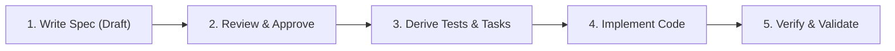

# Spec-Driven Development (Spec-First) Project

Welcome to the project repository. This project strictly follows **Spec-Driven Development (SDD)** and the **Spec-First** methodology.

---

## 🎯 Core Philosophy: Spec-First

In this repository, **no production code is written without a prior approved specification**. 

The specification is the single source of truth for:
- User requirements and domain problems
- Architectural & technical design decisions (ADRs)
- API contracts & data schemas
- Acceptance criteria and automated test suites
- Task breakdown and delivery roadmap



---

## 📁 Repository Structure

```text
├── specs/                        # Single source of truth for all specifications
│   ├── README.md                 # SDD guidelines, lifecycle & workflow
│   ├── templates/                # Reusable spec templates
│   │   ├── feature-spec.template.md   # Standard feature & functional spec
│   │   ├── adr.template.md            # Architecture Decision Record (ADR)
│   │   ├── api-contract.template.md   # API & Data contract spec
│   │   └── task-breakdown.template.md # Task list directly mapped to spec
│   ├── features/                 # Active, in-progress, and approved feature specs
│   │   └── 001-example-auth.md   # Reference example showing a complete spec
│   ├── architecture/             # System architecture & ADRs
│   │   └── adrs/                 # Numbered ADR documents (e.g., 0001-database-selection.md)
│   ├── api/                      # API schemas, OpenAPI / GraphQL definitions
│   └── tasks/                    # Task breakdowns linked to feature specs
├── src/                          # Application source code (built to satisfy specs)
├── tests/                        # Automated tests (derived directly from spec acceptance criteria)
│   ├── unit/                     # Unit test suites
│   ├── integration/              # Integration / contract test suites
│   └── e2e/                      # End-to-end acceptance tests
├── docs/                         # General project documentation, guides, setup
├── AGENTS.md                     # Directives for AI coding assistants (Spec-First compliance)
└── README.md                     # This documentation file
```

---

## 🔄 The 5-Step Spec-Driven Workflow

### 1. Draft Specification (`specs/features/`)
- Duplicate [feature-spec.template.md](file:///c:/Users/Franco%20Andre/OneDrive/diseño/specs/templates/feature-spec.template.md) into `specs/features/XXX-feature-name.md`.
- Detail the problem statement, user stories, requirements, and acceptance criteria (Given/When/Then).
- Status: `DRAFT`.

### 2. Review & Architectural Alignment
- If architectural choices are needed, create an ADR in `specs/architecture/adrs/` using [adr.template.md](file:///c:/Users/Franco%20Andre/OneDrive/diseño/specs/templates/adr.template.md).
- If endpoints/schemas are introduced, create or update `specs/api/` using [api-contract.template.md](file:///c:/Users/Franco%20Andre/OneDrive/diseño/specs/templates/api-contract.template.md).
- Review with stakeholders or team.
- Status: `APPROVED`.

### 3. Task Breakdown & Test Design
- Generate task breakdown in `specs/tasks/` using [task-breakdown.template.md](file:///c:/Users/Franco%20Andre/OneDrive/diseño/specs/templates/task-breakdown.template.md).
- Scaffold test definitions in `tests/` based on the Acceptance Criteria.
- Status: `IN_PROGRESS`.

### 4. Implementation (`src/`)
- Write minimal code in `src/` to satisfy the tests and functional requirements specified in the spec.
- No out-of-scope feature additions or unapproved changes.

### 5. Verification & Closure
- Execute the test suite and verify every acceptance criterion.
- Status: `IMPLEMENTED`.

---

## 🤖 AI / Agent Collaboration

If you are using AI pair programming tools or autonomous coding agents, refer to [AGENTS.md](file:///c:/Users/Franco%20Andre/OneDrive/diseño/AGENTS.md) for strict guardrails preventing code generation before specification approval.
