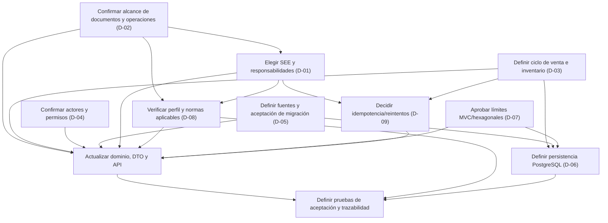

# Informe de consolidación de decisiones

| Metadato | Valor |
|---|---|
| Estado | `DRAFT` — documento para decisión; no aprueba alternativas |
| Fecha | 2026-11-04 |
| Fuente de alcance | [Análisis de requisitos vigente](../../01_Analisis_Requisitos/analisis_requisitos.md) |
| Especificación | [SPEC-002](../features/002-sistema-comercial-facturacion.md), `DRAFT` |
| Revisión de ADR | [ADR-0002/0003](./revision_ADR_0002_0003.md) |
| Alcance | Consolidar decisiones pendientes para autorizar el siguiente refinamiento Spec-First; no autoriza implementación |

## 1. Resumen ejecutivo

El análisis vigente fija capacidades y algunas restricciones, pero no cierra varias decisiones funcionales, técnicas y regulatorias necesarias para convertir los contratos preliminares en contratos aprobables. Son expresos: considerar UBL Invoice 2.1, integrar con servicios SUNAT, migrar datos históricos, registrar movimientos de inventario, definir una arquitectura modular MVC/hexagonal y usar PostgreSQL. No quedan definidos el SEE, los documentos concretos, las reglas de venta/stock, los permisos, el alcance de migración, la versión PostgreSQL ni la distribución detallada de módulos.

La arquitectura y los contratos actuales permanecen en `DRAFT`; ADR-0002 y ADR-0003 están en `PROPOSED`. Las alternativas de este informe son propuestas de evaluación, no requisitos ni decisiones aprobadas. El análisis original y sus códigos RF/RNF no se modifican. La matriz regulatoria antigua se conserva como histórico supersedido y no debe usarse como fuente normativa.

Para avanzar sin mezclar capas de decisión, primero deben acordarse el alcance comercial/documental y los actores; luego el SEE y el marco normativo aplicable; después las reglas de venta-inventario y migración; y finalmente los detalles de contratos, módulos y persistencia que dependan de esas respuestas.

## 2. Convención de clasificación

- **EXPRESO:** aparece directamente en los requisitos vigentes. Define alcance o restricción, no necesariamente una solución completa.
- **INFERIDO:** relación razonable derivada del alcance, pendiente de confirmación.
- **PROPUESTO:** alternativa de diseño que puede evaluarse; no es exigencia aprobada.
- **PENDIENTE DE APROBACIÓN:** falta autorización o información para cerrar la decisión.

Una decisión puede contener más de una clasificación. Por ejemplo, usar PostgreSQL es `EXPRESO`, mientras que su versión y esquema siguen `PENDIENTE DE APROBACIÓN`. Ninguna etiqueta `PROPUESTO` equivale a aprobación.

## 3. Tabla consolidada de decisiones

| ID / decisión | Requisitos relacionados y clasificación | Alternativas a evaluar (todas propuestas) | Ventajas | Desventajas / riesgos | Documentos afectados | Quién debe aprobar |
|---|---|---|---|---|---|---|
| D-01 — Modalidad de emisión SEE e integración | `RF-SUN-001`, `RF-CPE-001`, `RNF-DOC-001`. **EXPRESO:** integrar con SUNAT y considerar UBL 2.1. **PENDIENTE DE APROBACIÓN:** SEE, canal, responsabilidades, ambiente, protocolo y operación. | Evaluar SEE del contribuyente, SEE-OSE, SEE-SOL u otra modalidad aplicable, con base en el proceso empresarial y normativa oficial vigente. Mantener el puerto SUNAT abstracto hasta decidir. | Un SEE seleccionado permite delimitar obligaciones, intercambio, respuestas y pruebas; un puerto abstracto evita acoplar el dominio a un protocolo prematuro. | Cada modalidad tiene ámbito, roles y comportamiento distintos; seleccionar sin validar normativa consolidada puede producir contratos incompletos o afirmaciones tributarias erróneas. | Análisis solo con autorización; SPEC-002; modelo; DTO/Schemas; OpenAPI; arquitectura; ADR-0002; matriz normativa y pruebas. | Responsable del proyecto/examen; responsable tributario del negocio, si participa, para confirmar aplicabilidad. |
| D-02 — Tipos de comprobante y operaciones cubiertas | `RF-CPE-001`, `RNF-DOC-001`; `RF-VEN-002` es **INFERIDO** respecto de la asociación venta-comprobante. **EXPRESO:** emisión electrónica y consideración de UBL Invoice 2.1. **PENDIENTE DE APROBACIÓN:** factura, boleta, notas, baja/anulación y cardinalidad por venta. | Mantener alcance en los tipos que el examen confirme; evaluar Invoice y otros documentos solo con alcance empresarial y perfil técnico/normativo verificados. No inferir que Invoice 2.1 define por sí sola todos los tipos locales. | Delimitar tipos reduce campos, reglas y pruebas innecesarias; separar tipo comercial, tipo UBL y resultado de emisión evita mezclar conceptos. | Aplazar tipos impide cerrar el DTO fiscal, el mapeo de campos, estados y pruebas; ampliar prematuramente agrega obligaciones no pedidas. | SPEC-002; dominio (Venta/ComprobanteElectronico y relaciones); DTO/Schemas; OpenAPI; arquitectura; matriz de trazabilidad y pruebas por tipo. | Responsable del proyecto/examen; responsable tributario, si aplica, valida alcance y correspondencia documental. |
| D-03 — Consistencia entre ventas e inventario | `RF-VEN-001`, `RF-INV-002`; `RF-VEN-002` **INFERIDO** para vínculo con comprobante. **EXPRESO:** registrar ventas e historial de movimientos. **PENDIENTE DE APROBACIÓN:** momento de afectación, origen único de salidas de venta, stock insuficiente, reversos y atomicidad. | Evaluar venta registrada y confirmada por separado, con **la confirmación como única fuente propuesta** de sus salidas; limitar el movimiento genérico a entradas/ajustes no originados por ventas; comparar con movimientos totalmente externos al flujo de confirmación. Evaluar eventos compensatorios ligados al original para anulaciones/reversiones. | La fuente única reduce la doble contabilización y mantiene movimiento ligado a venta/línea; eventos compensatorios preservan trazabilidad. | La confirmación puede no coincidir con el momento comercial/físico real; compensaciones requieren reglas de autorización y tratamiento. No se decide atomicidad, disponibilidad de stock ni valoración. | Análisis; SPEC-002; dominio (Venta, DetalleVenta, MovimientoInventario); DTO/Schema; endpoints de ventas/movimientos y eventual reversión; ADR-0003; arquitectura; pruebas de repetición, duplicidad, concurrencia y compensación. | Responsable del negocio/proyecto; responsables de ventas y almacén, si existen como decisores. |
| D-04 — Autenticación, roles y permisos | Actores humanos `ACT-P01`–`ACT-P06`; `RNF-SEG-001` está clasificado **PROPUESTO**, no expreso. **PENDIENTE DE APROBACIÓN:** usuarios, identidad, permisos, separación de funciones y protección de datos. | Primero confirmar actores y operaciones; luego evaluar identidad local o proveedor externo, y autorización por roles/permisos (RBAC) u otra política de mínimo privilegio. No asumir OAuth/OIDC, JWT ni roles predeterminados. | Definir autorización con actores reales limita accesos a funciones y datos; RBAC puede facilitar administración si los perfiles son estables. | Añadir seguridad antes de conocer usuarios puede crear roles ficticios; proveedor externo agrega dependencia y operación; seguridad incompleta deja riesgos sobre ventas, emisión y migración. | Análisis solo con autorización; SPEC-002; casos de uso; DTO/API/OpenAPI (security schemes, 401/403); arquitectura; modelo si se incorpora Usuario/Auditoría; pruebas de autorización. | Responsable del proyecto; responsable de seguridad/privacidad designado, si existe; responsables de procesos validan permisos. |
| D-05 — Estrategia y alcance de migración | `RF-MIG-001`, `RF-VAL-001`, `RF-TRZ-001`; `RNF-MIG-001` es **PROPUESTO** en el análisis. **EXPRESO:** migrar datos históricos. **PENDIENTE DE APROBACIÓN:** fuentes, entidades, periodo, transformación, corte, conciliación y aceptación. | Evaluar carga por lotes controlados, importación asistida o migración por fases; elegir tras inspeccionar una muestra y conocer acceso, formato, volumen y calidad del legado. | Los lotes permiten validar, reportar errores y conciliar incrementalmente; una carga por fases limita el riesgo de un corte único. | El lote requiere controles de repetición y reportes; la migración por fases puede mantener sistemas coexistentes y aumentar coordinación; sin muestra no se puede estimar el esfuerzo. | Análisis; SPEC-002; dominio (referencia de origen, si se confirma); DTO/Schemas de carga; API o adaptador/CLI según decisión; ADR-0002/0003; arquitectura; casos y pruebas de conciliación. | Responsable del proyecto; custodio/administrador del sistema legado; propietarios de datos y procesos que acepten conciliación. |
| D-06 — Estrategia de persistencia sobre PostgreSQL | `RNF-TEC-001` es **EXPRESO** para motor PostgreSQL. **PENDIENTE DE APROBACIÓN:** versión, esquema, índices, transacciones, concurrencia, datos semiestructurados, artefactos y operación. | Mantener PostgreSQL y evaluar modelo relacional normalizado; uso selectivo de JSONB solo por variabilidad contractual justificada; almacenamiento separado de artefactos solo si se requiere; concurrencia optimista/pesimista según invariantes acordadas. | PostgreSQL satisface la tecnología fijada; el modelo relacional favorece referencias explícitas; uso selectivo de estructuras flexibles puede evitar acoplar contratos variables a columnas rígidas. | Sin volúmenes y reglas no se puede dimensionar; JSONB puede debilitar validaciones si se usa como sustituto del modelo; bloquear filas puede reducir concurrencia; guardar artefactos en DB tiene impactos de volumen/retención. | ADR-0003; dominio; DTO/API solo por semántica, no por columnas; arquitectura; decisiones de respaldo/retención; pruebas de integridad, concurrencia, recuperación y migración. | Responsable del proyecto/examen; responsable técnico/operacional de PostgreSQL, si existe. El motor no requiere re-aprobación, pero sus detalles sí. |
| D-07 — Organización de módulos y límites arquitectónicos | `RNF-ARQ-001`, `RNF-SDD-001` son **EXPRESOS** para MVC, modularidad, principios hexagonales y contratos previos. **PENDIENTE DE APROBACIÓN:** articulación exacta, módulos, puertos y adaptadores. | Aprobar la propuesta ADR-0002 de MVC en la frontera y núcleo aislado por puertos; o diagramar una alternativa modular que satisfaga MVC y visión hexagonal. Mantener módulos por capacidades antes que por tecnologías, como propuesta. | La frontera MVC y los adaptadores aislados mantienen el núcleo independiente; módulos por capacidad facilitan separar reglas e interfaces. | Una capa de abstracción excesiva agrega indirection; módulos definidos antes de aclarar capacidades podrían fragmentar o duplicar responsabilidades. No se ha aprobado framework, REST, CLI ni workers. | ADR-0002; diagramas de arquitectura; SPEC-002; catálogo de casos de uso/puertos; contratos API/DTO; pruebas de límites y dependencias. | Responsable del proyecto/examen o evaluador de arquitectura. |
| D-08 — Perfil normativo, versión vigente y evidencia de validación | `RF-CPE-001`, `RF-SUN-001`, `RF-VAL-001`, `RNF-DOC-001`. **EXPRESO:** considerar UBL 2.1 e integrar SUNAT. **PENDIENTE DE APROBACIÓN/VERIFICACIÓN:** anexos y reglas nacionales vigentes, aplicabilidad por SEE/tipo, fuentes consolidadas y estrategia de pruebas. | Verificar texto consolidado y anexos aplicables después de decidir D-01/D-02; separar validación XSD OASIS, reglas de perfil SUNAT, reglas de dominio y respuesta remota. | Evita atribuir reglas de un sistema a otro y ofrece evidencia de pruebas por capa. | No hay cumplimiento demostrable hasta contar con artefactos, reglas vigentes, entorno y resultado; validar solo contra XSD genérico es insuficiente. | Registro de fuentes; marco normativo; matriz CSV; brechas; DTO/API; pruebas normativas y de integración. | Responsable tributario y responsable del proyecto; asesoría especializada si corresponde. Las fuentes oficiales son base, pero no sustituyen autorización del alcance. |
| D-09 — Idempotencia y tratamiento de reintentos | `RF-VAL-001`, `RF-TRZ-001`; no existe requisito expreso de idempotencia. **PROPUESTO:** clave HTTP común opcional en comandos `POST` con efectos duplicables. **PENDIENTE DE APROBACIÓN:** obligatoriedad, alcance, retención, concurrencia, estados en curso y relación con timeout externo. | Comparar: no ofrecer garantía común; clave opcional en altas/movimientos/ventas/confirmación/emisión (`POST`); clave obligatoria en todas las mutaciones; o identidad específica por operación. Se recomienda provisionalmente la clave opcional en ocho `POST` y excluir `PATCH` descriptivos. Separar replay HTTP de reintentos/reconciliación SUNAT. | La clave evita repetir efectos tras pérdida de respuesta; restringirla a comandos con efectos duplicables reduce costo y no convierte un mecanismo propuesto en requisito de todos los consumidores. | Sin clave no hay garantía común de replay; requiere conservar huella, estado y resultado; no resuelve por sí sola carreras de negocio ni incertidumbre de ejecución externa. No es obligación SUNAT conocida por estos requisitos. | DTO/API/OpenAPI; SPEC-002; informe de revisión de idempotencia/inventario; persistencia si se aprueba; estado documental de emisión; pruebas de replay, concurrencia, colisión, expiración y timeout. | Responsable del proyecto; responsable técnico de API e integración para definir garantías. |

## 4. Impacto por elementos de diseño

La siguiente matriz explicita el alcance de cambios si cada decisión se aprueba. “Sin cambio estructural” no excluye actualizar trazabilidad o criterios de aceptación.

| ID | Entidades y relaciones del dominio | DTO / esquemas | Endpoints y contratos API | Diagramas de arquitectura | Casos de uso | Matriz normativa | Pruebas futuras |
|---|---|---|---|---|---|---|---|
| D-01 SEE | Posible configuración del emisor/SEE y referencia al proveedor; no incorporar clientes de protocolo al dominio. | Datos/estados requeridos por el canal elegido, credenciales fuera de DTO público y campos de transmisión según contrato externo. | Definir si basta solicitud/consulta local o se necesitan operaciones de envío/consulta; no exponer protocolo externo automáticamente. | Concretar puerto y adaptador SUNAT, modo síncrono/asíncrono solo si se decide. | Preparar documento, transmitir/consultar, registrar respuesta y tratar fallos conforme al SEE seleccionado. | Condicionar cada regla al SEE; verificar normas y anexos aplicables y registrar fuentes/ubicación. | Conformidad de perfil, respuestas, fallos de red, estados y pruebas en ambiente autorizado; XSD por sí solo no basta. |
| D-02 Tipos de comprobante | Revisar cardinalidad Venta–ComprobanteElectronico y relaciones de referencias/correcciones; no fijar uno-a-uno sin regla aprobada. | DTO específico por documento y JSON Schema con catálogos/versiones verificados. | Crear/solicitar/consultar y, si el alcance lo autoriza, corregir/anular documentos; actualizar métodos y respuestas. | Separar generador/mapeo UBL por perfil de los adaptadores externos. | Emisión por tipo, ciclo de vida, documento de referencia y manejo de respuesta. | Reglas/campos XPath, validaciones y fuente oficial por documento y SEE. | Casos válidos/invalidos por tipo, cardinalidades, correlación venta-comprobante y resultados externos. |
| D-03 Consistencia | Precisar cuándo Venta genera MovimientoInventario; cardinalidad/origen, reversos y posibles reservas; política de stock. | Crear/confirmar venta y movimiento, IDs de asignación, cantidades, errores de conflicto; evitar duplicar salida. | Aceptar, eliminar o alterar `POST /ventas/{id}/confirmar` y `POST /inventario/movimientos` según exclusividad del flujo. | Limitar transacción dentro del adaptador PostgreSQL o diseñar coordinación/compensación; no dibujar atomicidad antes de decidir. | Registrar, confirmar, reservar/despachar/revertir únicamente los pasos confirmados. | En general sin cambio tributario directo; mantener relación con comprobante diferenciada y revisar trazabilidad cruzada. | Concurrencia, fallo parcial, reintento, duplicados, stock insuficiente y reconciliación; criterios por aprobar. |
| D-04 Seguridad | Incluir Usuario/auditoría solo si se confirma autoría; enlazar operaciones a actor cuando se defina. | No poner secretos en DTOs; documentar identidad/claims solo si forman parte del contrato. | Añadir esquema de seguridad, permisos, respuestas 401/403 y restricciones de acceso. | Añadir proveedor de identidad y autorización en frontera; mantener políticas aisladas de dominio cuando aplique. | Verificar permiso por operación y separación de funciones aprobada. | Proteger artefactos/datos personales; registrar accesos solo según retención y obligaciones verificadas. | Acceso permitido/denegado, mínimo privilegio, escalamiento, anonimización/privacidad si corresponde. |
| D-05 Migración | Decidir conservar claves/IDs de origen y referencias históricas; eventual expediente/lote de migración separado del núcleo comercial. | Contratos de lote, línea, errores, identificador de origen y resultado de conciliación, si son necesarios. | Añadir endpoint de importación solo si se elige interfaz API; de lo contrario, definir CLI/archivo/adaptador sin inventar ruta pública. | Elegir adaptador, flujo por lotes/fases, monitoreo y recuperación. | Extraer, mapear, validar, cargar, reconciliar, repetir/corregir y aceptar lotes. | Normalmente no altera obligaciones SUNAT nuevas; preservar documentos/campos necesarios solo si se confirma alcance y retención. | Exactitud de conteos/totales, duplicados, datos inválidos, repetición segura, reversión y aceptación con muestra real. |
| D-06 Persistencia | Confirmar identidades, asociaciones, historial, importes, saldos y retención de artefactos antes de mapear a almacenamiento. | Mantener tipos conceptuales sin acoplarlos a `NUMERIC`, JSONB o BYTEA; acordar escala/precisión financieras por reglas. | Mantener contratos independientes del esquema; cambiar semántica sólo si la política de disponibilidad/concurrencia afecta respuestas. | Detallar adaptador PostgreSQL, transacciones, backup, recuperación y componentes solo tras requisitos. | Definir transacciones/repositorios, concurrencia y auditoría según invariantes aprobadas. | No crea obligaciones fiscales; conservación de XML/CDR requiere alcance y base normativa/operativa verificados. | Restricciones, migraciones de esquema futuras, transacciones, carga, contención, recuperación y preservación histórica. |
| D-07 Módulos/límites | No cambia automáticamente entidades; agrupa capacidades y define dependencias entre dominio comercial, documental y migración. | Aclara propietarios/versionado de contratos y mapeadores; no autoriza DTOs adicionales por sí solo. | Determina qué adaptador recibe cada operación y qué puertos consume; las rutas siguen propuestas. | Actualizar vistas lógicas, secuencias y límites MVC/hexagonales aprobados. | Asignar responsabilidades sin repetir reglas entre controladores, casos de uso y dominio. | Mantener adaptador normativo aislado; fuente y reglas no deben quedar embebidas como decisión de módulo sin validar. | Verificar dependencias hacia adentro, ausencia de acceso directo desde MVC a persistencia y pruebas de contrato. |
| D-08 Perfil normativo | Posible entidad/configuración fiscal solo si el alcance la necesita; precisar roles de emisor/adquirente. | Agregar identificación, importes, catálogos y datos UBL tras fuente oficial y tipo confirmados. | Definir transmisión/consulta/resultado remoto solo al cerrar SEE. | Diferenciar validador XSD, reglas de perfil y gateway remoto; el despliegue no se deduce. | Construcción, validación por capas, emisión y conciliación de respuestas. | Rehacer trazabilidad regla → RF/RNF → entidad/DTO/endpoint → XPath/fuente → validación/prueba. | XSD con instancia; perfil nacional; reglas semánticas; respuestas externas en ambiente autorizado. |
| D-09 Idempotencia | Puede requerir identidad estable de solicitud/documento y persistencia de resultado; no inventar estado de dominio hasta decidir semántica. | Documentar header, alcance, retención y errores; no incluirlo en body si se conserva como header. | Marcar operaciones idempotentes o condicionadas; definir mismo payload, payload distinto, solicitudes en curso y expiración. | Añadir componente de almacenamiento/coordinación solo si se aprueba y justifica. | Reproducir resultado, bloquear duplicados, reconciliar timeout externo sin crear otro documento. | Separar política interna de exigencias legales/SUNAT; actualizar fila `INT-*`, no tratarla como norma. | Replays concurrentes, colisión de claves, expiración y timeout luego de envío remoto. |

## 5. Preguntas concretas para el responsable del proyecto

1. **SEE:** ¿Qué sistema de emisión se encuentra dentro del alcance del examen: SEE del contribuyente, SEE-OSE, SEE-SOL u otra modalidad? ¿Quién opera el servicio y qué responsabilidades asume el emisor? ¿La respuesta debe ser conceptual o incluir el intercambio técnico?
2. **Documentos:** ¿Qué documentos se deben diseñar y probar (factura, boleta u otros)? ¿Se incluyen notas, anulaciones/bajas y comunicación al cliente? ¿Una venta puede generar más de un comprobante o un comprobante puede cubrir más de una venta?
3. **UBL:** ¿UBL Invoice 2.1 es exigido para un tipo específico de documento o se debe modelar como estándar de intercambio de factura? ¿Qué perfil/anexo nacional vigente y qué versión/catálogos deben usarse? ¿Quién revisará su aplicabilidad?
4. **Venta/inventario:** ¿En qué evento se descuenta o incrementa inventario? ¿Se permiten ventas sin stock, reservas o despachos parciales? ¿Qué ocurre si falla el registro de un movimiento después de registrar la venta? ¿Cómo se corrige un movimiento previo?
5. **Seguridad:** ¿Quiénes son los usuarios humanos confirmados? ¿Qué operaciones puede ejecutar/revisar cada persona? ¿Se requiere identificar autor de cada cambio? ¿Hay un proveedor de identidad ya impuesto por la empresa?
6. **Migración:** ¿Cuál es el sistema fuente, formato y dueño? ¿Qué entidades y periodo se migran: maestros, saldos, movimientos, ventas y comprobantes? ¿Se admite coexistencia con el legado? ¿Qué conteos/valores y quién firmará la conciliación?
7. **PostgreSQL:** ¿Existe versión mínima por infraestructura o rúbrica? ¿Qué volúmenes, concurrencia, retención, disponibilidad, backup y recuperación se esperan? ¿Hay que conservar XML y respuestas externas?
8. **Módulos:** ¿Se aprueba MVC como adaptador de entrada/presentación en el límite hexagonal? ¿Qué capacidades requieren módulos separados y cuáles solo son adaptadores? ¿REST es un requisito del examen o solo una opción de los contratos?
9. **Idempotencia:** ¿La garantía de repetición segura es requisito del sistema o se mantiene como propuesta API? ¿Qué solicitudes se pueden reintentar y qué respuesta debe darse ante resultado externo incierto?
10. **Gobierno:** ¿Quién tiene autoridad para aprobar la especificación, ADR, contratos API y matriz normativa? ¿La aprobación requiere revisión técnica/tributaria adicional?

## 6. Dependencias entre decisiones

La secuencia muestra dependencias de especificación, no una obligación de decidir cada detalle técnico ahora. Por ejemplo, el requisito de PostgreSQL no depende de la modalidad SEE; la retención de XML/resultado sí puede condicionar el modelo de almacenamiento si finalmente se incluye.

## 7. Orden recomendado para aprobación

1. **Confirmar alcance y decisores:** aprobar quién decide y qué exige el examen; mantener intactos los RF/RNF salvo autorización formal de cambio.
2. **Cerrar el alcance funcional mínimo:** tipos de comprobantes/operaciones, ciclo de venta e inventario, actores y frontera de migración.
3. **Elegir modalidad SEE y fuentes aplicables:** consultar texto consolidado y anexos oficiales específicos al SEE/documento; dejar constancia de versión y ubicación.
4. **Resolver seguridad y trazabilidad:** acordar usuarios, permisos, autoría, datos conservados y responsabilidades de migración.
5. **Aprobar opciones arquitectónicas:** decidir la articulación MVC/hexagonal y límites de módulos; no decidir mecanismos de infraestructura sin necesidad.
6. **Refinar persistencia y consistencia:** sobre dominio y requisitos ya acordados, establecer política PostgreSQL, transacciones, concurrencia, recuperación y artefactos.
7. **Actualizar contratos Spec-First:** armonizar dominio, DTO/Schemas y OpenAPI; documentar estados, errores, reintentos e idempotencia si se aprueban.
8. **Completar trazabilidad y criterios de prueba:** enlazar cada regla aplicable con requisito, dato/DTO, endpoint, elemento UBL/fuente, validación y prueba.
9. **Revisar y aprobar formalmente:** actualizar estados desde `DRAFT`/`PROPOSED` solo con responsable y evidencia de aprobación registrados. Ninguna etapa autoriza implementar código por sí sola.

## 8. Documentos a actualizar después de la aprobación

Actualizar únicamente los documentos afectados por las decisiones aprobadas:

1. [Análisis de requisitos](../../01_Analisis_Requisitos/analisis_requisitos.md): solo mediante autorización expresa y con control de cambios; conservar códigos y registrar justificación.
2. [SPEC-002](../features/002-sistema-comercial-facturacion.md): requisitos/casos de aceptación, decisiones y pendientes.
3. [Modelo de dominio, diagramas y trazabilidad](../../02_Modelo_Dominio/modelo_dominio.md): entidades, cardinalidades, invariantes y relaciones efectivamente confirmadas.
4. [DTOs y JSON Schema](../../03_DTOs_Schemas/dtos_schemas.md): campos, tipos, validaciones, importación, datos UBL y seguridad según alcance.
5. [Contratos API/OpenAPI y revisión](../../05_Contratos_API/especificacion_contratos_api.md): rutas, métodos, estados, respuestas de error, seguridad, idempotencia y ciclo de comprobantes.
6. [Arquitectura MVC/hexagonal](../../04_Arquitectura_MVC_Hexagonal/diagramas_arquitectura.md): módulos, límites, puertos, adaptadores y flujos acordados.
7. [ADR-0002](./adrs/0002-arquitectura-hexagonal-mvc.md) y [ADR-0003](./adrs/0003-persistencia-postgresql-kardex.md): registrar decisión, alternativas rechazadas, responsable y fecha; conservar `PROPOSED` hasta aprobación explícita.
8. ADR adicional si se decide un mecanismo con consecuencias independientes (SEE, consistencia transaccional, seguridad o migración); no agrupar decisiones no relacionadas solo para acelerar aprobación.
9. [Registro de fuentes](../../06_Matriz_Trazabilidad_Normativa/registro_fuentes_oficiales.md), [marco normativo](../../06_Matriz_Trazabilidad_Normativa/marco_normativo_ubl_sunat.md), [matriz CSV](../../06_Matriz_Trazabilidad_Normativa/matriz_trazabilidad_normativa.csv) e [informe de brechas](../../06_Matriz_Trazabilidad_Normativa/informe_brechas_normativas.md): actualizar solo con reglas y fuentes oficiales cuya vigencia/aplicabilidad se haya verificado.
10. Planes/casos de pruebas futuros: aceptación comercial, consistencia e idempotencia, autorización, migración/conciliación y validación UBL/perfil/servicio externo.

La [matriz regulatoria histórica](../../06_Matriz_Trazabilidad_Regulatoria/matriz_trazabilidad_regulatoria.md) no se elimina ni se rehabilita mediante esta aprobación. Cualquier dato que se quisiera reutilizar debe verificarse desde fuentes oficiales actuales e incorporarse en la matriz vigente.

## 9. Fuentes oficiales y límites de verificación

Las referencias siguientes constan en el [registro de fuentes oficiales](../../06_Matriz_Trazabilidad_Normativa/registro_fuentes_oficiales.md), consultado documentalmente el **2026-11-04**. En esta consolidación se usan como referencias ya registradas; no se declara una nueva verificación de vigencia consolidada.

| Fuente oficial | Referencia registrada | Uso posible y límite |
|---|---|---|
| SUNAT, RS N.° 117-2017/SUNAT, texto original | [PDF oficial](https://www.sunat.gob.pe/legislacion/superin/2017/117-2017.pdf); art. 1.18, arts. 7.4 y 16.1–16.2, art. 39.1 literales a–j. | Referencia sobre SEE-OSE, respuestas y UBL/anexos según el texto consultado. No se revisaron todas sus modificaciones; no generalizar a otros SEE. |
| SUNAT, RS N.° 193-2020/SUNAT, texto modificatorio | [PDF oficial](https://www.sunat.gob.pe/legislacion/superin/2020/193-2020.pdf); arts. 2.1, 3.1 y 5.1; vigencia indicada en el texto desde 2021-04-01. | Modifica reglas distintas por SEE, incluidas reglas de pago y remisión. No es texto consolidado ni prueba por sí sola la regla vigente en la fecha del proyecto. |
| SUNAT, RS N.° 097-2012/SUNAT, versión original enlazada | [PDF oficial](https://www.sunat.gob.pe/legislacion/superin/2012/097-2012.pdf); art. 12.1(b) en relación con su modificación, y anexos referidos. | PDF registrado como escaneado/no legible en extracción previa; no atribuirle reglas no verificadas en otra fuente textual. Obtener texto y anexos vigentes antes de cerrar contratos. |
| OASIS, UBL Version 2.1, OASIS Standard publicado 2013-11-04 | [Especificación UBL 2.1](https://docs.oasis-open.org/ubl/os-UBL-2.1/UBL-2.1.html) y [XSD Invoice 2.1](https://docs.oasis-open.org/ubl/os-UBL-2.1/xsd/maindoc/UBL-Invoice-2.1.xsd). | Sustenta estructura genérica Invoice/XSD; no define perfil SUNAT, reglas tributarias peruanas, transporte ni aceptación externa. |

La matriz de `06_Matriz_Trazabilidad_Normativa` y su registro son el material vigente de investigación, en `DRAFT`. Validar un XML contra XSD OASIS no acredita por sí solo cumplimiento normativo ni aceptación de SUNAT/OSE. No usar tasas, plazos, códigos o reglas del archivo histórico sin verificación oficial y aplicabilidad confirmada.

## 10. Criterio de cierre

Este informe no elige alternativas ni cambia el estado de otros entregables. Cada punto permanece `PENDIENTE DE APROBACIÓN` hasta obtener una respuesta explícita del responsable y actualizar los documentos dependientes. No se genera base de datos, migración SQL, código, controlador ni dependencia como resultado de esta fase.
