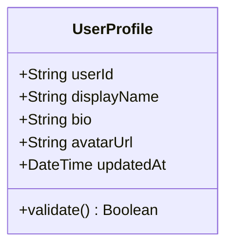

# SPEC-001: User Profile Management

---

## 📋 Metadata

| Attribute | Details |
|---|---|
| **Spec ID** | SPEC-001 |
| **Title** | User Profile Management |
| **Status** | `APPROVED` |
| **Author(s)** | Core Architecture Team |
| **Reviewer(s)** | Lead Engineer |
| **Created Date** | 2026-10-21 |
| **Target Milestone** | v1.0.0 |
| **Related ADRs** | [ADR-0001](../architecture/adrs/0001-record-architecture-decisions.md) |
| **Related API Spec**| [API Spec Reference](../api/README.md) |

---

## 1. Executive Summary & Problem Statement

### 1.1 Problem Statement
Users currently have no self-service mechanism to view or update their basic profile information (display name, avatar URL, bio). This requires administrative manual updates and reduces user autonomy.

### 1.2 Proposed Solution
Provide a dedicated profile retrieval and update service adhering to strict validation rules (length constraints, sanitized text, HTTPS URLs for avatars).

### 1.3 Out of Scope
- Profile picture uploads directly to disk (users must provide an external valid HTTPS image URL).
- Account deletion (governed by separate GDPR/compliance spec SPEC-009).

---

## 2. User Personas & User Stories

### 2.1 Personas
- **Registered User**: A logged-in authenticated member of the platform wishing to personalize their account.

### 2.2 User Stories
- **US-01**: As a Registered User, I want to view my profile details, so that I know what information is currently saved.
- **US-02**: As a Registered User, I want to update my display name and bio, so that other members can identify me accurately.

---

## 3. Detailed Functional Requirements

| Requirement ID | Description | Priority | Complexity |
|---|---|---|---|
| **FR-01** | The system must authenticate the user before allowing access to profile data. | P0 | Low |
| **FR-02** | Display name must be between 2 and 50 characters, trimmed of leading/trailing whitespace. | P0 | Low |
| **FR-03** | Bio is optional, maximum length of 280 characters. | P1 | Low |
| **FR-04** | If an avatar URL is supplied, it must use the `https://` protocol. | P1 | Low |

---

## 4. Non-Functional Requirements (NFRs)

- **Performance**: Profile read requests must respond within < 100ms at p95.
- **Security**: Prevent Cross-Site Scripting (XSS) by stripping HTML tags from name and bio inputs.
- **Auditability**: Profile update events must log timestamp and user ID.

---

## 5. Domain Models & Data Schemas

---

## 6. Edge Cases & Error Handling

| Scenario / Edge Case | Expected System Behavior | Error Code / Message |
|---|---|---|
| Display name contains HTML tags | System strips tags; if resulting length < 2 chars, returns 400 | `INVALID_DISPLAY_NAME` |
| Avatar URL is not HTTPS (e.g. `http://` or `ftp://`) | Rejects update with 400 Bad Request | `INSECURE_AVATAR_PROTOCOL` |
| User ID does not exist | Returns 404 Not Found | `USER_NOT_FOUND` |

---

## 7. Acceptance Criteria (Given / When / Then)

### Scenario 1: Successful Profile Update
- **Given** an authenticated user with ID `"usr_100"`
- **When** they submit a PATCH request with `{"displayName": "Alex Dev", "bio": "Building spec-first apps"}`
- **Then** the system updates the record, responds with HTTP `200 OK`, and returns the updated profile.

### Scenario 2: Validation Failure on Invalid Avatar URL
- **Given** an authenticated user
- **When** they submit an avatar URL with `http://insecure.site/avatar.jpg`
- **Then** the system rejects the update with HTTP `400 Bad Request` and message `"Avatar URL must use HTTPS"`.

---

## 8. Verification & Test Plan

- **Unit Tests**:
  - [ ] Validate length and sanitization for `displayName`
  - [ ] Validate URL scheme enforcement for `avatarUrl`
- **Integration Tests**:
  - [ ] `GET /api/v1/profile` with valid authorization token
  - [ ] `PATCH /api/v1/profile` updating valid fields
  - [ ] `PATCH /api/v1/profile` with invalid payload returns 400
