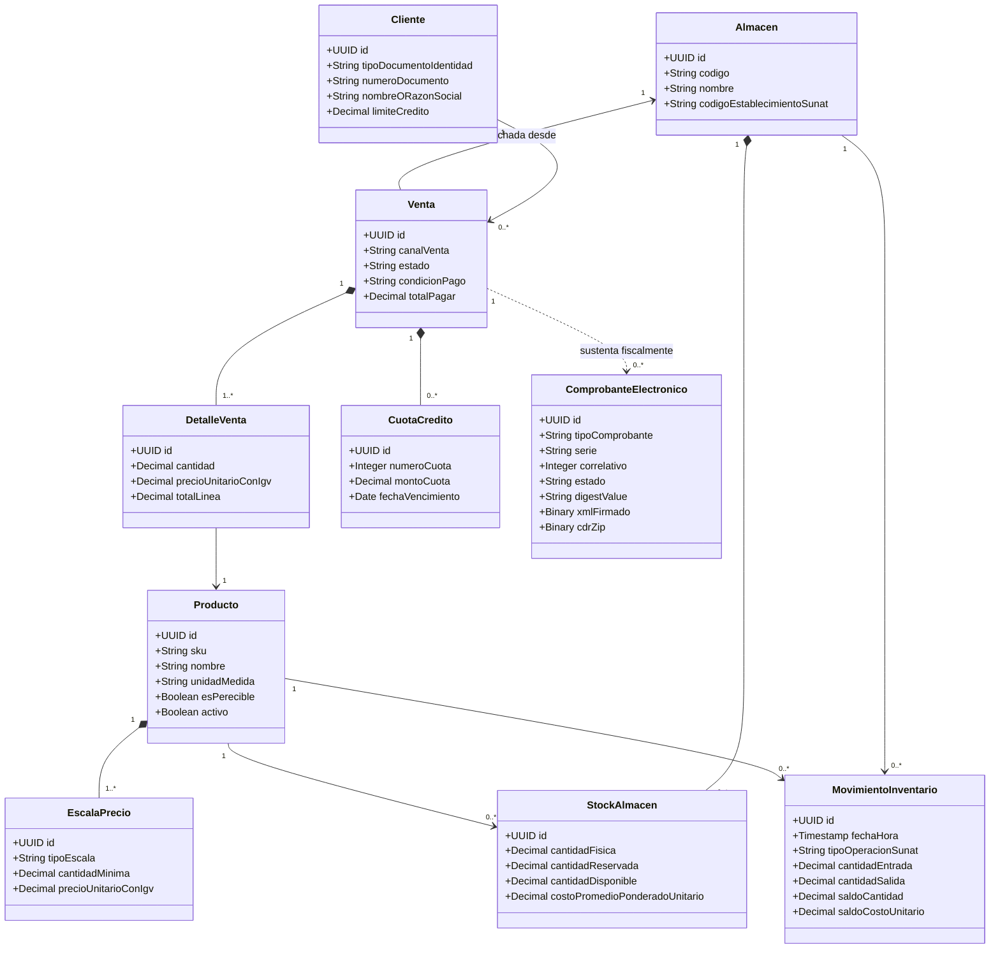

# SPEC-002: Sistema Comercial, Control de Inventarios Multialmacén y Facturación Electrónica UBL 2.1

---

## 📋 Metadata

| Attribute | Details |
|---|---|
| **Spec ID** | SPEC-002 |
| **Title** | Sistema Comercial, Control de Inventarios Multialmacén y Facturación Electrónica UBL 2.1 |
| **Status** | `DRAFT` <!-- Options: DRAFT | REVIEW | APPROVED | IN_PROGRESS | IMPLEMENTED | RETIRED --> |
| **Author(s)** | Senior Software Architect & Requirements Analyst |
| **Reviewer(s)** | Evaluador Docente de Arquitectura de Software |
| **Created Date** | 2026-10-22 |
| **Target Milestone** | v1.0.0 (Entrega Integral de Arquitectura) |
| **Related ADRs** | [ADR-0001](../architecture/adrs/0001-record-architecture-decisions.md), [ADR-0002 (Arquitectura Hexagonal + MVC)](../../04_Arquitectura_MVC_Hexagonal/diagramas_arquitectura.md) |
| **Related API Spec**| [API Contract Specification](../../05_Contratos_API/especificacion_contratos_api.md) |
| **Academic Deliverables** | [01 Requisitos](../../01_Analisis_Requisitos/analisis_requisitos.md), [02 Dominio](../../02_Modelo_Dominio/modelo_dominio.md), [03 DTOs/Schemas](../../03_DTOs_Schemas/dtos_schemas.md), [06 Trazabilidad SUNAT](../../06_Matriz_Trazabilidad_Regulatoria/matriz_trazabilidad_regulatoria.md) |

---

## 1. Executive Summary & Problem Statement

### 1.1 Problem Statement
La empresa bajo estudio es una distribuidora mediana de abarrotes y mercadería general que atiende simultáneamente a dos canales comerciales:
1. **Canal Minorista (Retail / Mostrador)**: Ventas de alta rotación, cobro inmediato y emisión masiva de Boletas de Venta.
2. **Canal Mayorista**: Ventas corporativas de alto volumen por pedido, precios escalonados por volumen, líneas de crédito comercial y emisión obligatoria de Facturas Electrónicas con detalle de cuotas de crédito.

El sistema legado actual presenta:
* **Descontrol de existencias multialmacén**: Desfase entre el inventario físico y contable, pérdidas sin justificación y quiebres de stock en puntos de venta.
* **Riesgo tributario y fiscal ante la SUNAT**: Errores en la construcción de XML UBL 2.1, retrasos en la recepción de la Constancia de Recepción (CDR), e incumplimiento del plazo legal máximo de 3 días calendario (RS 193-2020 y RS 000003-2023).
* **Obsolescencia del sistema heredado**: Necesidad de migrar catálogos y saldos iniciales de inventario sin interrumpir la operación ni corromper periodos fiscales pasados.
* **Acoplamiento tecnológico**: Dificultad para integrar nuevos servicios o soportar caídas de conectividad sin bloquear las cajas registradoras.

### 1.2 Proposed Solution
Diseñar y especificar la arquitectura de software de una plataforma modular desacoplada basada en **Modelo-Vista-Controlador (MVC)** articulado con **Arquitectura Hexagonal (Ports & Adapters)** y base de datos relacional **PostgreSQL**, garantizando:
* Gestión integral multialmacén con Kardex permanente físico y valorizado (fórmula de Costo Promedio Ponderado, Catálogo N° 12 SUNAT).
* Emisión y validación sintáctica/semántica de Comprobantes de Pago Electrónicos (CPE) conforme al estándar **OASIS UBL 2.1** (Facturas `01`, Boletas `03`, Notas de Crédito `07` y Débito `08`).
* Desacoplamiento de la disponibilidad en línea de SUNAT mediante el patrón **Transactional Outbox**, asegurando que las ventas en mostrador concluyan en $< 1.5$ segundos sin riesgo de comprobantes perdidos.
* Migración auditada y conciliada de saldos iniciales y catálogo desde el sistema legado.

### 1.3 Out of Scope
* Implementación de pasarelas de pago con tarjeta en caliente (se modela el registro del medio de pago y código de referencia POS bancario).
* Gestión de nóminas, recursos humanos o contabilidad financiera completa (únicamente se cubre la facturación fiscal y el libro de inventarios/Kardex).
* Desarrollo de aplicaciones móviles nativas (el alcance cubre servicios API REST, interfaces web y terminales POS).

---

## 2. User Personas & User Stories

### 2.1 Personas
* **Cajero / Vendedor Minorista (Carlos - POS)**: Requiere registrar ventas en mostrador a gran velocidad, leer códigos de barras, cobrar en efectivo o billetera digital y emitir boletas de venta al instante sin bloqueos de red.
* **Ejecutivo de Ventas Mayoristas (Mariana - Corporativo)**: Gestiona pedidos de alto volumen, consulta existencias multialmacén, solicita reserva de stock y programa ventas a crédito con cuotas y fechas de vencimiento.
* **Jefe de Almacén (Roberto - Logística)**: Supervisa ingresos de proveedores, autoriza traslados interalmacén, concilia diferencias físicas y audita el Kardex permanente valorizado.
* **Contador / Responsable de Facturación (Sofía - Tributación)**: Monitorea el estado de los comprobantes electrónicos ante SUNAT, revisa los CDRs, emite Notas de Crédito por anulación o descuento y fiscaliza el cumplimiento de los plazos legales.
* **Administrador del Sistema / TI (Alejandro - Infraestructura)**: Parametriza almacenes y series oficiales, custodia el certificado digital X.509 y ejecuta los procesos ETL de migración de datos legados.

### 2.2 User Stories
* **US-01 (Venta Rápida POS Retail)**: Como *Cajero Retail*, quiero registrar una venta en mostrador escaneando productos y cobrando en efectivo o tarjeta, para entregar de inmediato el comprobante impreso (Boleta o Factura) sin demoras ocasionadas por la conexión a internet.
* **US-02 (Venta Mayorista a Crédito)**: Como *Ejecutivo Mayorista*, quiero ingresar un pedido mayorista asignando cuotas de crédito comercial, para que el sistema valide la línea de crédito del cliente y reserve la mercadería en el almacén central.
* **US-03 (Kardex Permanente Inmutable)**: Como *Jefe de Almacén*, quiero que cada entrada, salida, traslado o ajuste genere un asiento cronológico inmutable recalculando el costo promedio ponderado, para cumplir con el formato oficial del Libro de Inventarios de SUNAT.
* **US-04 (Emisión UBL 2.1 y Firma Digital)**: Como *Contador*, quiero que el sistema genere automáticamente el archivo XML UBL 2.1 y aplique la firma digital XMLDSig con el certificado X.509 de la empresa, garantizando la validez jurídica del documento.
* **US-05 (Despacho Asíncrono y Gestión de CDR)**: Como *Contador*, quiero que los comprobantes firmados se transmitan a SUNAT en segundo plano y se procese el archivo de respuesta (CDR), actualizando el estado a Aceptado o reportando el código de rechazo exacto.
* **US-06 (Anulación mediante Nota de Crédito)**: Como *Contador*, quiero emitir una Nota de Crédito electrónica vinculada a una Factura aceptada previamente por SUNAT, para revertir la operación comercial y restituir el stock al almacén de origen sin alterar registros históricos.
* **US-07 (Migración y Conciliación de Saldos Legados)**: Como *Administrador de TI*, quiero cargar los saldos de apertura de stock desde archivos del sistema anterior a una fecha de corte, para emitir un reporte de cuadre y generar el asiento inicial en el Kardex.
* **US-08 (Control Sanitario de Lotes Perecibles)**: Como *Jefe de Almacén*, quiero registrar lotes y fechas de vencimiento para los productos perecibles, para que el sistema impida despachar ítems caducados.

---

## 3. Detailed Functional Requirements

| Requirement ID | Description | Priority | Complexity |
|---|---|---|---|
| **RF-CAT-001** | Catálogo unificado de productos con SKU único, código de barras, descripción comercial y eliminación lógica (*soft delete*). | P0 (Must) | Low |
| **RF-CAT-002** | Esquema dual de precios por producto: precio minorista estándar y escalas de precio mayoristas por volumen de compra. | P0 (Must) | Medium |
| **RF-CAT-003** | Normalización obligatoria de unidades de medida según el Catálogo N° 03 de SUNAT (`NIU`, `KGM`, `BX`, `PK`). | P0 (Must) | Low |
| **RF-CAT-004** | Control de lotes y fechas de caducidad para productos clasificados como perecibles con bloqueo de despacho caduco. | P1 (Should) | Medium |
| **RF-CAT-005** | Clasificación arancelaria y de bienes según el código UNSPSC del Catálogo N° 25 de SUNAT. | P2 (Could) | Low |
| **RF-ALM-001** | Gestión multialmacén (almacén central, tiendas retail, cuarentena) con código de establecimiento anexo SUNAT (Catálogo 19). | P0 (Must) | Medium |
| **RF-ALM-002** | Registro histórico inmutable de movimientos de inventario (Kardex físico y valorizado por Costo Promedio Ponderado, Cat. 12). | P0 (Must) | High |
| **RF-ALM-003** | Registro de entradas (Inflows) por compra nacional sustentada en Factura o Guía de Remisión del proveedor. | P0 (Must) | Medium |
| **RF-ALM-004** | Registro de salidas (Outflows) por venta o baja, con prohibición estricta de saldos negativos en inventario (`RN-05`). | P0 (Must) | High |
| **RF-ALM-005** | Transferencias interalmacén en dos fases (despacho en tránsito y recepción) con soporte para mermas en transporte. | P1 (Should) | Medium |
| **RF-ALM-006** | Ajustes de inventario físico (sobrantes/faltantes) debidamente justificados y autorizados por el Jefe de Almacén. | P1 (Should) | Medium |
| **RF-DIR-001** | Maestro de clientes categorizados en retail y mayoristas, con validación de DNI (8 dígitos) y RUC (11 dígitos, Módulo 11, Cat. 06). | P0 (Must) | Medium |
| **RF-DIR-002** | Maestro de proveedores con RUC oficial validado y condiciones de compra. | P0 (Must) | Low |
| **RF-DIR-003** | Configuración y control de líneas de crédito comercial y plazos máximos para clientes mayoristas. | P1 (Should) | Medium |
| **RF-DIR-004** | Consulta automatizada de padrones oficiales RUC/DNI con mecanismo de caché local y tolerancia a desconexión. | P2 (Could) | Medium |
| **RF-VEN-001** | Punto de Venta Retail (POS) de alta velocidad para mostrador con lectura de código de barras y liquidación de vuelto. | P0 (Must) | High |
| **RF-VEN-002** | Flujo comercial mayorista: cotización, pedido corporativo, validación crediticia, reserva de stock y facturación. | P0 (Must) | High |
| **RF-VEN-003** | Motor tributario automatizado: liquidación de Gravado (18% IGV), Exonerado (0%), Inafecto e ICBPER (bolsas plásticas). | P0 (Must) | High |
| **RF-VEN-004** | Gestión de descuentos comerciales por volumen en líneas de venta reflejados en el comprobante fiscal. | P1 (Should) | Medium |
| **RF-CPE-001** | Generación de Facturas Electrónicas (Tipo 01) bajo OASIS UBL 2.1 con desglose de cuotas a crédito (RS 193-2020). | P0 (Must) | High |
| **RF-CPE-002** | Generación de Boletas de Venta Electrónicas (Tipo 03) UBL 2.1 con validación obligatoria de DNI para importes $\ge$ S/ 700.00. | P0 (Must) | High |
| **RF-CPE-003** | Generación de Notas de Crédito (Tipo 07) y Notas de Débito (Tipo 08) UBL 2.1 vinculadas a comprobante de referencia. | P0 (Must) | High |
| **RF-CPE-004** | Módulo criptográfico de firma digital XMLDSig con certificado tributario X.509 y cálculo de Hash SHA-256 (DigestValue). | P0 (Must) | High |
| **RF-CPE-005** | Generación de representación impresa PDF (formato ticket 80mm y A4) con código QR oficial según formato SUNAT. | P0 (Must) | Medium |
| **RF-CPE-006** | Generación de Resúmenes Diarios de Boletas y Comunicaciones de Baja conforme a especificaciones UBL 2.1. | P1 (Should) | High |
| **RF-SUN-001** | Empaquetado ZIP y transmisión segura mediante protocolo SOAP WSDL (`sendBill`) hacia servidores de SUNAT. | P0 (Must) | High |
| **RF-SUN-002** | Descompresión, procesamiento y persistencia inmutable de la Constancia de Recepción (CDR oficial de SUNAT). | P0 (Must) | High |
| **RF-SUN-003** | Consulta asíncrona de estado de tickets (`getStatus`) para resúmenes diarios. | P1 (Should) | Medium |
| **RF-SUN-004** | Manejo de contingencias por indisponibilidad de SUNAT con cola de reintentos exponenciales dentro del plazo de 3 días. | P0 (Must) | High |
| **RF-SUN-005** | Desacoplamiento de la venta respecto a SUNAT mediante el patrón Transactional Outbox en PostgreSQL. | P0 (Must) | High |
| **RF-MIG-001** | Ingesta y normalización ETL de catálogos de productos, clientes y proveedores desde el sistema legado. | P0 (Must) | Medium |
| **RF-MIG-002** | Carga y conciliación de saldos de apertura de stock por almacén con generación del asiento inicial en Kardex (Cat. 12, código 16). | P0 (Must) | High |
| **RF-MIG-003** | Repositorio histórico de consultas de ejercicios pasados alojado en esquema segregado de solo lectura (`legacy_archive`). | P1 (Should) | Medium |
| **RF-TRZ-001** | Trazabilidad integral bidireccional: Comprobante Fiscal $\leftrightarrow$ Venta Comercial $\leftrightarrow$ Movimiento Kardex $\leftrightarrow$ CDR SUNAT. | P0 (Must) | High |
| **RF-TRZ-002** | Validación sintáctica y semántica previa a la persistencia en base de datos con transaccionalidad ACID atómica. | P0 (Must) | High |
| **RF-TRZ-003** | Registro inmutable de auditoría (*Audit Log*) para eventos sensibles (cambios de precios, ajustes de inventario, anulaciones). | P0 (Must) | Medium |

---

## 4. Non-Functional Requirements (NFRs)

* **Performance**:
  * Finalización de transacción y emisión local del ticket en mostrador POS retail con $P_{95} \le 1.5$ segundos.
  * Procesamiento y firma criptográfica XMLDSig en $\le 350$ milisegundos por documento.
* **Security & Privacy**:
  * Autenticación basada en tokens JWT con control de acceso basado en roles (RBAC).
  * Almacenamiento seguro del certificado digital tributario X.509 (`.p12`/`.pfx`) con claves custodiadas fuera del código fuente.
  * Cifrado en tránsito mediante TLS 1.2 o superior en todas las conexiones externas hacia SUNAT y PostgreSQL.
* **Reliability & Availability**:
  * Cero pérdida de comprobantes ante caídas de los Web Services de SUNAT mediante el patrón *Transactional Outbox*.
  * Idempotencia estricta en transmisiones tributarias mediante cabecera `Idempotency-Key` y hash de contenido.
* **Compliance & Standards**:
  * Cumplimiento estricto del estándar OASIS UBL 2.1 y directrices de la RS 097-2012, RS 193-2020 y RS 000003-2023 de SUNAT.
  * Formato formal de errores bajo el estándar RFC 7807 / RFC 9457 (*Problem Details for HTTP APIs*).
* **Data Integrity & Auditability**:
  * Garantía de transaccionalidad ACID en PostgreSQL 15+ con niveles de aislamiento `Read Committed` o `Serializable`.
  * Inmutabilidad absoluta de registros en Kardex y comprobantes con CDR de aceptación oficial.

---

## 5. Domain Models & Data Schemas

El modelo conceptual del dominio se articula a través del siguiente diagrama de agregados clave (detallado extensivamente en [02_Modelo_Dominio/modelo_dominio.md](../../02_Modelo_Dominio/modelo_dominio.md)):

---

## 6. Edge Cases & Error Handling

| Escenario / Caso Borde | Comportamiento Esperado del Sistema | Código / Mensaje RFC 7807 |
|---|---|---|
| Salida de almacén excede existencias físicas | Aborta la transacción; impide saldos negativos según regla `RN-05`. | `ERR_INSUFFICIENT_STOCK` (422) |
| Solicitud de crédito mayorista excede límite disponible | Rechaza la orden a crédito y notifica al asesor comercial para pago al contado. | `ERR_CREDIT_LIMIT_EXCEEDED` (422) |
| Emisión de Factura (Tipo 01) para adquirente con DNI | Rechaza la emisión; exige obligatoriamente RUC de 11 dígitos válido (Cat. 06). | `ERR_INVALID_CUSTOMER_TAX_ID` (400) |
| Caída de conexión o timeout con los servidores de SUNAT | Almacena el comprobante firmado en la tabla Outbox y retorna éxito local con ticket de despacho. | `WARN_SUNAT_TIMEOUT_ENQUEUED` (202) |
| Reintento de transmisión de un comprobante con CDR Aceptado | Detecta clave de negocio duplicada; retorna el CDR existente sin re-transmitir. | `ERR_DOCUMENT_ALREADY_ACCEPTED` (409) |
| Sumatoria de cuotas de crédito no cuadra con el monto total | Rechaza la estructuración del comprobante según la regla Schematron de la RS 193-2020. | `ERR_PAYMENT_INSTALLMENTS_MISMATCH` (422) |
| Boleta de venta $\ge$ S/ 700.00 sin documento del comprador | Bloquea el cobro en mostrador retail hasta registrar el documento de identidad. | `ERR_ANONYMOUS_SALE_EXCEEDS_THRESHOLD` (400) |

---

## 7. Acceptance Criteria (Given / When / Then)

### Scenario 1: Venta Rápida Minorista en Mostrador (POS) con Boleta de Venta
* **Given** un cajero autenticado en la terminal POS de la "Tienda 01" con stock suficiente del producto `"Arroz Costeño 50 Kg"` (saldo físico: 20 sacos).
* **When** registra la venta de 2 sacos a precio minorista (S/ 185.00 c/u, total S/ 370.00), ingresa un pago en efectivo de S/ 400.00 y selecciona comprobante Boleta de Venta con serie `"B001"`.
* **Then** el sistema confirma la venta en $< 1.5$ segundos, rebaja inmediatamente el saldo físico a 18 sacos, genera el asiento correspondiente en `MovimientoInventario`, calcula el vuelto en S/ 30.00, genera el XML firmado con su DigestValue SHA-256, programa el envío a SUNAT en la tabla Outbox y emite el ticket de compra con código QR impreso.

### Scenario 2: Pedido Mayorista al Crédito con Cuotas (RS 193-2020) y Reserva de Stock
* **Given** un cliente mayorista registrado con RUC activo y línea de crédito disponible de S/ 30,000.00 en el Almacén Central.
* **When** el asesor comercial genera un pedido por 50 sacos de arroz (total S/ 8,625.00) bajo modalidad crédito a 30 días, desglosado en dos cuotas iguales (Cuota 1: S/ 4,312.50 a 15 días, Cuota 2: S/ 4,312.50 a 30 días).
* **Then** el sistema verifica que el monto no exceda la línea de crédito, valida que la sumatoria de cuotas sea idéntica al total a pagar, compromete 50 sacos en `cantidadReservada` (sin alterar el stock físico ni el Kardex todavía) y genera la orden en estado `CONFIRMADA`.

### Scenario 3: Bloqueo Estricto de Venta por Stock Insuficiente (Invariante RN-05)
* **Given** un producto en el Almacén Central con un saldo disponible de 5 unidades.
* **When** un operador intenta confirmar una salida o venta por 10 unidades.
* **Then** el sistema aborta la operación emitiendo un error `ERR_INSUFFICIENT_STOCK` (código HTTP 422), realiza un rollback completo y garantiza que el balance de inventario y el Kardex permanezcan inalterados en 5 unidades.

### Scenario 4: Envío Asíncrono a SUNAT y Procesamiento Exitoso de CDR (Transactional Outbox)
* **Given** un comprobante electrónico en estado `XML_FIRMADO_OUTBOX_PENDIENTE` en la tabla `billing_outbox_events`.
* **When** el proceso demonio en segundo plano toma el registro, empaqueta el XML firmado en un contenedor ZIP oficial y remite la invocación SOAP `sendBill` a los servidores de SUNAT.
* **Then** SUNAT responde satisfactoriamente retornando el archivo `R-*.zip` con código `0` ("La Factura ha sido aceptada"), el worker desempaca el CDR, extrae el hash de recepción y actualiza el comprobante a estado `ACEPTADO_CDR` marcando el evento Outbox como entregado.

### Scenario 5: Manejo de Contingencia por Falla de Conectividad con SUNAT
* **Given** una venta confirmada y emitida localmente en una sucursal física.
* **When** el worker asíncrono intenta conectarse a SUNAT y recibe un timeout de red o error HTTP 503 (Servicio no disponible).
* **Then** el sistema no cancela la venta física del cliente, mantiene el comprobante en estado pendiente, incrementa el contador de reintentos y programa el siguiente intento mediante retroceso exponencial (*exponential backoff*), alertando al contador si el comprobante supera las 48 horas sin confirmación de CDR.

### Scenario 6: Carga y Conciliación de Saldos Iniciales desde el Sistema Legado
* **Given** un archivo de extracción del sistema anterior con saldos de cierre al 30 de septiembre de 2026 para el Almacén Central.
* **When** el Administrador de TI ejecuta la ingesta de saldos iniciales con su token de autorización.
* **Then** el sistema valida la existencia de cada SKU en el catálogo, verifica que las cantidades sean mayores a cero, genera el asiento de apertura en `MovimientoInventario` con tipo de operación SUNAT `16` ("Saldo Inicial"), actualiza `StockAlmacen` y emite un reporte comparativo de conciliación con discrepancia cero.

---

## 8. Verification & Test Plan

### Unit Tests
- [ ] Validar algoritmo Módulo 11 para números de RUC de 11 dígitos y formato de DNI de 8 dígitos.
- [ ] Validar la fórmula matemática de Costo Promedio Ponderado en entradas sucesivas de inventario.
- [ ] Validar invariante de stock no negativo ante solicitudes de despacho que superen el saldo disponible.
- [ ] Validar el desglose de cuotas a crédito conforme a la regla Schematron de la RS 193-2020 ($\sum \text{Cuotas} == \text{TotalCredito}$).
- [ ] Validar canonicalización C14N y firmado digital XMLDSig RSA-SHA256 generando el `DigestValue` esperado.

### Integration Tests
- [ ] `POST /api/v1/sales/pos`: Ejecutar venta en mostrador, verificar atómica deducción de stock e inserción en tabla Outbox.
- [ ] `POST /api/v1/billing/invoices`: Construir Factura UBL 2.1, validar sintácticamente contra esquemas XSD oficiales de OASIS.
- [ ] Simulación SOAP `sendBill`: Enviar archivo ZIP a Web Service de homologación SUNAT y verificar deserialización del CDR con código `0`.
- [ ] Prueba de reintentos Outbox: Simular interrupción de red, verificar reintento exponencial y no duplicación de comprobantes.
- [ ] `POST /api/v1/migration/jobs/stock-balances`: Ejecutar carga masiva de saldos iniciales y verificar generación de asientos Kardex con código 16.

### End-to-End Acceptance Tests
- [ ] Escenario completo de atención en mostrador minorista: Escaneo $\rightarrow$ Cobro $\rightarrow$ Deducción de Stock $\rightarrow$ Impresión de Ticket con QR $\rightarrow$ Procesamiento asíncrono de CDR.
- [ ] Escenario mayorista: Cotización $\rightarrow$ Validación Crediticia $\rightarrow$ Reserva de Stock $\rightarrow$ Facturación UBL 2.1 con Cuotas $\rightarrow$ Recepción de CDR $\rightarrow$ Despacho físico liberando reserva.
