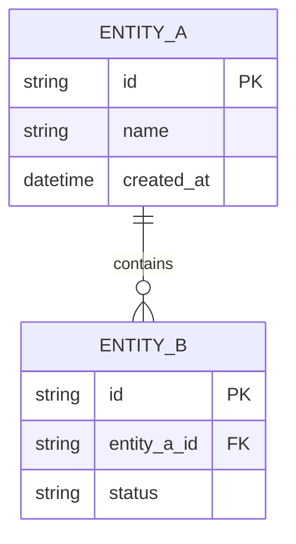

# SPEC-XXX: [Feature Title]

---

## 📋 Metadata

| Attribute | Details |
|---|---|
| **Spec ID** | SPEC-XXX |
| **Title** | [Feature Title] |
| **Status** | `DRAFT` <!-- Options: DRAFT | REVIEW | APPROVED | IN_PROGRESS | IMPLEMENTED | RETIRED --> |
| **Author(s)** | [Author Name / Agent] |
| **Reviewer(s)** | [Reviewer Name] |
| **Created Date** | YYYY-MM-DD |
| **Target Milestone** | [e.g., v1.0.0 / Sprint X] |
| **Related ADRs** | [Link to ADR or N/A] |
| **Related API Spec**| [Link to API spec or N/A] |

---

## 1. Executive Summary & Problem Statement

### 1.1 Problem Statement
> Describe the core problem being solved. What pain point does the user experience? Why are existing solutions insufficient?

### 1.2 Proposed Solution
> High-level summary of what will be built to solve this problem.

### 1.3 Out of Scope
> Explicit list of what this spec does NOT cover to prevent scope creep.
- [ ] Non-goal 1
- [ ] Non-goal 2

---

## 2. User Personas & User Stories

### 2.1 Personas
- **Persona A ([Role/Title])**: [Brief description of user context and goals]

### 2.2 User Stories
- **US-01**: As a `[persona]`, I want to `[action]`, so that `[benefit]`.
- **US-02**: As a `[persona]`, I want to `[action]`, so that `[benefit]`.

---

## 3. Detailed Functional Requirements

| Requirement ID | Description | Priority | Complexity |
|---|---|---|---|
| **FR-01** | The system must... | P0 (Must) | Medium |
| **FR-02** | When a user submits..., the system will... | P1 (Should) | Low |
| **FR-03** | If invalid data is provided, the system shall... | P0 (Must) | Low |

---

## 4. Non-Functional Requirements (NFRs)

- **Performance**: [e.g., Latency < 200ms at p95 under 100 concurrent requests]
- **Security & Privacy**: [e.g., Authentication required via JWT, inputs sanitized, data encrypted at rest]
- **Reliability & Availability**: [e.g., Graceful degradation on database timeout]
- **Compatibility**: [e.g., Node.js LTS, modern browsers Chrome/Firefox/Safari]

---

## 5. Domain Models & Data Schemas

---

## 6. Edge Cases & Error Handling

| Scenario / Edge Case | Expected System Behavior | Error Code / Message |
|---|---|---|
| Network connection lost during submission | Retries up to 3 times, then alerts user | `ERR_NETWORK_TIMEOUT` |
| Duplicate entity identifier submitted | Reject request without altering state | `ERR_DUPLICATE_RESOURCE` (409) |
| Empty payload received | Return validation error | `ERR_VALIDATION_FAILED` (400) |

---

## 7. Acceptance Criteria (Given / When / Then)

### Scenario 1: Successful Primary Flow
- **Given** [initial state / prerequisites]
- **When** [user action or trigger]
- **Then** [expected outcome and state changes]

### Scenario 2: Validation Failure
- **Given** [user provides invalid input]
- **When** [submission action occurs]
- **Then** [system returns validation error without saving state]

---

## 8. Verification & Test Plan

- **Unit Tests**:
  - [ ] `tests/unit/...`: Test domain logic and edge cases in isolation.
- **Integration Tests**:
  - [ ] `tests/integration/...`: Test API handlers with mock database.
- **End-to-End Tests**:
  - [ ] `tests/e2e/...`: Happy path automated verification.

---

## 9. Sign-off & Changelog

| Date | Version | Author | Notes |
|---|---|---|---|
| YYYY-MM-DD | 0.1 | [Author] | Initial draft |
